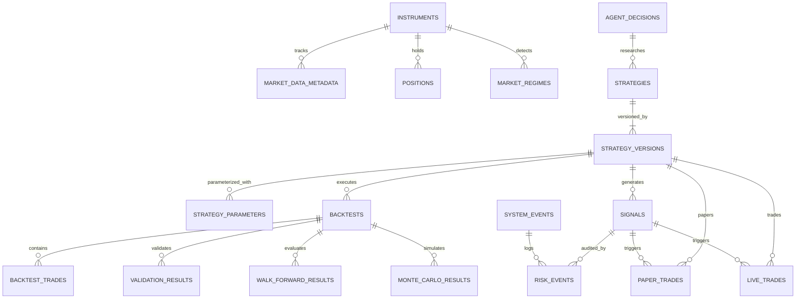

# DATABASE SCHEMA & ENTITY RELATIONSHIP DESIGN
*Relational Persistence Specifications for Gold AI Quant Platform*

---

## 1. OVERVIEW & PERSISTENCE STRATEGY

The system uses a hybrid persistence model:
1. **Time-Series Candle Storage:** High-performance, columnar Apache Parquet files in `data/` partitioned by `source`, `instrument`, and `timeframe` with PyArrow metadata.
2. **Transactional & Metadata Relational Store:** PostgreSQL 16 (production) with SQLAlchemy 2.0 ORM and Alembic migrations. In local/test environments, the connection layer supports SQLite (`sqlite+aiosqlite`) seamlessly.
3. **In-Memory Cache & Event Bus (Phase 3):** Redis 7 for real-time market quotes, active state caches, and distributed pub/sub channels. Phase 1 and Phase 2 run independently with zero Redis runtime dependency. In Phase 1, an in-process asyncio event bus handles internal events.

---

## 2. ENTITY RELATIONSHIP DIAGRAM (ERD)

---

## 3. TABLE SPECIFICATIONS

### 3.1 `instruments`
Stores canonical tradeable and reference instruments (e.g. `XAUUSD_SPOT`, `XAUUSD_PERP`).
- `id` (VARCHAR(64), PK): Unique canonical identifier.
- `symbol` (VARCHAR(32), NOT NULL): Exchange / Source symbol.
- `name` (VARCHAR(128), NOT NULL): Descriptive name (e.g., "Gold / US Dollar Perpetual Contract").
- `asset_class` (VARCHAR(32), NOT NULL): `COMMODITY`, `CRYPTO_DERIVATIVE`, `FX`.
- `quote_currency` (VARCHAR(10), NOT NULL): `USD`, `USDT`.
- `tick_size` (NUMERIC(12, 6), NOT NULL): Minimum price increment.
- `lot_size` (NUMERIC(12, 6), NOT NULL): Minimum contract trade increment.
- `contract_multiplier` (NUMERIC(12, 6), DEFAULT 1.0): Multiplier per contract.
- `maker_fee_rate` (NUMERIC(8, 6), DEFAULT 0.0002): 0.02% maker fee.
- `taker_fee_rate` (NUMERIC(8, 6), DEFAULT 0.0005): 0.05% taker fee.
- `is_active` (BOOLEAN, DEFAULT TRUE): Active trading flag.
- `created_at` (TIMESTAMP WITH TIME ZONE, DEFAULT NOW()).
- `updated_at` (TIMESTAMP WITH TIME ZONE, DEFAULT NOW()).

### 3.2 `market_data_metadata`
Tracks historical datasets downloaded, cleaned, and partitioned.
- `id` (UUID, PK)
- `instrument_id` (VARCHAR(64), FK -> instruments.id)
- `source` (VARCHAR(32), NOT NULL): `YAHOO`, `DELTA_EXCHANGE`, `LOCAL_ARCHIVE`.
- `timeframe` (VARCHAR(16), NOT NULL): `1m`, `5m`, `15m`, `30m`, `1h`, `4h`, `1d`.
- `start_time` (TIMESTAMP WITH TIME ZONE, NOT NULL)
- `end_time` (TIMESTAMP WITH TIME ZONE, NOT NULL)
- `candle_count` (BIGINT, NOT NULL)
- `file_path` (VARCHAR(512), NOT NULL): Parquet storage location.
- `file_size_bytes` (BIGINT, NOT NULL)
- `checksum_sha256` (VARCHAR(64), NOT NULL)
- `quality_score` (NUMERIC(5, 2), DEFAULT 100.0)
- `is_normalized` (BOOLEAN, DEFAULT TRUE)
- `created_at` (TIMESTAMP WITH TIME ZONE, DEFAULT NOW())

### 3.3 `strategies`
Top-level conceptual strategy container.
- `id` (VARCHAR(64), PK): Strategy identifier (e.g., `gold_liquidity_sweep`).
- `name` (VARCHAR(128), NOT NULL): Human-readable name.
- `category` (VARCHAR(64), NOT NULL): `TREND_FOLLOWING`, `BREAKOUT`, `MEAN_REVERSION`, `MOMENTUM`, `LIQUIDITY_SWEEP`.
- `description` (TEXT)
- `author` (VARCHAR(64), NOT NULL): `AI_STRATEGY_RESEARCHER`, `QUANT_ENGINEER`.
- `created_at` (TIMESTAMP WITH TIME ZONE, DEFAULT NOW())

### 3.4 `strategy_versions`
Immutable version records for each iteration of strategy logic.
- `id` (UUID, PK)
- `strategy_id` (VARCHAR(64), FK -> strategies.id)
- `version_tag` (VARCHAR(32), NOT NULL): `v1`, `v2`, etc.
- `timeframe` (VARCHAR(16), NOT NULL)
- `status` (VARCHAR(32), NOT NULL): `RESEARCH`, `BACKTESTED`, `VALIDATION`, `OOS_PASSED`, `PAPER_TRADING`, `LIVE_CANDIDATE`, `ACTIVE`, `REJECTED`, `RETIRED`.
- `logic_description` (TEXT, NOT NULL)
- `entry_rules` (JSONB, NOT NULL)
- `exit_rules` (JSONB, NOT NULL)
- `stop_loss_logic` (JSONB, NOT NULL)
- `take_profit_logic` (JSONB, NOT NULL)
- `position_sizing_logic` (JSONB, NOT NULL)
- `pine_script_code` (TEXT)
- `created_at` (TIMESTAMP WITH TIME ZONE, DEFAULT NOW())
- `updated_at` (TIMESTAMP WITH TIME ZONE, DEFAULT NOW())

### 3.5 `strategy_parameters`
Key-value configuration for strategy versions.
- `id` (UUID, PK)
- `strategy_version_id` (UUID, FK -> strategy_versions.id)
- `name` (VARCHAR(64), NOT NULL)
- `param_type` (VARCHAR(32), NOT NULL): `INT`, `FLOAT`, `BOOL`, `STRING`.
- `default_value` (VARCHAR(64), NOT NULL)
- `min_value` (VARCHAR(64))
- `max_value` (VARCHAR(64))
- `step` (VARCHAR(64))
- `optimized_value` (VARCHAR(64))

### 3.6 `backtests`
Deterministic backtest run execution records.
- `id` (UUID, PK)
- `strategy_version_id` (UUID, FK -> strategy_versions.id)
- `instrument_id` (VARCHAR(64), FK -> instruments.id)
- `timeframe` (VARCHAR(16), NOT NULL)
- `start_date` (TIMESTAMP WITH TIME ZONE, NOT NULL)
- `end_date` (TIMESTAMP WITH TIME ZONE, NOT NULL)
- `initial_capital` (NUMERIC(14, 2), NOT NULL)
- `final_equity` (NUMERIC(14, 2), NOT NULL)
- `total_net_profit` (NUMERIC(14, 2), NOT NULL)
- `total_return_pct` (NUMERIC(8, 4), NOT NULL)
- `cagr_pct` (NUMERIC(8, 4))
- `sharpe_ratio` (NUMERIC(8, 4))
- `sortino_ratio` (NUMERIC(8, 4))
- `profit_factor` (NUMERIC(8, 4))
- `win_rate_pct` (NUMERIC(6, 2))
- `max_drawdown_pct` (NUMERIC(6, 2), NOT NULL)
- `max_drawdown_usd` (NUMERIC(14, 2), NOT NULL)
- `recovery_factor` (NUMERIC(8, 4))
- `expectancy_usd` (NUMERIC(10, 4))
- `average_r` (NUMERIC(8, 4))
- `total_trades` (INT, NOT NULL)
- `winning_trades` (INT, NOT NULL)
- `losing_trades` (INT, NOT NULL)
- `max_consecutive_losses` (INT)
- `max_adverse_excursion_avg` (NUMERIC(8, 4))
- `max_favorable_excursion_avg` (NUMERIC(8, 4))
- `total_fees_paid` (NUMERIC(10, 2), NOT NULL)
- `total_slippage_cost` (NUMERIC(10, 2), NOT NULL)
- `execution_assumptions` (JSONB, NOT NULL)
- `created_at` (TIMESTAMP WITH TIME ZONE, DEFAULT NOW())

### 3.7 `backtest_trades`
Bar-by-bar individual trade fills and exits.
- `id` (UUID, PK)
- `backtest_id` (UUID, FK -> backtests.id)
- `trade_number` (INT, NOT NULL)
- `direction` (VARCHAR(10), NOT NULL): `LONG`, `SHORT`.
- `entry_time` (TIMESTAMP WITH TIME ZONE, NOT NULL)
- `exit_time` (TIMESTAMP WITH TIME ZONE, NOT NULL)
- `entry_price` (NUMERIC(12, 4), NOT NULL)
- `exit_price` (NUMERIC(12, 4), NOT NULL)
- `size` (NUMERIC(12, 4), NOT NULL)
- `initial_stop_loss` (NUMERIC(12, 4), NOT NULL)
- `initial_take_profit` (NUMERIC(12, 4), NOT NULL)
- `gross_pnl` (NUMERIC(12, 2), NOT NULL)
- `net_pnl` (NUMERIC(12, 2), NOT NULL)
- `return_pct` (NUMERIC(8, 4), NOT NULL)
- `r_multiple` (NUMERIC(8, 4), NOT NULL)
- `fees` (NUMERIC(10, 4), NOT NULL)
- `slippage` (NUMERIC(10, 4), NOT NULL)
- `mae_pct` (NUMERIC(8, 4))
- `mfe_pct` (NUMERIC(8, 4))
- `exit_reason` (VARCHAR(32), NOT NULL): `STOP_LOSS`, `TAKE_PROFIT`, `SIGNAL_REVERSAL`, `EXPIRY`.

### 3.8 `validation_results`
Out-of-sample and stress test validation outcomes.
- `id` (UUID, PK)
- `backtest_id` (UUID, FK -> backtests.id)
- `oos_start_date` (TIMESTAMP WITH TIME ZONE, NOT NULL)
- `oos_end_date` (TIMESTAMP WITH TIME ZONE, NOT NULL)
- `oos_sharpe` (NUMERIC(8, 4), NOT NULL)
- `oos_profit_factor` (NUMERIC(8, 4), NOT NULL)
- `oos_drawdown_pct` (NUMERIC(6, 2), NOT NULL)
- `degradation_ratio` (NUMERIC(8, 4), NOT NULL)
- `is_oos_passed` (BOOLEAN, NOT NULL)
- `robustness_score` (NUMERIC(6, 2), NOT NULL)
- `rejection_reasons` (JSONB)
- `created_at` (TIMESTAMP WITH TIME ZONE, DEFAULT NOW())

### 3.9 `walk_forward_results`
Rolling walk-forward evaluation statistics.
- `id` (UUID, PK)
- `strategy_version_id` (UUID, FK -> strategy_versions.id)
- `windows_count` (INT, NOT NULL)
- `train_window_bars` (INT, NOT NULL)
- `test_window_bars` (INT, NOT NULL)
- `walk_forward_efficiency` (NUMERIC(8, 4), NOT NULL)
- `is_consistent` (BOOLEAN, NOT NULL)
- `window_details` (JSONB, NOT NULL)
- `created_at` (TIMESTAMP WITH TIME ZONE, DEFAULT NOW())

### 3.10 `monte_carlo_results`
Trade reshuffling and equity curve stress analysis.
- `id` (UUID, PK)
- `backtest_id` (UUID, FK -> backtests.id)
- `iterations` (INT, NOT NULL): e.g. 5000.
- `median_drawdown_pct` (NUMERIC(6, 2), NOT NULL)
- `p95_drawdown_pct` (NUMERIC(6, 2), NOT NULL)
- `worst_case_drawdown_pct` (NUMERIC(6, 2), NOT NULL)
- `probability_of_ruin` (NUMERIC(8, 6), NOT NULL)
- `p95_losing_streak` (INT, NOT NULL)
- `confidence_intervals` (JSONB, NOT NULL)
- `created_at` (TIMESTAMP WITH TIME ZONE, DEFAULT NOW())

### 3.11 `signals`
Trading signals emitted by active or simulated strategies.
- `id` (UUID, PK)
- `strategy_version_id` (UUID, FK -> strategy_versions.id)
- `instrument_id` (VARCHAR(64), FK -> instruments.id)
- `timestamp` (TIMESTAMP WITH TIME ZONE, NOT NULL)
- `direction` (VARCHAR(10), NOT NULL): `LONG`, `SHORT`, `FLAT`.
- `suggested_entry` (NUMERIC(12, 4), NOT NULL)
- `suggested_sl` (NUMERIC(12, 4), NOT NULL)
- `suggested_tp` (NUMERIC(12, 4), NOT NULL)
- `suggested_size` (NUMERIC(12, 4), NOT NULL)
- `risk_reward_ratio` (NUMERIC(6, 2), NOT NULL)
- `regime_context` (VARCHAR(32), NOT NULL)
- `status` (VARCHAR(32), NOT NULL): `PENDING`, `APPROVED_BY_RISK`, `REJECTED_BY_RISK`, `EXPIRED`.
- `created_at` (TIMESTAMP WITH TIME ZONE, DEFAULT NOW())

### 3.12 `paper_trades` & `live_trades`
Forward paper and live trade executions.
- `id` (UUID, PK)
- `signal_id` (UUID, FK -> signals.id)
- `strategy_version_id` (UUID, FK -> strategy_versions.id)
- `instrument_id` (VARCHAR(64), FK -> instruments.id)
- `exchange_order_id` (VARCHAR(128))
- `direction` (VARCHAR(10), NOT NULL)
- `order_type` (VARCHAR(20), NOT NULL): `LIMIT`, `MARKET`.
- `entry_time` (TIMESTAMP WITH TIME ZONE, NOT NULL)
- `exit_time` (TIMESTAMP WITH TIME ZONE)
- `entry_price` (NUMERIC(12, 4), NOT NULL)
- `exit_price` (NUMERIC(12, 4))
- `size` (NUMERIC(12, 4), NOT NULL)
- `stop_loss` (NUMERIC(12, 4), NOT NULL)
- `take_profit` (NUMERIC(12, 4), NOT NULL)
- `realized_pnl` (NUMERIC(12, 2))
- `fees` (NUMERIC(10, 4), DEFAULT 0)
- `slippage` (NUMERIC(10, 4), DEFAULT 0)
- `status` (VARCHAR(20), NOT NULL): `OPEN`, `CLOSED`, `CANCELLED`.
- `exit_reason` (VARCHAR(32))
- `mae_pct` (NUMERIC(8, 4))
- `mfe_pct` (NUMERIC(8, 4))
- `created_at` (TIMESTAMP WITH TIME ZONE, DEFAULT NOW())

### 3.13 `positions`
Current live or paper portfolio holdings.
- `id` (UUID, PK)
- `instrument_id` (VARCHAR(64), FK -> instruments.id)
- `mode` (VARCHAR(16), NOT NULL): `PAPER`, `LIVE`.
- `direction` (VARCHAR(10), NOT NULL): `LONG`, `SHORT`, `FLAT`.
- `quantity` (NUMERIC(12, 4), NOT NULL)
- `average_entry_price` (NUMERIC(12, 4), NOT NULL)
- `current_mark_price` (NUMERIC(12, 4), NOT NULL)
- `unrealized_pnl` (NUMERIC(12, 2), NOT NULL)
- `liquidation_price` (NUMERIC(12, 4))
- `allocated_margin` (NUMERIC(12, 2), NOT NULL)
- `updated_at` (TIMESTAMP WITH TIME ZONE, DEFAULT NOW())

### 3.14 `risk_events`
Deterministic risk check failures, vetoes, or trigger alerts.
- `id` (UUID, PK)
- `event_type` (VARCHAR(64), NOT NULL): `DAILY_LOSS_EXCEEDED`, `DRAWDOWN_BREACH`, `KILL_SWITCH_ENGAGED`, `INVALID_SL`, `EXCESS_EXPOSURE`, `SPREAD_SPIKE`.
- `severity` (VARCHAR(16), NOT NULL): `INFO`, `WARNING`, `CRITICAL`, `FATAL`.
- `signal_id` (UUID, FK -> signals.id, NULLABLE)
- `description` (TEXT, NOT NULL)
- `snapshot_equity` (NUMERIC(14, 2), NOT NULL)
- `snapshot_drawdown_pct` (NUMERIC(6, 2), NOT NULL)
- `action_taken` (VARCHAR(64), NOT NULL): `SIGNAL_VETOED`, `TRADING_HALTED`, `POSITIONS_CLOSED`.
- `created_at` (TIMESTAMP WITH TIME ZONE, DEFAULT NOW())

### 3.15 `market_regimes`
Historical and live market regimes detected by quantitative rules.
- `id` (UUID, PK)
- `instrument_id` (VARCHAR(64), FK -> instruments.id)
- `timeframe` (VARCHAR(16), NOT NULL)
- `timestamp` (TIMESTAMP WITH TIME ZONE, NOT NULL)
- `regime_type` (VARCHAR(32), NOT NULL): `TRENDING_UP`, `TRENDING_DOWN`, `RANGING`, `BREAKOUT`, `REVERSAL`, `HIGH_VOLATILITY`, `LOW_VOLATILITY`, `ABNORMAL`.
- `adx_value` (NUMERIC(8, 4))
- `atr_percent` (NUMERIC(8, 4))
- `bb_width` (NUMERIC(8, 4))
- `confidence` (NUMERIC(5, 2), NOT NULL)
- `created_at` (TIMESTAMP WITH TIME ZONE, DEFAULT NOW())

### 3.16 `agent_decisions`
Audit log of all AI agent inquiries, hypotheses, and diagnostic reasoning.
- `id` (UUID, PK)
- `agent_name` (VARCHAR(64), NOT NULL): `MARKET_ANALYST`, `STRATEGY_RESEARCHER`, `PERFORMANCE_ANALYST`.
- `input_context_summary` (TEXT, NOT NULL)
- `prompt_tokens` (INT)
- `completion_tokens` (INT)
- `reasoning_output` (TEXT, NOT NULL)
- `strategy_version_id` (UUID, FK -> strategy_versions.id, NULLABLE)
- `created_at` (TIMESTAMP WITH TIME ZONE, DEFAULT NOW())

### 3.17 `system_events`
System lifecycle events (startup, shutdown, data download, health check).
- `id` (UUID, PK)
- `component` (VARCHAR(64), NOT NULL): `API`, `DATA_INGESTION`, `BACKTESTER`, `RISK_ENGINE`, `WEBSOCKET`.
- `event_name` (VARCHAR(64), NOT NULL)
- `details` (JSONB)
- `status` (VARCHAR(20), NOT NULL): `SUCCESS`, `WARNING`, `ERROR`.
- `created_at` (TIMESTAMP WITH TIME ZONE, DEFAULT NOW())

