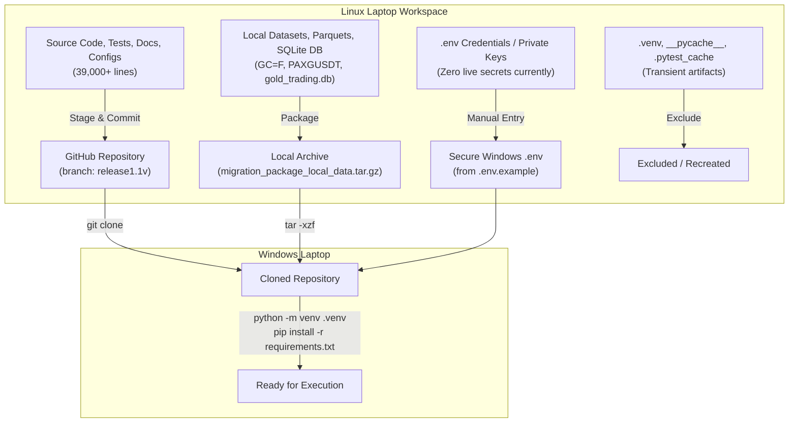

# AGentTrXPAUS — Migration Inventory

**Document:** `docs/MIGRATION_INVENTORY.md`  
**Date:** 2026-10-13  
**Source Host:** Linux (Ubuntu 24.04 / Linux 6.8 x86_64)  
**Target Host:** Windows Laptop (Native Windows 11 / WSL2 Optional)  
**Repository:** `git@github.com:Kunal-dhadwal/gold-trade-agent-pax.git`  
**Branch:** `release1.1v`  
**Governing Authority:** `PROJECT_CONSTITUTION.md`

---

## 1. Executive Summary

This inventory classifies every artifact, file, and directory in the AGentTrXPAUS Gold AI Strategy Creator workspace. It defines the exact migration path (Git sync, transfer archive, secure recreation, or intentional exclusion) to guarantee total operational continuity when moving from Linux to Windows.

---

## 2. Comprehensive Component Classification

| Category | Path / Files | Tracked in Git? | Required on Windows? | Recommended Handling | Rationale |
| :--- | :--- | :---: | :---: | :--- | :--- |
| **Source Code** | `src/` (all subpackages) | ✅ Yes | Yes | Git | Core application, strategy engines, Pine transpiler, tournament, risk, execution |
| **CLI Tools** | `src/cli/strategy_creator.py`, `src/cli/import_dataset.py` | ✅ Yes | Yes | Git | Primary interfaces for Gold strategy creation and dataset qualification |
| **Utility Scripts** | `scripts/download_dukascopy_gold.py` | ✅ Yes | Yes | Git | Memory-safe historical Dukascopy downloader script |
| **Unit & Integration Tests** | `tests/` (unit, integration, adversarial, determinism) | ✅ Yes | Yes | Git | Complete verification test suite (470+ passing tests) |
| **Pine Fixtures** | `tests/fixtures/pine/*.pine` | ✅ Yes | Yes | Git | Golden fixtures for Pine Script v6 transpiler verification |
| **Alembic Migrations** | `alembic/`, `alembic.ini` | ✅ Yes | Yes | Git | Database schema versions (Phase 1 through Phase 4) |
| **Core Documentation** | `PROJECT_CONSTITUTION.md`, `ARCHITECTURE.md`, `README.md` | ✅ Yes | Yes | Git | System constitution, architecture design, and system guides |
| **Audit Reports** | `docs/` (Milestones 2.5.1–2.5.4, Gate Audits, Downloader Audit) | ✅ Yes | Yes | Git | Institutional verification audit trail and formal completion reports |
| **Strategy Dossiers & Runs** | `output/` (`strategies/`, `strategies_db/`, `tournament_real_gcf/`) | ✅ Yes | Yes | Git | Generated strategy dossiers, Pine scripts, and leaderboard JSONs (564 KB) |
| **Dataset Manifests** | `data/metadata/manifest_GC_F_1h.json`, `manifest_PAXGUSDT_1h.json` | ✅ Yes | Yes | Git | Reproducibility hashes and metadata for canonical datasets |
| **Dataset Registry** | `data/metadata/dataset_registry.json`, `checkpoints/` | ✅ Yes | Yes | Git | Tracks ingested dataset registry and streaming checkpoints |
| **Configuration Templates** | `.env.example`, `pyproject.toml`, `requirements.txt` | ✅ Yes | Yes | Git | Environment variable template and dependency specifications |
| **Normalized Parquet Data** | `data/normalized/GC_F/1h.parquet` (24 KB), `PAXGUSDT/1h.parquet` (8 KB) | ❌ Ignored | Yes | Transfer Archive | Canonical normalized historical data used by backtest engine |
| **Raw Market Payloads** | `data/raw/yahoo/*.json` (48 KB), `data/raw/delta/*.json` (16 KB) | ❌ Ignored | Yes | Transfer Archive | Original raw API payloads for provenance auditing |
| **Quality Reports** | `data/quality_reports/*.json`, `*.md` (~924 KB) | ❌ Ignored | Yes | Transfer Archive | DataQualityEngine certification reports |
| **SQLite Research DB** | `data/gold_trading.db` (1.2 MB) | ❌ Ignored | Yes | Transfer Archive | 35 tables containing 370 strategies, 316 backtests, 218 validation records |
| **Multi-Year XAUUSD CSV** | `data/raw/external/XAUUSD_1h_2021_2024.csv` | ❌ Not Present | No (Pending) | Host Download | Not yet downloaded; will be fetched directly on Windows host |
| **Virtual Environment** | `.venv/` | ❌ Ignored | No | Exclude / Recreate | Recreate on Windows with `python -m venv .venv` |
| **Bytecode Caches** | `__pycache__/`, `*.pyc` | ❌ Ignored | No | Exclude | Auto-regenerated by Python on target platform |
| **Test Caches & Coverage** | `.pytest_cache/`, `fee_manager_coverage.xml` | ❌ Ignored | No | Exclude | Test runner caches and coverage output; safely disposable |
| **Live Credentials** | `.env` | ❌ Excluded | No (Manual) | Recreate | Zero live secrets exist; copy `.env.example` to `.env` on Windows |

---

## 3. Dataset & Database Inventory Details

### 3.1 Certified Historical Datasets

| Dataset ID | Instrument | Timeframe | Bar Count | Canonical Parquet Path | Size | SHA-256 Checksum | Tracking Status |
| :--- | :---: | :---: | :---: | :--- | :---: | :--- | :---: |
| `GC_F_1h` | GC=F | 1h | 510 | `data/normalized/GC_F/1h.parquet` | 24 KB | `4a8cedf02a65977fbfa4fe32873cf878ca3006a8f6087fbcc95a5fbcbb66133f` | In Archive |
| `PAXGUSDT_1h` | PAXGUSDT | 1h | 164 | `data/normalized/PAXGUSDT/1h.parquet` | 8 KB | `58501f6789f1f0a8231885b736b41d017b275bfba5a3c87ce274a496839352e8` | In Archive |
| `XAUUSD_multiyear` | XAUUSD | 1h | ~25,000 | `data/raw/external/XAUUSD_1h_2021_2024.csv` | Pending | N/A (Not yet fetched) | To download on Windows |

### 3.2 Local Database State

- **Database Engine:** SQLite (with AsyncPG/PostgreSQL schema compatibility via SQLAlchemy/Alembic).
- **File Location:** `data/gold_trading.db`
- **File Size:** 1,183,744 bytes (~1.2 MB).
- **Contents:**
  - `strategies`: 370 records
  - `strategy_versions`: 370 records
  - `backtests`: 316 records
  - `validation_results`: 218 records
  - `research_sessions`: 151 records
  - `research_hypotheses`: 151 records
  - `paper_accounts`: 183 records
  - `paper_trading_sessions`: 89 records
  - `risk_events`: 178 records
  - `alembic_version`: 1 record (current migration head)

### 3.3 Transfer Archive Specifications

- **Archive File:** `migration_package_local_data.tar.gz`
- **Archive Size:** 234,632 bytes (~229.1 KB)
- **Archive SHA-256:** `5034fbd4693cdcc037e32d6991f299c750500aeac2b950055bedab21801d795a`
- **Archive Integrity:** Verified self-contained gzip tarball containing all normalized Parquets, raw source JSONs, quality reports, and `data/gold_trading.db`.

---

## 4. Intentional Exclusions

1. **`.venv/`**: Python virtual environments are platform-specific (Linux ELF binaries vs Windows PE DLLs). Installing dependencies cleanly on Windows prevents C-extension linking errors (`numpy`, `pyarrow`, `scipy`).
2. **`__pycache__/`**: Python bytecode files (`.pyc`) contain Linux file paths and Python bytecode specific to Linux.
3. **`.pytest_cache/`**: Pytest internal tracking cache.
4. **Coverage XML / Reports**: Generated ephemeral test artifacts (`fee_manager_coverage.xml`).
5. **Dukascopy Empty Dirs**: `data/raw/dukascopy/XAUUSD/2024/` (contained zero files).

