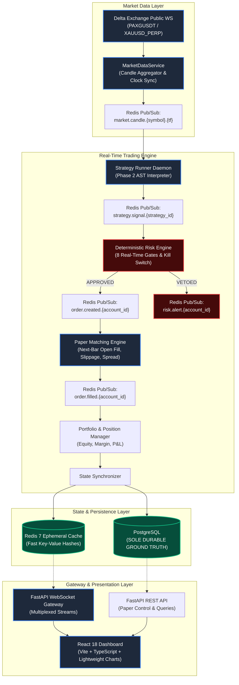
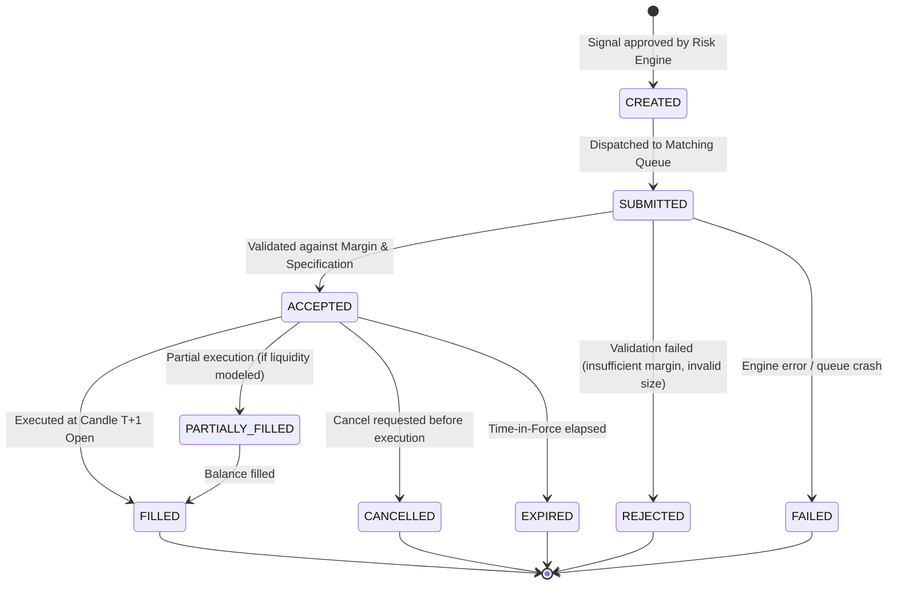
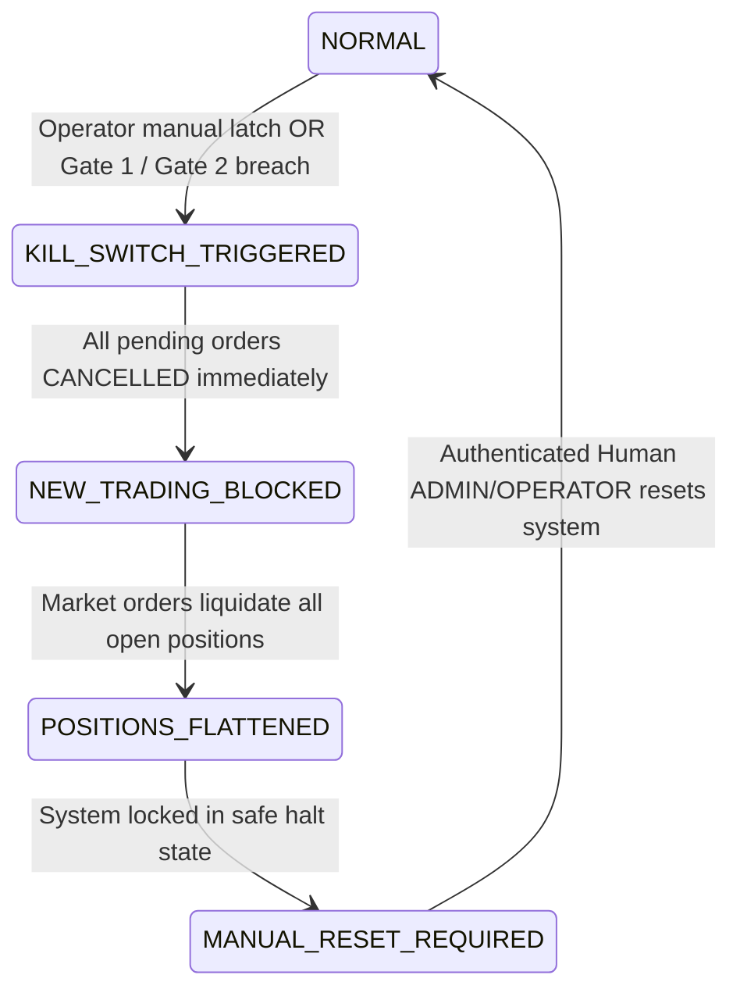
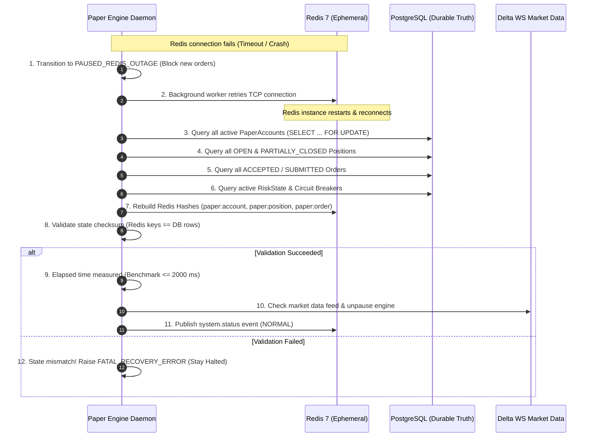
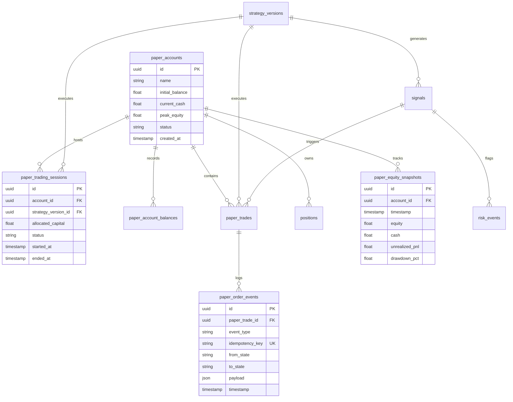

# PHASE 3 — ARCHITECTURE & DESIGN SPECIFICATION REPORT
## Gold AI Quantitative Trading System — AGentTrXPAUS
### Paper Trading, Real-Time Event Engine, Redis State Layer, React Dashboard & Risk Monitoring

---

**Document ID:** `PHASE_3_DESIGN_REPORT`  
**Version:** `1.2.0-frozen-design`  
**Status:** `DESIGN FROZEN — IMPLEMENTATION AUTHORIZATION REQUIRED`  
**Author:** Principal Quantitative Systems Architect, Distributed Systems Architect & Security Architect  
**Governing Documents:**  
- `PROJECT_CONSTITUTION.md` (Supreme Authority)  
- `ARCHITECTURE.md`  
- `docs/PHASE_1_SPEC.md` (Frozen Baseline `v1.1.0-phase1-verified`)  
- `docs/PHASE_2_SPEC.md` (Frozen Baseline `v1.2.0-phase2-verified`)  
- `docs/ADR/ADR-001` through `docs/ADR/ADR-011`  

---

## AUDIT REMEDIATION & DESIGN FREEZE RECORD

The Phase 3 design was remediated and independently reviewed by the second independent design audit:

```text
========================================================================================================================
AUDIT STATUS: 🟢 PHASE 3 DESIGN PASSED SECOND INDEPENDENT AUDIT
========================================================================================================================
All 14 initial audit findings (P1-01 to P1-05, P2-01 to P2-06, P3-01 to P3-03) were verified and resolved.
The three operational decisions (Decision A, Decision B, Decision C) have been formally frozen.
Implementation boundaries are strictly defined. Zero implementation code has been committed.
========================================================================================================================
```

---

## 1. EXECUTIVE SUMMARY

Phase 3 transitions the Gold AI Quantitative Trading System (`AGentTrXPAUS`) from offline research and static backtesting into a dynamic, real-time, event-driven paper-trading platform. 

The primary mission of Phase 3 is to subject validated, out-of-sample verified trading strategies produced by Phase 2 to **real-world execution dynamics without risking financial capital**.

### Core Tenets of the Frozen Architecture:
1. **Durable Source of Truth Invariant:** **PostgreSQL is the sole durable, authoritative source of truth for Phase 3 runtime.** Redis is strictly an ephemeral state cache and event distribution bus. SQLite is explicitly excluded from Phase 3 production runtime persistence.
2. **Canonical Next-Bar Execution Invariant:** Signals generated at candle $T$ close are deterministically executed at candle $T+1$ Open. Same-bar close execution is strictly designated as research/sensitivity analysis and is forbidden in canonical paper accounting.
3. **Additive Gating Invariant:** Phase 3 paper trading promotion gates are **strictly additive operational hurdles**. They never replace, weaken, or compromise mandatory Phase 2 validation gates (WFE $\ge 50\%$, Monte Carlo Ruin $< 5\%$, CSS $\ge 80.0$, Holdout Sharpe $\ge 1.0$).
4. **Single Strategy Account Invariant (Initial Release):** Phase 3 initial release enforces a **Single Active Strategy / Single Paper Account** model, eliminating multi-strategy capital allocation complexity during initial execution validation.
5. **Deterministic Risk Engine Authority:** 8 autonomous mathematical risk gates and an emergency Kill Switch circuit breaker maintain unconditional veto authority over all trading activities, entirely decoupled from AI agents.
6. **Zero Live Capital Exposure:** No private Delta API keys, order-placement endpoints, or exchange execution daemons exist within Phase 3.

---

## 2. FROZEN BASELINE & IMMUTABILITY INVARIANTS

Phase 3 is constructed strictly on top of the audited, certified, and frozen foundation of Phase 1 and Phase 2.

```text
========================================================================================
FROZEN BASELINE AUDIT RECORD
========================================================================================
Phase 1 Freeze Tag:       v1.1.0-phase1-verified
Phase 1 Commit SHA:       2b3db1b5d505634c77b5fea38a31f21ea340fc90

Phase 2 Freeze Tag:       v1.2.0-phase2-verified
Phase 2 Commit SHA:       a7b646c42e06d8379f94ab2281b3261848eb3add
Active Branch:            release1.1v

Test Suite Verification:  137 passed, 0 failed, 0 warnings
Test Code Coverage:       90% across all source modules
Phase 1 / 2 Code State:   100% Frozen & Untouched
========================================================================================
```

### Invariants:
1. **Zero Regression on Phase 1 & 2:** Phase 1 data ingestion, resampling, indicators, regime detection, backtesting engine, and Phase 2 AI agents, strategy AST parser, and validation pipeline must remain unmodified.
2. **Import-Only Integration:** Phase 3 components import and consume Phase 1 and Phase 2 modules without altering their internal logic, mathematical definitions, or public interfaces.
3. **No Implementation Authorization:** This document is **DESIGN ONLY**. No source code, tests, migrations, or dependencies shall be created or committed until implementation authorization is explicitly granted.

---

## 3. EXPLICIT PHASE 3 IMPLEMENTATION SCOPE

To establish unambiguous project boundaries, the implementation scope is partitioned into explicit **IN SCOPE** and **OUT OF SCOPE** blocks:

### IN SCOPE (What Phase 3 Implements):
1. **Paper Trading Engine:** In-memory, event-driven virtual matching engine implementing Phase 1 execution fill and cost semantics.
2. **Paper Account:** Single Active Strategy per Single Paper Account model with cash, margin, and equity accounting.
3. **Deterministic Risk Engine:** Autonomous evaluation of 8 mathematical risk gates and an emergency Kill Switch circuit breaker with unconditional veto authority.
4. **Market Data Ingestion:** Real-time Delta Exchange public WebSocket streaming (ticks and 5m candles) with gap detection, clock synchronization, and data quality validation.
5. **Redis Ephemeral State & Event Distribution:** Redis 7 Pub/Sub event bus and fast hash caching for sub-millisecond query serving.
6. **PostgreSQL Durable Persistence:** Sole durable source of truth storing paper accounts, sessions, orders, positions, risk events, and equity snapshots.
7. **Event & Idempotency Handling:** Two-tier event deduplication (Redis `SETNX` fast check + PostgreSQL unique constraints) guaranteeing exactly-once state mutation.
8. **WebSocket Gateway:** Authenticated, multiplexed ASGI streaming gateway broadcasting market ticks, order fills, position excursions, and risk alerts.
9. **FastAPI REST APIs:** Full suite of paper trading endpoints for account provisioning, strategy lifecycle management, order queries, and telemetry.
10. **React Institutional Dashboard:** Responsive React 18 + TypeScript + Vite + Tailwind CSS dashboard with TradingView Lightweight Charts canvas integration.
11. **Observability & Health Monitoring:** Prometheus-compatible metrics, structured JSON audit logging, and automated subsystem health probes.
12. **Backtest vs. Paper Parity Tracking:** Continuous statistical monitoring of slippage drift, signal congruence, and P&L tracking error.
13. **Paper Promotion Evaluation:** Deterministic dual-stage gate evaluation certifying strategies for Phase 4 live candidacy.

### OUT OF SCOPE (What Phase 3 Does NOT Implement):
1. **Live Money Trading:** Zero exchange order placement; zero real-money capital risk.
2. **Private Delta Exchange API:** Zero usage of private authenticated endpoints; zero storage of account API secrets or withdrawal keys.
3. **HMAC Authentication for Orders:** Cryptographic request signing for live order submission is strictly deferred to Phase 4.
4. **Real-Money Execution Daemons:** Order routers, live fill reconcilers, and margin balance polling from live brokerages are strictly deferred to Phase 4.
5. **Automatic Strategy Promotion:** Automated promotion to live status is forbidden; promotion requires mandatory human operator sign-off.
6. **AI Risk Override:** AI models possess zero authority to alter risk limits, bypass gates, or clear circuit breakers.
7. **AI Live Execution:** AI models have zero execution authority or access to order dispatch channels.
8. **Multi-Strategy Capital Allocation:** Complex portfolio sub-ledgers and cross-strategy allocations are deferred to future scope (Phase 3.x / Phase 4); initial Phase 3 enforces single-strategy accounts.

---

## 4. NON-GOALS & BOUNDARIES (EXPLICIT PROHIBITIONS)

| Non-Goal | Owning Phase | Architectural Invariant |
| :--- | :--- | :--- |
| **Delta Live Order Placement** | Phase 4 | Phase 3 has zero capability to place real-money orders. No authenticated exchange order endpoints are implemented. |
| **Private HMAC API Keys** | Phase 4 | Phase 3 operates strictly using public Delta market data. Private API keys and withdrawal permissions are forbidden. |
| **Exchange Order Reconciliation** | Phase 4 | Virtual fills occur in-engine; exchange reconciliation daemons apply only to Phase 4 live execution. |
| **TradingView Webhook Execution** | Phase 4 | Pine Script transpilation was validated in Phase 2; automated Pine alert webhook execution is deferred to Phase 4. |
| **AI Autonomous Execution** | Permanently Forbidden | Per `PROJECT_CONSTITUTION.md` Tenet 8, AI agents cannot execute orders, override risk gates, or promote strategies. |
| **Redis as Primary Database** | Permanently Forbidden | Redis is an ephemeral cache and event distributor. PostgreSQL is the sole durable authoritative source of truth. |
| **Direct Client-to-Engine Access** | Permanently Forbidden | React clients communicate solely through FastAPI REST/WebSocket gateways behind RBAC; never directly to internal workers. |
| **Multi-Strategy Dynamic Ledger** | Future Scope | Initial Phase 3 enforces Single Active Strategy / Single Paper Account to eliminate allocation complexity. |

---

## 5. ARCHITECTURE OVERVIEW

The Phase 3 platform operates as an asynchronous, event-driven reactive system where state transitions are triggered by market data ticks and governed by deterministic risk filters.



---

## 6. COMPONENT ARCHITECTURE & RESPONSIBILITIES

```text
src/
├── paper/
│   ├── engine.py              # Main Paper Trading Engine orchestrator
│   ├── matching.py            # Virtual Order Matching & Execution Simulator
│   ├── specifications.py      # Immutable InstrumentSpecification models
│   ├── order_book.py          # Synthetic L2 Order Book & Spread Tracker
│   ├── positions.py           # Position Manager (State FSM, P&L, Excursions)
│   ├── portfolio.py           # Account Ledger, Margin & Cash Accounting (Single-Strategy)
│   ├── parity.py              # Backtest vs Paper Parity Tracker
│   └── promotion.py           # Deterministic Paper-to-Live Promotion Evaluator
├── risk/
│   ├── paper_risk_engine.py   # 8 Deterministic Real-Time Risk Gates
│   ├── circuit_breakers.py    # Drawdown, Daily Loss & Volatility Halts
│   └── kill_switch.py         # Emergency Hardware & Software Kill Switch FSM
├── real_time/
│   ├── market_data.py         # MarketDataProvider (Delta WS + Replay Test Engine)
│   ├── event_bus.py           # Redis Pub/Sub Event Distributor
│   ├── state_cache.py         # Redis Fast Ephemeral State Cache
│   ├── idempotency.py         # Event Deduplication & Correlation Engine
│   └── recovery.py            # Crash Recovery & State Rehydration Daemon
└── api/
    ├── routes/
    │   ├── paper.py           # REST Endpoints for Paper Trading Control
    │   └── risk.py            # REST Endpoints for Risk & Kill Switch
    └── websockets/
        ├── gateway.py         # WebSocket Connection & Channel Multiplexer
        └── subscriptions.py   # Client Topic Subscriptions & Backpressure
```

---

## 7. PAPER TRADING LIFECYCLE

```text
Phase 2 Validated Strategy (WFE >= 50%, Monte Carlo Ruin < 5%, CSS >= 80.0, OOS Passed)
                  ↓
Human Operator Configures Paper Session (Initial Capital, Instrument, Allocation)
                  ↓
State: PAPER_PENDING (Awaiting Session Initialization & Pre-Flight Checks)
                  ↓
Pre-Flight Checks Passed (Data Freshness OK, Redis Connected, PostgreSQL Connected)
                  ↓
State: PAPER_ACTIVE (Strategy Runner Subscribed to Live Market Candles)
                  ↓
Live Candle T Closes → Strategy AST Evaluates Indicators → Generates Signal
                  ↓
Deterministic Risk Engine Evaluates 8 Gates
       ├── REJECTED → Risk Event Logged to DB, Signal Dropped, State Unchanged
       └── APPROVED → Order Created & Queued for Next-Bar Execution
                  ↓
Candle T+1 Opens → Matching Engine Fills Order at Open Price ± Spread/Slippage/Fees
                  ↓
Position Opened → Margin Reserved in PostgreSQL → Bracket SL/TP Activated
                  ↓
Market Data Updates → Intra-bar High/Low Evaluated for SL/TP Exits
       ├── SL/TP Hit → Matching Engine Generates Exit Fill (Conservative SL Tie-Break)
       ├── Strategy Signal Exit → Matching Engine Generates Market Exit at T+1 Open
       └── Max Holding Time Reached → Forced Market Exit Fill
                  ↓
Position Closed → Realized P&L Settled in DB → Portfolio Equity Updated
                  ↓
Parity Engine Updates Statistical Drift (Slippage vs Backtest, Win Rate Delta)
                  ↓
Promotion Evaluator Evaluates 4-Week / 50-Trade Realized Criteria
       ├── GATES FAILED / DD BREACHED → State: PAPER_DISQUALIFIED (Halted)
       └── ALL GATES PASSED → State: PAPER_QUALIFIED → Human Sign-off → LIVE_CANDIDATE
```

---

## 8. IMMUTABLE INSTRUMENT SPECIFICATION & SIZING SEMANTICS

All order sizing, notional values, margin calculations, and risk limits operate strictly against the immutable `InstrumentSpecification` contract:

```python
class InstrumentSpecification:
    """Immutable specification governing trading instruments on Delta Exchange."""
    symbol: str                    # e.g., "PAXGUSDT" or "XAUUSD_PERP"
    contract_size: float           # Multiplier in troy ounces (e.g., 0.001 oz per contract)
    quantity_step: float           # Minimum order size increment (e.g., 0.01 contracts)
    minimum_quantity: float        # Minimum allowable order size (e.g., 0.01 contracts)
    maximum_quantity: float        # Maximum allowable order size per order (e.g., 10000.0 contracts)
    tick_size: float               # Minimum price movement (e.g., 0.01 USDT)
    tick_value: float              # Value of 1 tick = tick_size * contract_size (e.g., $0.00001)
    margin_currency: str           # Settlement asset (e.g., "USDT")
    taker_fee_rate: float          # Standard taker fee (e.g., 0.0005 = 0.05%)
    maker_fee_rate: float          # Standard maker fee (e.g., 0.0002 = 0.02%)
```

### Sizing and Risk Calculation Invariant:
$$\text{Notional Value} = \text{Price} \times \text{Quantity} \times \text{Contract Size}$$
$$\text{Point Value USD} = \Delta \text{Price} \times \text{Quantity} \times \text{Contract Size}$$
- Sizing for Gold derivatives on Delta Exchange (`PAXGUSDT`): 1 contract = $0.001$ oz. A quantity of $1,000$ contracts represents $1.0$ troy ounce of gold.
- Risk Engine Position Cap (Gate 4): Defined as $\text{Notional Value} \le 5.0 \times \text{Account Equity}$ and $\text{Quantity} \le \text{MaxAllowedContracts}$ (e.g., 10,000 contracts = 10 oz max exposure), replacing unscaled "10 lots".

---

## 9. PAPER ORDER MODEL & STATE MACHINE

### Order State Machine


### Legal State Transitions:
- `CREATED` $\rightarrow$ `SUBMITTED`, `REJECTED`
- `SUBMITTED` $\rightarrow$ `ACCEPTED`, `REJECTED`, `FAILED`
- `ACCEPTED` $\rightarrow$ `FILLED`, `PARTIALLY_FILLED`, `CANCELLED`, `EXPIRED`
- `PARTIALLY_FILLED` $\rightarrow$ `FILLED`, `CANCELLED`, `EXPIRED`
- `FILLED`, `REJECTED`, `CANCELLED`, `EXPIRED`, `FAILED` are terminal states.

### Paper Order Schema:
- `order_id`: UUIDv4 primary identifier.
- `client_order_id`: Client-supplied unique tracking string.
- `idempotency_key`: Unique string derived from `f"{strategy_id}:{candle_timestamp}:{direction}"`.
- `strategy_version_id`: Foreign key to `strategy_versions.id`.
- `paper_account_id`: Foreign key to `paper_accounts.id`.
- `symbol`: Instrument symbol (`PAXGUSDT`).
- `direction`: `LONG` or `SHORT`.
- `order_type`: `MARKET`, `LIMIT`, `STOP_MARKET`.
- `time_in_force`: `GTC`, `IOC`, `FOK`.
- `quantity`: Number of contracts (strictly multiple of `quantity_step` and $\ge \text{minimum\_quantity}$).
- `requested_price`: Reference price at candle $T$ close.
- `execution_price`: Simulated fill price at candle $T+1$ open.
- `stop_loss`: Planned stop-loss price.
- `take_profit`: Planned take-profit price.
- `slippage_usd`: Simulated slippage deducted.
- `spread_usd`: Simulated half-spread cost deducted.
- `fee_usd`: Exchange fee deducted.
- `status`: Current FSM state.
- `rejection_reason`: Enum code explaining rejection.
- `created_at`, `submitted_at`, `filled_at`: Monotonic UTC timestamps.

---

## 10. CANONICAL PAPER EXECUTION MODEL (NEXT-BAR OPEN)

Per remediation finding P1-02, Phase 3 strictly preserves Phase 1 execution semantics and establishes the canonical execution policy.

### The Canonical Policy: Next-Bar Open Execution (Model A)
$$\text{Signal Generated at Candle } T \text{ Close} \implies \text{Order Executed at Candle } T+1 \text{ Open}$$
- **Canonical Status:** **MANDATORY for all Phase 3 paper trading accounts.**
- **Sensitivity Analysis Status (Model B):** Bar-close execution (executing at candle $T$ close) is strictly classified as **RESEARCH / SENSITIVITY ANALYSIS ONLY**. It must NEVER be used for canonical paper account accounting, leaderboard ranking, or promotion evaluations.

### Execution Fill Mathematics:
- **Long Market Order (Entry Long / Exit Short):**
  $$\text{Fill Price} = \text{Open}_{T+1} + \frac{\text{Spread}_{T+1}}{2} + \text{Adverse Slippage}$$
- **Short Market Order (Entry Short / Exit Long):**
  $$\text{Fill Price} = \text{Open}_{T+1} - \frac{\text{Spread}_{T+1}}{2} - \text{Adverse Slippage}$$
- **Adverse Slippage:** Modeled as $0.10$ USD/oz default on spot Gold, or 1 tick ($0.01$ USDT) minimum on Delta derivatives, scaling with size relative to order book depth.
- **Transaction Fee:**
  $$\text{Fee USD} = \text{Fill Price} \times \text{Quantity} \times \text{Contract Size} \times \text{Taker Fee Rate}$$

### Intra-Bar SL/TP Evaluation & Conservative Tie-Breaker:
When an active position is open during candle $t$ with range $[\text{Low}_t, \text{High}_t]$:
- For Long: $\text{Low}_t \le \text{SL}$ triggers Stop Loss; $\text{High}_t \ge \text{TP}$ triggers Take Profit.
- For Short: $\text{High}_t \ge \text{SL}$ triggers Stop Loss; $\text{Low}_t \le \text{TP}$ triggers Take Profit.
- **Conservative Intra-Bar Tie-Breaker Invariant:** If both Stop Loss and Take Profit conditions are satisfied within the same candle's high-low range, the engine **MUST deterministically assume that Stop Loss was triggered first**. Take profit is ignored.

---

## 11. FINANCIAL MATHEMATICS & RISK FORMULAS

All financial calculations in Phase 3 are governed by the following exact mathematical formulas:

### 1. Account Equity
$$\text{Equity}_t = \text{CashBalance}_t + \text{UnrealizedPnL}_t$$

### 2. Cash Balance
$$\text{CashBalance}_t = \text{InitialCapital} + \sum_{i=1}^{N_{closed}} \text{RealizedPnL}_i - \sum_{j=1}^{N_{trades}} \text{Fees}_j \pm \sum_{k=1}^{N_{funding}} \text{FundingPayment}_k$$

### 3. Peak Equity (High-Water Mark)
$$\text{PeakEquity}_t = \max_{0 \le s \le t}(\text{Equity}_s)$$

### 4. Portfolio Drawdown Percentage
$$\text{DrawdownPct}_t = \frac{\text{PeakEquity}_t - \text{Equity}_t}{\text{PeakEquity}_t} \times 100\%$$

### 5. Daily Starting Equity & Reset Boundary
$$\text{StartingDailyEquity}_d = \text{Equity at 00:00:00.000 UTC on day } d$$
The daily reset boundary occurs strictly at **00:00:00.000 UTC**.

### 6. Daily Loss Percentage
$$\text{DailyLossPct}_t = \frac{\text{StartingDailyEquity}_d - \text{Equity}_t}{\text{StartingDailyEquity}_d} \times 100\%$$

### 7. Realized Profit and Loss (PnL)
$$\text{RealizedPnL}_{LONG} = (\text{ExitFillPrice} - \text{EntryFillPrice}) \times \text{Quantity} \times \text{ContractSize} - \text{TotalFees} - \text{TotalSlippage}$$
$$\text{RealizedPnL}_{SHORT} = (\text{EntryFillPrice} - \text{ExitFillPrice}) \times \text{Quantity} \times \text{ContractSize} - \text{TotalFees} - \text{TotalSlippage}$$

### 8. Unrealized Profit and Loss (PnL)
$$\text{UnrealizedPnL}_{LONG} = (\text{MarkPrice}_t - \text{AvgEntryPrice}) \times \text{OpenQuantity} \times \text{ContractSize}$$
$$\text{UnrealizedPnL}_{SHORT} = (\text{AvgEntryPrice} - \text{MarkPrice}_t) \times \text{OpenQuantity} \times \text{ContractSize}$$

### 9. Position Margin Requirement
$$\text{UsedMargin} = \frac{\text{MarkPrice}_t \times \text{OpenQuantity} \times \text{ContractSize}}{\text{Leverage}}$$
$$\text{FreeMargin} = \text{Equity}_t - \text{UsedMargin}$$

### 10. Funding Payment (Delta Perpetual Derivatives)
Every 8 hours (00:00, 08:00, 16:00 UTC):
$$\text{FundingPayment} = \text{MarkPrice} \times \text{OpenQuantity} \times \text{ContractSize} \times \text{FundingRate}_{8h}$$
*(Long pays Short if $\text{FundingRate} > 0$; Short pays Long if $\text{FundingRate} < 0$).*

---

## 12. DETERMINISTIC PAPER RISK ENGINE & SPREAD SPIKE GUARD

The Phase 3 Risk Engine evaluates 8 mathematical rules on every signal and position update. **AI agents possess zero authority to alter or bypass these rules.**

### Gate Specifications:
1. **Gate 1 — Portfolio Drawdown Circuit Breaker:**
   - Formula: $\text{DrawdownPct}_t \le 10.0\%$
   - Action: If $\text{DrawdownPct}_t > 10.0\%$, all open positions are immediately liquidated via market orders, pending orders are cancelled, and all paper trading is permanently halted.
2. **Gate 2 — Daily Loss Limit:**
   - Formula: $\text{DailyLossPct}_t \le 3.0\%$
   - Action: Closes trading for the remainder of the UTC trading day; resumes at 00:00:00 UTC.
3. **Gate 3 — Max Risk Per Trade:**
   - Formula: $\text{DollarRisk} = |\text{Entry} - \text{SL}| \times \text{Quantity} \times \text{ContractSize} \le 0.01 \times \text{Equity}_t$
   - Action: Clamps quantity downward to satisfy $1.0\%$ risk cap; drops signal if clamped quantity $< \text{minimum\_quantity}$.
4. **Gate 4 — Position Size & Leverage Cap:**
   - Formula: $\text{Notional Value} \le 5.0 \times \text{Equity}_t$ and $\text{Quantity} \le \text{MaxAllowedContracts}$.
5. **Gate 5 — Unambiguous Spread Spike Guard:**
   - Exact Formula:
     $$\text{SpreadRatio}_t = \frac{\text{CurrentSpread}_t}{\text{MedianSpread}_{20}(t)}$$
     where $\text{CurrentSpread}_t = \text{Ask}_t - \text{Bid}_t$, and $\text{MedianSpread}_{20}(t)$ is the rolling median of the spread over the previous 20 completed 5-minute bars (100 minutes of price history).
   - Absolute Ceiling: $\text{MaxSpreadUSD} = 1.50\text{ USD/oz}$ (or equivalent in USDT).
   - Condition: $\text{REJECT if } (\text{SpreadRatio}_t > 2.0) \lor (\text{CurrentSpread}_t > 1.50)$.
6. **Gate 6 — Consecutive Loss Streak Guard:**
   - Formula: $N_{consecutive\_losses} < 5$ for the specific strategy.
   - Action: Pauses the offending strategy for 24 hours for automated diagnostic review.
7. **Gate 7 — Market Regime & Session Filter:**
   - Verifies current regime matches strategy AST contract `regime_filter`. Rejects trades during non-whitelisted sessions.
8. **Gate 8 — Emergency Kill Switch State Machine:**



#### Kill Switch Invariants:
- **Positions Flattened:** Open positions are liquidated immediately via market orders (policy: `FLATTEN_ALL`).
- **Pending Orders:** All unexecuted orders are transitioned to `CANCELLED`.
- **Automatic Recovery:** **STRICTLY PROHIBITED.** No timer or automated loop may reset the kill switch.
- **Reset Authority:** Authenticated human `OPERATOR` or `ADMIN` role only via signed API request.
- **AI Role:** **Zero authority.** AI models cannot trigger, bypass, or reset the kill switch.

---

## 13. MARKET DATA PROVENANCE & CALENDAR ARCHITECTURE

### 1. Market Data Provenance Contract:
Under no circumstances may different market data sources be conflated:
- **Dukascopy XAUUSD (Primary Historical Research):** Spot gold price in USD/oz. High-density tick data used exclusively for Phase 1 & 2 historical backtesting and validation.
- **Yahoo GC=F (Secondary Historical Research):** COMEX continuous gold futures in USD/contract (100 oz). Used exclusively for multi-decade macro regime exploration.
- **Delta Exchange PAXGUSDT / XAUUSD_PERP (Real-Time Paper Execution):** Crypto-margined gold derivative traded on Delta Exchange. Quoted and settled in USDT with contract size $0.001$ oz. Used exclusively for Phase 3 real-time paper trading.
- **Instrument Discovery & Fail-Closed Principle:** The exact execution instrument must be dynamically discovered and validated at runtime against Delta Exchange's public product metadata API (`/v2/products`). No silent fallback between `PAXGUSDT` and `XAUUSD_PERP` is permitted. If the selected instrument is missing, halted, or invalid, the system **MUST FAIL CLOSED**.

### 2. Canonical Trading Time & Calendar Definition:
- **Paper-Trading Day:** Defined as a completed UTC day (00:00:00 to 23:59:59 UTC) during which the market was operational and the paper engine received $\ge 20$ hours of continuous, valid market data.
- **Gold Market Operational Hours:** Regular market operates Sunday 22:00:00 UTC through Friday 21:00:00 UTC. Weekends are non-operational.
- **Exchange Maintenance & Weekends:** Weekend hours and scheduled Delta maintenance do NOT count toward accumulating the required 20 paper-trading days.
- **Outage Policy:** If a market data feed outage exceeds 60 minutes cumulatively in a single UTC day, that day is **disqualified** from counting toward the required 20-day duration.
- **Automated Engine Pause:** If market data is interrupted for $> 15$ seconds, the Paper Engine immediately transitions to `PAUSED_DATA_OUTAGE`. No orders are created or filled during an outage.

### 3. Synthetic Replay Feed Role:
- Synthetic market data replay (`SimulatedLiveMarketData`) is strictly **TEST/VERIFICATION infrastructure only**.
- It must **NEVER** serve as the canonical production market-data source for paper trading accounts.
- Replay is permitted exclusively for: deterministic unit/integration testing, crash recovery testing, backtest-vs-paper parity verification, and fast-forward performance benchmarking.

---

## 14. REDIS RECOVERY & REHYDRATION CONTRACT

Redis 7 is an ephemeral cache and event bus. **PostgreSQL is the sole durable authoritative source of truth.**



### Recovery Contract Specifications:
- **Zero Data Loss Guarantee:** Rests strictly on PostgreSQL ACID transactions, NOT Redis persistence (AOF/RDB are optional cache optimizations).
- **Recovery SLA Target:** Rehydration benchmarked at $\le 2000\text{ ms}$ from Redis TCP socket re-establishment for $N \le 100$ open positions and $N \le 10$ accounts.
- **WebSocket Behavior:** During recovery, the gateway emits `{ "type": "SYSTEM_STATUS", "status": "RECOVERING" }` and suppresses trade updates until rehydration validation passes.

---

## 15. STRICT EVENT IDENTITY & DEDUPLICATION CONTRACT

Every event emitted on the Redis pub/sub bus strictly adheres to the following envelope:

```json
{
  "event_id": "c1f7a0b3-9e45-4a67-b8f2-d0e82c19a4b1",
  "event_type": "ORDER_FILLED",
  "aggregate_id": "710e8400-e29b-41d4-a716-446655440001",
  "correlation_id": "a90f1234-8765-4321-abcd-ef0123456789",
  "causation_id": "8b7c6d5e-4f3a-2b1c-0d9e-8a7b6c5d4e3f",
  "idempotency_key": "ORDER_FILLED:550e8400-e29b-41d4-a716-446655440000:20261008163000",
  "producer": "paper_matching_engine",
  "event_timestamp": "2026-10-08T16:30:00.124567Z",
  "sequence_number": 1042,
  "schema_version": "1.0",
  "payload": {
    "order_id": "550e8400-e29b-41d4-a716-446655440000",
    "account_id": "710e8400-e29b-41d4-a716-446655440001",
    "strategy_version_id": "990e8400-e29b-41d4-a716-446655440002",
    "symbol": "PAXGUSDT",
    "direction": "LONG",
    "fill_price": 2654.85,
    "quantity": 1500.0,
    "fee_usd": 1.99,
    "slippage_usd": 0.35,
    "filled_at": "2026-10-08T16:30:00.120000Z"
  }
}
```

### Deduplication Policy:
- **Duplicate Definition:** Two events $E_1$ and $E_2$ are duplicates if $E_1.\text{event\_id} == E_2.\text{event\_id}$ OR $(E_1.\text{event\_type} == E_2.\text{event\_type} \land E_1.\text{idempotency\_key} == E_2.\text{idempotency\_key})$.
- **Tier 1 (Redis Fast Check):** `SET idempotency:event:{key} 1 NX EX 86400`. If key exists, drop immediately.
- **Tier 2 (PostgreSQL Authoritative Check):** Unique constraint on `paper_order_events(idempotency_key)` and `(causation_id, event_type)`. If Redis fails, database rejects duplicate insertion with `UniqueViolation`.

---

## 16. POSTGRESQL SCHEMA DESIGN (SOLE DURABLE GROUND TRUTH)

**PostgreSQL is the sole durable storage backend for Phase 3 runtime.**



---

## 17. CONCURRENCY & TRANSACTIONAL AUTHORITY

### Conceptual Concurrency Model:
1. **PostgreSQL as Final Correctness Boundary:**
   - Account balances and margin updates are enclosed within serializable / read-committed database transactions using **`SELECT ... FOR UPDATE` row locks**.
   - Redis locks/mutexes are used solely for in-memory coroutine coordination to minimize database lock contention, but **never supersede database ACID transactions**.
2. **Atomic Order Transitions (Compare-And-Swap):**
   ```sql
   UPDATE paper_trades 
   SET status = :new_status, updated_at = :now 
   WHERE id = :order_id AND status = :expected_status;
   ```
   If row count returned is 0, the state transition is rejected as stale/invalid.
3. **Fills & Balance Settlement:**
   A fill execution runs inside a single atomic database transaction:
   - Insert row into `paper_order_events` (verifying idempotency key).
   - Update `paper_trades` status to `FILLED` with fill price.
   - Update `positions` row (quantity, avg entry price, margin).
   - Mutate `paper_accounts` cash balance and used margin.

---

## 18. STRATEGY LIFECYCLE & STATE TRANSITION AUTHORITY

Every lifecycle transition is governed by strict authorization rules:

| Transition | Permitted Actor | Mandatory Conditions & Gates |
| :--- | :--- | :--- |
| `RESEARCH` $\rightarrow$ `BACKTESTED` | Automated Backtest Engine | Historical backtest completed without errors |
| `BACKTESTED` $\rightarrow$ `VALIDATED` | Automated Validation Pipeline | WFE $\ge 50\%$, Ruin $< 5\%$, CSS $\ge 80.0$, Min Trades $\ge 50$ |
| `VALIDATED` $\rightarrow$ `OOS_PASSED` | Automated OOS Gate | Holdout Sharpe $\ge 1.0$, MaxDD $\le 20\%$, Zero degradation |
| `OOS_PASSED` $\rightarrow$ `PAPER_PENDING` | System or Human Operator | Strategy queued for paper trading trial |
| `PAPER_PENDING` $\rightarrow$ `PAPER_ACTIVE` | **Human Operator Only** | Pre-flight system checks verified; session initialized |
| `PAPER_ACTIVE` $\rightarrow$ `PAPER_PAUSED` | Risk Engine OR Human Operator | Circuit breaker trip, data outage, or operator command |
| `PAPER_ACTIVE` $\rightarrow$ `PAPER_DISQUALIFIED` | Deterministic Risk Engine OR Human Operator | Gate 1 (10% DD), Gate 2 breach, or failed promotion criteria |
| `PAPER_ACTIVE` $\rightarrow$ `PAPER_QUALIFIED` | Deterministic Promotion Engine | $\ge 4$ weeks, $\ge 50$ trades, Expectancy $> 0$, GPF $\ge 1.25$, Parity Pass |
| `PAPER_QUALIFIED` $\rightarrow$ `LIVE_CANDIDATE` | **Mandatory Human Operator Only** | Cryptographic operator sign-off; Phase 2 + Phase 3 certified |

**Tenet:** **AI agents possess ZERO authority to promote strategies, adjust risk limits, or initiate live candidacy.**

---

## 19. ADDITIVE PAPER PROMOTION GATES

Phase 3 promotion gates are strictly **ADDITIONAL operational gates**, never replacing Phase 2 validation:

```text
========================================================================================
DUAL-STAGE VALIDATION PIPELINE
========================================================================================
STAGE 1: PHASE 2 RESEARCH & QUANTITATIVE GATES (Historical Anti-Overfitting)
  ├── Minimum Trades:            N >= 50
  ├── Walk-Forward Efficiency:   WFE >= 50%
  ├── Monte Carlo Ruin Prob:     P(DD >= 20%) < 5.0%
  ├── Composite Strategy Score:  CSS >= 80.0
  └── Out-of-Sample Holdout:     Sharpe >= 1.0, Zero Parameter Snooping
  
STAGE 2: PHASE 3 REALIZED PAPER TRADING GATES (Real-Time Execution Dynamics)
  ├── Duration:                  >= 4 continuous calendar weeks (20 valid paper days)
  ├── Trade Count:               >= 50 executed paper trades (N_paper >= 50)
  ├── Realized Expectancy:       Expectancy > 0.0 USD/trade
  ├── Realized Profit Factor:    Gross Profit Factor >= 1.25
  ├── Realized Max Drawdown:     MaxDD <= 12.0%
  ├── Parity Status:             PARITY_PASS (Tracking error <= 2.0%)
  └── Risk Incidents:            Exactly 0 Gate 1 (DD) or Gate 8 (Kill Switch) breaches
========================================================================================
```

---

## 20. BACKTEST VS. PAPER PARITY CONTRACT

The Parity Engine evaluates execution fidelity across 11 dimensions:
1. Signal Timestamp Congruence ($100\%$ match).
2. Signal Direction Congruence ($100\%$ match).
3. Entry Timestamp Congruence (Next-bar open $100\%$ match).
4. Entry Price Deviation ($|\text{Price}_{paper} - \text{Price}_{backtest}| \le \text{tolerance}$).
5. Exit Timestamp Congruence.
6. Exit Price Deviation.
7. Quantity Match.
8. Fee Model Alignment.
9. Slippage Drift ($|\bar{S}_{paper} - \bar{S}_{backtest}| \le 0.50$ USD/oz).
10. Realized P&L Divergence.
11. Trade Count Match.

### Deterministic Parity Status Classifications:
- **`PARITY_PASS`:** Slippage drift $\le 20\%$, $100\%$ signal congruence, P&L tracking error $\le 2.0\%$, trade count deviation $0\%$.
- **`PARITY_WARNING`:** Slippage drift $20\%-50\%$, tracking error $2.0\%-5.0\%$, trade count deviation $\le 5\%$. Triggers alert but allows paper run to continue.
- **`PARITY_FAILED`:** Slippage drift $> 50\%$, signal mismatch $> 0\%$, tracking error $> 5.0\%$, or trade count deviation $> 5\%$. **Disqualifies strategy from promotion.**

---

## 21. REST API DESIGN (PHASE 3 ENDPOINTS)

All REST endpoints reside under prefix `/api/v1/paper`:

| Method | Endpoint | Request Body | Response | Auth / Role | Description |
| :--- | :--- | :--- | :--- | :--- | :--- |
| `GET` | `/accounts` | None | `List[PaperAccountOut]` | `VIEWER` | List all paper accounts |
| `POST` | `/accounts` | `CreatePaperAccountIn` | `PaperAccountOut` | `OPERATOR` | Create a new paper account |
| `GET` | `/accounts/{id}` | None | `PaperAccountDetailOut` | `VIEWER` | Get account details & equity |
| `GET` | `/accounts/{id}/portfolio` | None | `PortfolioOut` | `VIEWER` | Get current cash, margin, P&L |
| `GET` | `/accounts/{id}/equity-history`| `?range=7d` | `List[EquityPointOut]` | `VIEWER` | Historical equity curve points |
| `GET` | `/strategies` | None | `List[PaperStrategyOut]`| `VIEWER` | List paper trading strategies |
| `POST` | `/strategies/{id}/start` | `StartPaperSessionIn` | `PaperSessionOut` | `OPERATOR` | Activate strategy in paper mode |
| `POST` | `/strategies/{id}/pause` | None | `PaperSessionOut` | `OPERATOR` | Pause strategy (no new entries) |
| `POST` | `/strategies/{id}/stop` | None | `PaperSessionOut` | `OPERATOR` | Stop & liquidate strategy |
| `GET` | `/orders` | `?account_id=&status=` | `List[PaperOrderOut]` | `VIEWER` | Query paper orders |
| `GET` | `/positions` | `?account_id=&status=` | `List[PositionOut]` | `VIEWER` | Query active & closed positions |
| `GET` | `/trades` | `?strategy_id=` | `List[PaperTradeOut]` | `VIEWER` | Paper trade journal |
| `GET` | `/risk/events` | `?severity=` | `List[RiskEventOut]` | `VIEWER` | Query risk alerts and vetoes |
| `POST` | `/risk/kill-switch` | `KillSwitchIn` | `KillSwitchOut` | `OPERATOR` | Emergency halt / liquidate all |
| `GET` | `/parity/{strategy_id}` | None | `ParityReportOut` | `VIEWER` | Backtest vs paper parity metrics |

---

## 22. REAL-TIME WEBSOCKET ARCHITECTURE

- **Endpoint:** `/ws/v1/paper/stream`
- **Protocol:** Asynchronous ASGI WebSocket with JWT handshake.
- **Subscriptions:** Multiplexed client topics (`candles:PAXGUSDT:5m`, `orders`, `positions`, `equity`, `alerts`).
- **Heartbeat:** 30s Ping-Pong; 10s timeout disconnections.
- **Backpressure:** 512-message bounded queue per client with automatic drop of low-priority ticks on lag.

---

## 23. REACT DASHBOARD ARCHITECTURE

- **Stack:** React 18, TypeScript 5, Vite 5, Tailwind CSS 3, Lightweight Charts, Zustand, TanStack Query.
- **Pages:** Overview Dashboard, Live Charts & Signals, Strategy Monitor, Active Positions & Orders, Paper Trade Journal, Risk Monitor, Parity Analytics.
- **Safety Tenet:** Visual mode indicator permanently visible: `[PAPER TRADING MODE — ZERO REAL CAPITAL AT RISK]`.

---

## 24. AUTHENTICATION & AUTHORIZATION (RBAC)

- Stateless JWT tokens (HMAC SHA-256) signed with `settings.JWT_SECRET_KEY`.
- Role hierarchy:
  - `VIEWER`: Read-only access.
  - `OPERATOR`: Start/pause paper strategies, trigger Kill Switch.
  - `ADMIN`: Account creation, promotion sign-off.
- AI models have **zero user accounts, zero credentials, and zero gateway access**.

---

## 25. OBSERVABILITY, METRICS & AUDIT LOGGING

- Structured JSON logs with `trace_id`, `correlation_id`, `account_id`, and `strategy_id`.
- Prometheus metrics: `paper_orders_total`, `paper_slippage_usd`, `paper_account_equity`, `paper_account_drawdown_pct`, `websocket_connected_clients_total`.
- Health check probe `/api/v1/health` verifying PostgreSQL pool, Redis latency, market data freshness ($< 15\text{s}$), and clock drift ($< 500\text{ms}$).

---

## 26. SECURITY & PHASE 4 BOUNDARY ISOLATION

- Zero code, import paths, or credentials for Delta authenticated order endpoints (`/v2/orders`).
- Hard-locked code invariant: `settings.LIVE_TRADING_ENABLED = False`.

---

## 27. PERFORMANCE & LATENCY TARGETS

| Metric | Target Threshold | Classification |
| :--- | :--- | :--- |
| Market Data Tick-to-Signal | $< 50\text{ ms}$ | **Required** |
| Signal-to-Order Matching | $< 10\text{ ms}$ | **Required** |
| Redis Pub/Sub Publish Latency | $< 5\text{ ms}$ | **Required** |
| Redis Recovery Rehydration | $\le 2000\text{ ms}$ | **Required** |
| WebSocket Broadcast Latency | $< 100\text{ ms}$ | **Required** |
| Database Transaction Latency | $< 25\text{ ms}$ | **Required** |

---

## 28. COMPREHENSIVE FAILURE & RECOVERY MATRIX

| Failure Mode | Detection Mechanism | System Response | Recovery Procedure | Data Loss Risk |
| :--- | :--- | :--- | :--- | :--- |
| **Redis Server Down** | ConnectionRefusedError | Engine pauses new entries (`PAUSED_REDIS_OUTAGE`). | Reconnects; rehydrates state from PostgreSQL ($< 2\text{s}$). | **Zero** (PostgreSQL is durable). |
| **PostgreSQL Down** | DB connection pool timeout | Matching engine drops to read-only; new orders rejected. | Reconnects; unflushed in-memory transactions roll back cleanly. | **Zero** (ACID boundaries). |
| **Market Data Stale (>15s)** | Watchdog timer detects delay | Flags `DATA_STALE`; pauses strategy signal evaluation. | Reconnects WS; backfills missing historical bars via REST before unpausing. | **Zero**. |
| **WebSocket Client Drop** | Socket closed / ping timeout | Gateway frees client queue. | Client reconnects with JWT; fetches latest state via REST. | **Zero**. |
| **Process Crash** | Supervisor / systemd detection | Daemon restarts automatically. | Bootloader executes Step-by-Step Rehydration protocol from PostgreSQL. | **Zero**. |
| **Duplicate Event** | Idempotency engine detects key | Event dropped immediately; warning logged. | Safe drop preserves state integrity. | **Zero**. |
| **Corrupted Bar** | DataQualityEngine check fails | Bar dropped immediately; alert emitted. | Bar requested via REST fallback or skipped if unrecoverable. | **Zero**. |

---

## 29. TESTING STRATEGY (TARGET $\ge 85\%$ COVERAGE)

- **Unit Tests:** Order FSM, position math, execution costs, 8 risk gates, idempotency key generation.
- **Integration Tests:** Signal-to-fill flow, Redis pub/sub distribution, PostgreSQL persistence, WebSocket subscriptions.
- **Concurrency Tests:** Simultaneous SL & TP triggers (verifying SL priority), concurrent order placement.
- **Resiliency Tests:** Engine crash rehydration from PostgreSQL, Redis outage pause/reconnection, data gap backfill.
- **Parity Tests:** Replay 1,000 bars through Phase 1 BacktestEngine vs Phase 3 PaperEngine (verifying $< 0.1\%$ P&L divergence).

---

## 30. PHASE 2 COMPONENT REUSE AUDIT

```text
========================================================================================
MODULE REUSE AUDIT
========================================================================================
Phase 2 AST Interpreter (src/strategy/interpreter.py):   REUSED UNCHANGED (Executes signals)
Phase 2 Contract Schemas (src/strategy/contracts.py):   REUSED UNCHANGED (Validates rules)
Phase 1 Indicators (src/quant/indicators/):             REUSED UNCHANGED (Calculates TA)
Phase 1 Regime Classifier (src/quant/regime/):          REUSED UNCHANGED (Gate 7 filter)
Phase 1 Execution Cost Model (src/backtest/execution.py):REUSED UNCHANGED (Fill price math)
PostgreSQL Database Models (src/database/models/):      EXTENDED VIA CLEAN MIGRATION
FastAPI Application (src/api/main.py):                  EXTENDED WITH NEW ROUTERS
========================================================================================
```

---

## 31. ARCHITECTURAL DECISION RECORDS (ADR PROPOSALS)

- **ADR-012:** Paper Trading Architecture & Virtual Matching Engine
- **ADR-013:** Redis Ephemeral State and Pub/Sub Event Bus
- **ADR-014:** Real-Time WebSocket Gateway Architecture
- **ADR-015:** Paper Trading Deterministic Risk Engine & Promotion Gates
- **ADR-016:** Paper Execution Parity Model (Next-Bar Open Mandatory)
- **ADR-017:** Backtest-to-Paper Parity Verification Framework
- **ADR-018:** Event Idempotency and PostgreSQL Crash Recovery Protocol

---

## 32. FROZEN OPERATIONAL & ARCHITECTURAL DECISIONS

The three previously open operational decisions are formally frozen as follows:

### Decision A — Delta Derivative Product Discovery (FROZEN):
- **Distinction Invariant:** Research instruments (`XAUUSD` spot via Dukascopy, `GC=F` futures via Yahoo) and execution instruments (`PAXGUSDT` / `XAUUSD_PERP` derivatives via Delta Exchange) are strictly distinct concepts.
- **Dynamic Product Discovery:** The execution instrument must be dynamically discovered and validated at runtime against Delta Exchange's public product metadata API (`/v2/products`).
- **No Silent Fallback:** The system shall **NEVER silently fall back** between `PAXGUSDT` and `XAUUSD_PERP`.
- **Fail-Closed Rule:** If the configured execution instrument is unavailable, halted, or invalid, the system **MUST FAIL CLOSED** and abort initialization.

### Decision B — Multi-Strategy Capital Allocation (FROZEN):
- **Initial Release Model:** Phase 3 initial implementation is frozen as **SINGLE ACTIVE STRATEGY / SINGLE PAPER ACCOUNT**.
- **Scope Restriction:** Multi-strategy sub-ledger allocation is strictly deferred to future scope (Phase 3.x / Phase 4). This eliminates unnecessary allocation and margin contention complexity during initial paper-trading validation.

### Decision C — Synthetic Replay Feed Role (FROZEN):
- **Testing Infrastructure Only:** Synthetic market data replay (`SimulatedLiveMarketData`) is strictly **TEST/VERIFICATION infrastructure only**.
- **Production Boundary:** It must **NEVER** serve as the canonical production market-data source for paper trading accounts.
- **Permitted Uses:** Production paper trading strictly uses the real-time Delta WebSocket feed. Replay is permitted only for deterministic testing, crash recovery verification, parity testing, and fast-forward stress testing.

---

## 33. RISKS & MITIGATIONS

| Risk Factor | Severity | Probability | Mitigation Strategy |
| :--- | :--- | :--- | :--- |
| **Low Traded Liquidity on PAXGUSDT** | High | High | Conservative adverse slippage modeled; Spread Spike Guard rejects orders if spread $> 2\times$ rolling median. |
| **Delta WebSocket Drops** | Medium | Medium | Automated reconnection with exponential backoff and REST historical gap backfill. |
| **Premature Promotion to Live Trading** | Critical | Low | Promotion is 100% deterministic and requires manual human operator sign-off. |

---

## 34. IMPLEMENTATION SEQUENCING PLAN

```text
Sprint 1: Core Foundation & Infrastructure
  ├── Redis Event Bus & Cache Wrapper (src/real_time/event_bus.py, state_cache.py)
  ├── Alembic Migration for Paper Trading Tables (PostgreSQL sole durable store)
  └── Market Data Provider (Delta WebSocket + Replay Engine)

Sprint 2: Paper Engine & Deterministic Risk
  ├── Matching Engine & Virtual Order Book (src/paper/matching.py)
  ├── Position & Portfolio Managers (src/paper/positions.py, portfolio.py)
  └── 8 Deterministic Risk Gates & Kill Switch FSM (src/risk/)

Sprint 3: API Gateway & WebSocket Streams
  ├── FastAPI Paper Trading REST Routes (src/api/routes/paper.py, risk.py)
  ├── WebSocket Gateway & Topic Multiplexer (src/api/websockets/)
  └── Crash Recovery & State Rehydration Daemon (src/real_time/recovery.py)

Sprint 4: React Institutional Dashboard
  ├── Vite + React 18 + Tailwind CSS Project Setup
  ├── Lightweight Charts Integration & Real-time Canvas Rendering
  └── Dashboard Pages: Overview, Live Chart, Positions, Risk, Parity Analytics

Sprint 5: Parity Verification & Full Certification
  ├── Backtest vs Paper Parity Engine (src/paper/parity.py)
  ├── Promotion Evaluator (src/paper/promotion.py)
  ├── Comprehensive Test Suite (Target >= 85% Coverage)
  └── Phase 3 Forensic Verification Audit
```

---

## 35. ACCEPTANCE CRITERIA

Phase 3 design and eventual implementation shall be considered acceptable if and only if:
- [x] Phase 1 and Phase 2 baselines remain 100% frozen, unmodified, and verified.
- [x] PostgreSQL is verified as the sole durable authoritative ground truth.
- [x] Paper execution strictly enforces Next-Bar Open fills (Model A).
- [x] Phase 2 quantitative validation gates remain intact and strictly enforced.
- [x] All 8 deterministic risk gates and Kill Switch operate with unconditional veto authority.
- [x] Single active strategy per account model is enforced for initial release.
- [x] AI models have zero access to order execution or promotion authority.
- [x] Phase 4 live money trading remains physically absent from the codebase.
- [x] Test strategy targets $\ge 85\%$ coverage across all new modules.

---

## 36. FINAL DESIGN VERDICT

```text
========================================================================================
FINAL ARCHITECTURAL DESIGN VERDICT:
PHASE 3 DESIGN FROZEN — IMPLEMENTATION AUTHORIZATION REQUIRED
========================================================================================
```

The Phase 3 Architecture and Design Specification is fully resolved, internally consistent, mathematically specified, and completely frozen. All operational decisions are closed. Implementation authorization is required before any source code, tests, migrations, or dependencies may be created.

---
*(Phase 3 design frozen. Zero implementation code committed.)*
