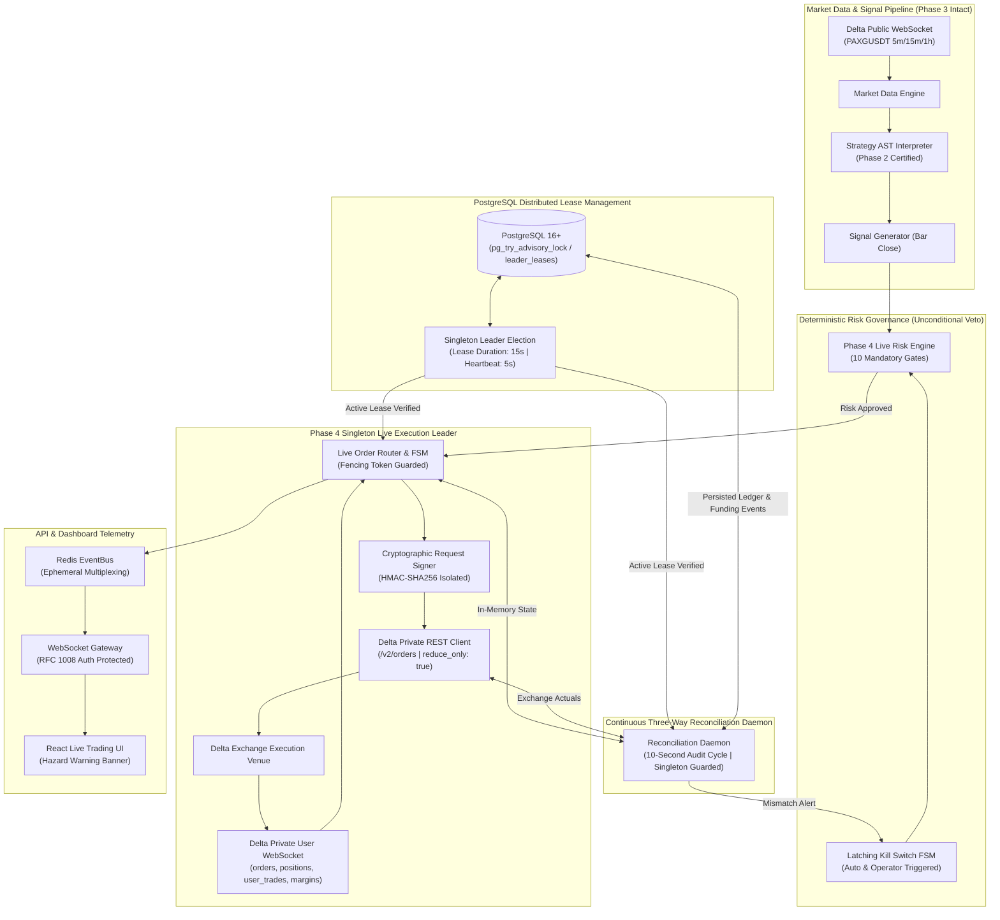
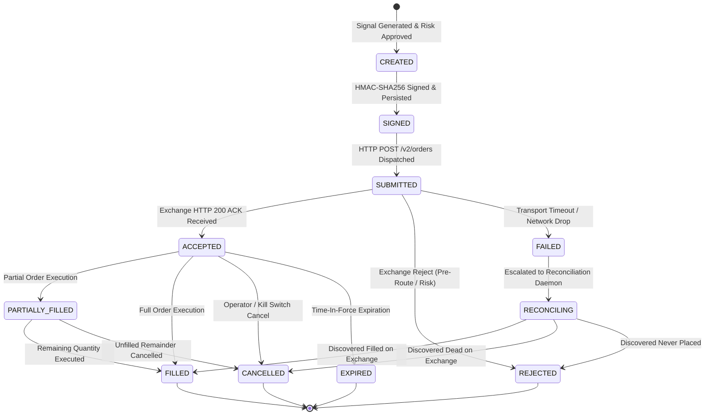
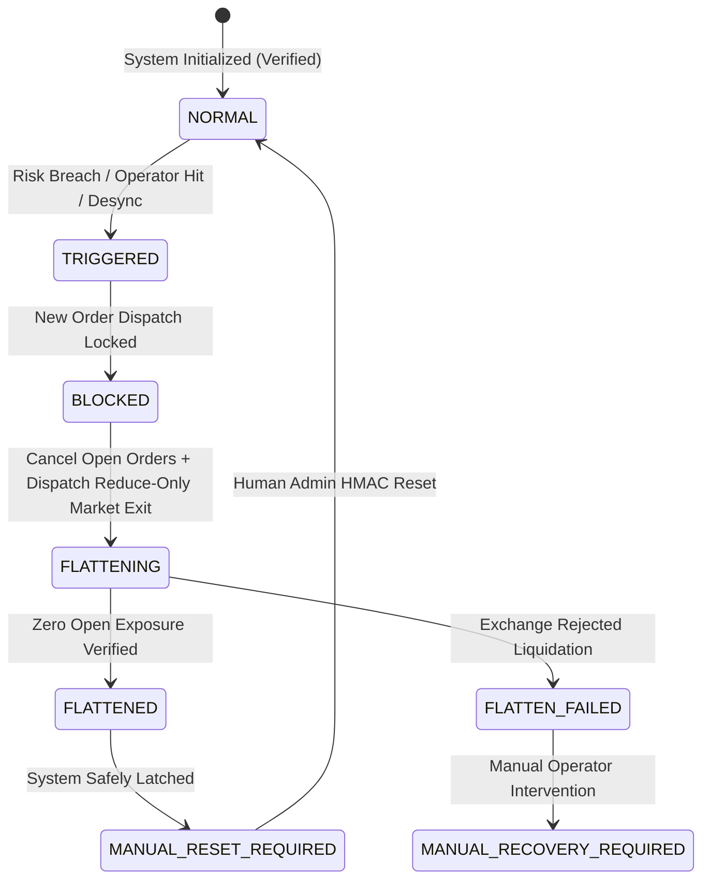
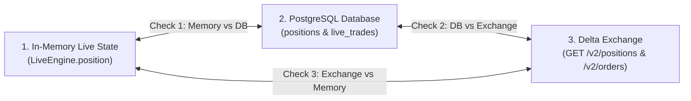
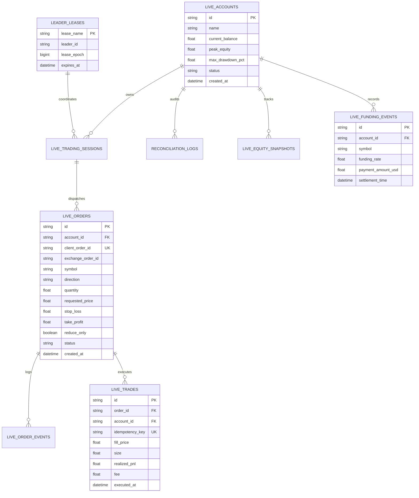

# PHASE 4 — ARCHITECTURE & DESIGN SPECIFICATION
## Gold AI Quantitative Trading System — AGentTrXPAUS
### Live Exchange Execution, Real-Time Reconciliation, Production Hardening & Safety Architecture
### (Remediated Post-Audit Round 1 Baseline)

**Status:** REMEDIATED DESIGN BASELINE (PENDING INDEPENDENT RE-AUDIT)  
**Author:** Principal Quantitative Systems Architect, Distributed Systems Architect, and Security Architect  
**Date:** October 9, 2026  
**Governing Documents:**  
1. `PROJECT_CONSTITUTION.md`  
2. `ARCHITECTURE.md`  
3. `docs/PHASE_1_SPEC.md`  
4. `docs/PHASE_2_SPEC.md`  
5. `docs/PHASE_3_DESIGN_REPORT.md`  
6. `docs/PHASE_3_FINAL_FREEZE_AUDIT.md`  
7. `docs/PHASE_4_DESIGN_AUDIT_ROUND_1.md` (Audit Findings Baseline)  
8. Approved ADRs (`ADR-001` through `ADR-011`)  
**Frozen Milestone Baselines:**  
- Phase 1 Baseline: `v1.1.0-phase1-verified` (`2b3db1b5d505634c77b5fea38a31f21ea340fc90`)  
- Phase 2 Baseline: `v1.2.0-phase2-verified` (`a7b646c42e06d8379f94ab2281b3261848eb3add`)  
- Phase 3 Baseline: `v1.3.0-phase3-verified` (`054cd00d4219e804c2b1ec5859c65a81e1892108`)  

---

## 1. EXECUTIVE SUMMARY

The **AGentTrXPAUS** platform has formally completed, independently audited, and frozen Phase 1 (Data Foundation & Deterministic Backtester), Phase 2 (AI Multi-Agent Strategy Research Factory & Anti-Overfitting Validation Engine), and Phase 3 (Paper Trading Engine, Deterministic Risk Engine, Redis Event Bus, and Institutional Dashboard).

Phase 4 represents the final architectural transition: **Live Exchange Integration, Real-Time Three-Way Order & Position Reconciliation, Production Deployment, and Operational Hardening**.

This remediated specification addresses all twelve (12) findings identified during Independent Design Audit Round 1 (`P1: 5`, `P2: 5`, `P3: 2`), formalizing:
- Mandatory `reduce_only: true` execution safety on all exit, stop-loss, and emergency liquidation orders.
- Concrete private WebSocket authentication handshake and subscription protocol schemas for Delta Exchange.
- Full partial-fill lifecycle semantics with dynamic bracket quantity scaling ($Q_{\text{stop}} = Q_{\text{filled}}$) and resting remainder cancellation.
- A PostgreSQL-backed distributed lease leadership protocol with fencing tokens for multi-worker daemon concurrency.
- Ingestion, recording, and wallet reconciliation of 8-hour perpetual contract funding payments.
- Rigorous mathematical definitions for live-to-paper tracking error and slippage parity.
- Explicit startup crash-recovery pre-reconciliation using client order IDs to prevent false-positive ghost position alerts.

### Core Architectural Axiom:
$$\mathbf{Security} \ge \mathbf{Capital\ Preservation} > \mathbf{Data\ Integrity} > \mathbf{Execution\ Correctness} > \mathbf{Throughput}$$

No automated signal, machine learning model, or system daemon possesses autonomous authority to deploy real financial capital without cryptographic human authorization, multi-layered risk validation, and strict fail-closed safety circuits.

---

## 2. SCOPE

Phase 4 defines and specifies the following production capabilities:

1. **Authenticated Delta Exchange Connector:**
   - Asynchronous REST v2 client with RFC 2104 HMAC-SHA256 request signing.
   - Millisecond timestamp nonce generation, clock drift tracking (< 1000ms SLA), and client-side token-bucket rate limiting.
   - Private WebSocket feed for authenticated user events (`orders`, `positions`, `user_trades`, `margins`).
2. **Deterministic Live Order Management System (OMS):**
   - Canonical 11-state finite state machine governing the complete order lifecycle.
   - Client-side idempotency locking via deterministic SHA-256 client order keys.
   - Partial fill tracking, resting remainder cancellation, and proportional bracket sizing.
3. **Three-Way Continuous State Reconciliation Daemon:**
   - Independent background daemon reconciling state across:
     $$\mathbf{In\text{-}Memory\ Live\ Engine} \iff \mathbf{PostgreSQL\ Durable\ Store} \iff \mathbf{Delta\ Exchange\ Orderbook/Wallet}$$
   - Microsecond discrepancy detection for missing positions, ghost positions, quantity drift, or order desynchronization with zero silent correction.
4. **Perpetual Funding Rate Ingestion & Accounting:**
   - Real-time ingestion and ledger recording of Delta 8-hour funding cash settlements into `live_funding_events`.
   - Defined tolerance bands for wallet balance reconciliation across funding settlement boundaries.
5. **Distributed Concurrency & Process Leadership Protocol:**
   - PostgreSQL advisory lock and lease-backed singleton leadership for `LiveOrderRouter` and `ReconciliationDaemon`.
   - Monotonic fencing tokens (`lease_epoch`) preventing split-brain execution across multi-worker deployments.
6. **Live-Hardened Deterministic Risk Engine:**
   - Extension of the Phase 3 8-gate model to 10 mandatory live gates: Stale Market Data Guard, Slippage Realization Guard, Exchange Connectivity Guard, Order Rejection Threshold, and Three-Way Desynchronization Guard.
7. **Multi-Stage Latching Emergency Kill Switch:**
   - Automatic and manual emergency liquidation (`FLATTEN_ALL`) enforcing mandatory `reduce_only: true`.
   - Strict human-only cryptographic reset (`ADMIN` or `OPERATOR`).
8. **Live/Paper/Backtest Statistical Parity Engine:**
   - Continuous out-of-sample tracking error, slippage variance, and commission drag monitoring using explicit formulas.
9. **Production Security & Secret Management:**
   - Complete credential isolation; zero secrets in Git, frontend, logs, or LLM contexts.
   - Operator signing key lifecycle: hardware/vault custody, rotation, revocation, and salted hash storage.
10. **Institutional Operator Governance:**
    - Dual-stage cryptographic promotion workflow requiring HMAC-SHA256 operator sign-off with nonce replay prevention.
11. **Dashboard Live-Mode Extensions:**
    - High-contrast visual hazard warning: `[LIVE TRADING ACTIVE — REAL FINANCIAL CAPITAL AT RISK]`.
    - Real-time reconciliation health, exchange connectivity telemetry, and emergency manual kill controls.

---

## 3. EXPLICIT OUT-OF-SCOPE ITEMS

The following elements are strictly forbidden and out of scope for Phase 4:

1. **AI Autonomous Live Execution:** AI models (Ollama, Gemini, or any subagent) have **ZERO** execution authority, zero API key access, zero risk override capability, and zero trade signing authority.
2. **Multi-Exchange Arbitrage:** Phase 4 executes exclusively on Delta Exchange. Routing to Binance, Bybit, or CME is out of scope.
3. **High-Frequency Market Making / Colocation:** Execution operates on bar-close signal generation ($5\text{m}, 15\text{m}, 1\text{h}$) with Next-Bar Open execution. Sub-millisecond tick arbitrage is explicitly out of scope.
4. **Automated Strategy Self-Promotion:** Strategies cannot automatically graduate from Paper to Live. Promotion requires explicit human operator cryptographic signature.
5. **Direct Client-to-Exchange Connections:** The React frontend dashboard never communicates directly with Delta Exchange. All telemetry routes through the FastAPI gateway.
6. **Cross-Margin / Multi-Asset Complex Margining:** Live trading is restricted to isolated margin in USDT for Gold derivative contracts.
7. **Modifications to Frozen Phase 1, Phase 2, or Phase 3 Code:** Prior releases remain immutable baselines.

---

## 4. EXISTING PHASE 3 BASELINE

Phase 4 directly builds upon and integrates with the frozen Phase 3 baseline (`v1.3.0-phase3-verified`, commit `054cd00d4219e804c2b1ec5859c65a81e1892108`):

* **Data Foundation:** Resilient Delta public market data feed (`src/real_time/market_data.py`) and dynamic instrument discovery (`validate_public_product()`).
* **Execution Foundation:** Single active strategy per account model, Next-Bar Open execution semantics, conservative slippage modeling, and SL-first intra-bar tie-breaking (`src/paper/matching.py`, `src/paper/positions.py`).
* **Risk Engine:** 8 deterministic mathematical risk gates (`src/risk/paper_risk_engine.py`) and 5-state latching Kill Switch FSM (`src/risk/kill_switch.py`).
* **Durability Layer:** PostgreSQL as sole authoritative source of truth (`alembic/versions/4b591a2e8c92_phase3_paper_trading_tables.py`) with sub-second recovery SLA (`src/real_time/recovery.py`).
* **Real-Time Layer:** Ephemeral Redis 7 pub/sub and caching (`src/real_time/state_cache.py`, `src/real_time/event_bus.py`) with WebSocket multiplexing gateway (`src/api/websockets/gateway.py`).
* **Governance Layer:** Dual-stage promotion certification and HMAC-SHA256 operator sign-off with nonce replay cache (`src/paper/promotion.py`).

---

## 5. PROPOSED ARCHITECTURE & CONCURRENCY TOPOLOGY

To resolve multi-worker concurrency risks (Finding `P1-04`), Phase 4 partitions the system into **Stateless API Worker Nodes** and a **Singleton Live Execution Leader Node** governed by PostgreSQL distributed advisory leases.



---

## 6. COMPONENT RESPONSIBILITIES

| Component | Module Path | Authority Level | Primary Responsibility |
| :--- | :--- | :--- | :--- |
| **Leadership Manager** | `src/execution/leadership.py` | Infrastructure | Acquires and renews PostgreSQL advisory locks (`leader_leases`), issues fencing tokens. |
| **Live Order Router** | `src/execution/delta/order_router.py` | Execution Engine | Manages 11-state order FSM, dispatches bracket orders, enforces Next-Bar Open timing. |
| **Request Signer** | `src/execution/delta/signer.py` | Security Core | Computes HMAC-SHA256 signatures for REST and WebSocket auth, secures secrets. |
| **Delta REST Client** | `src/execution/delta/client.py` | Exchange Gateway | Executes authenticated REST requests, enforces `reduce_only`, manages rate limits. |
| **Delta Private WS** | `src/execution/delta/websocket.py` | Event Listener | Authenticates private feed (`orders`, `positions`, `margins`), pushes trade fills. |
| **Funding Ingestion Worker** | `src/execution/funding_worker.py` | Accounting | Ingests 8-hour funding cash settlements and commits to `live_funding_events`. |
| **Reconciliation Daemon** | `src/execution/reconciliation.py` | Auditor | 10-second background daemon auditing In-Memory vs PostgreSQL vs Delta Exchange. |
| **Live Risk Engine** | `src/risk/live_risk_engine.py` | Veto Authority | Evaluates 10 pre-trade and intra-trade risk gates prior to order intent dispatch. |
| **Live Portfolio Ledger** | `src/execution/portfolio.py` | Accounting | Tracks live cash, used margin, unrealized PnL, leverage, and realized PnL. |
| **Parity Monitor** | `src/execution/parity_monitor.py` | Quality Assurance | Tracks live vs paper vs backtest execution slippage, fees, and tracking error. |

---

## 7. DATA FLOW

### Primary Live Execution Pipeline:
1. **Signal Generation ($T$ Close):** `DeltaWebSocketMarketData` delivers bar close candle. `StrategyInterpreter` generates signal at bar $T$ close.
2. **Pre-Flight Leadership Lease Check:** `LiveOrderRouter` validates that local process holds the active PostgreSQL leadership lease and provides valid fencing token `lease_epoch`.
3. **Pre-Trade Risk Verification:** Signal is evaluated across all 10 gates of `LiveRiskEngine`.
4. **Order Intent Creation ($T$ Close):** If approved, `OrderIntent` is created in state `CREATED` with a deterministic idempotency key:
   $$\text{ClientOrderID} = \text{SHA256}(\text{account\_id} + \text{strategy\_id} + \text{bar\_timestamp} + \text{direction})[:32]$$
5. **Execution Dispatch ($T+1$ Open):** At bar $T+1$ Open, `LiveOrderRouter` writes `SIGNED` state to PostgreSQL and constructs the Delta order payload.
6. **Cryptographic Signing:** `RequestSigner` signs the payload using `DELTA_API_SECRET` and current UTC millisecond timestamp.
7. **Exchange Submission:** Request is dispatched via HTTP POST `/v2/orders`.
8. **Acknowledgment & Fill Notification:** Delta confirms submission (`SUBMITTED` $\to$ `ACCEPTED`). Private WebSocket pushes execution (`FILLED` or `PARTIALLY_FILLED`).
9. **Durable Persistence & Event Broadcast:** Fills are committed synchronously to PostgreSQL `live_trades` and `positions`. Event is published to Redis `order.filled.live.*`.

---

## 8. ORDER LIFECYCLE & 11-STATE FINITE STATE MACHINE

To resolve Finding `P2-01`, the order lifecycle is strictly standardized as an **11-State Finite State Machine**:



### Canonical State Definitions & Ownership:

| State Name | Classification | Ownership Component | Persistence Invariant |
| :--- | :--- | :--- | :--- |
| `CREATED` | Transient | `LiveOrderRouter` | In-memory intent registered. |
| `SIGNED` | Transient | `RequestSigner` | Committed to PostgreSQL `live_order_events` with client order ID. |
| `SUBMITTED` | Transient | `DeltaExchangeClient` | HTTP socket dispatch initiated. |
| `ACCEPTED` | Active Resting | `DeltaExchangeClient` | Exchange `order_id` recorded in `live_orders`. |
| `PARTIALLY_FILLED` | Active Resting | `DeltaPrivateWebSocket` | Cumulative filled quantity recorded; bracket orders scaled. |
| `FILLED` | Terminal | `DeltaPrivateWebSocket` | Trade recorded in `live_trades`; position updated. |
| `REJECTED` | Terminal | `DeltaExchangeClient` | Rejection code and reason logged to `live_order_events`. |
| `CANCELLED` | Terminal | `DeltaExchangeClient` / WS | Cancel event recorded; allocated margin released. |
| `EXPIRED` | Terminal | `DeltaExchangeClient` / WS | TIF expiration logged; margin released. |
| `FAILED` | Transient Error | `DeltaExchangeClient` | Network timeout flagged; automatic retry strictly blocked. |
| `RECONCILING` | Recovery | `ReconciliationDaemon` | Audited against Delta REST `/v2/orders` before state resolution. |

### Partial-Fill Sizing & Bracket Scaling Rules (Remediates P1-03):
1. **Entry Order Time-In-Force:** Live entries submit with Time-In-Force `IOC` (Immediate-Or-Cancel) or standard Limit with a 1-bar execution timeout.
2. **Dynamic Bracket Scaling:** When an entry order enters `PARTIALLY_FILLED` with filled quantity $Q_{\text{filled}}$, any attached or contingent Stop Loss and Take Profit orders MUST be scaled to:
   $$Q_{\text{SL}} = Q_{\text{filled}}, \quad Q_{\text{TP}} = Q_{\text{filled}}$$
   Under **zero circumstances** may an active Stop Loss quantity exceed the actual filled position quantity.
3. **Remainder Cancellation:** If the resting remainder $Q_{\text{remaining}}$ does not fill within the current bar, `LiveOrderRouter` dispatches an explicit cancel for the remainder (`POST /v2/orders/cancel`). Upon cancel confirmation, the order transitions `PARTIALLY_FILLED` $\to$ `CANCELLED`, and the position is locked at $Q_{\text{filled}}$.

---

## 9. RISK ARCHITECTURE (10 MANDATORY GATES)

The `LiveRiskEngine` enforces ten (10) deterministic mathematical gates with unconditional veto authority:

| Gate ID | Risk Gate Name | Institutional Metric / Condition | Enforcement Action |
| :--- | :--- | :--- | :--- |
| **Gate 1** | Portfolio Drawdown Cap | $\text{Drawdown} \ge 10.0\%$ from peak equity | Unconditional Kill Switch Trigger (`FLATTEN_ALL`) |
| **Gate 2** | Daily Loss Limit | $\text{Daily Loss} \ge 3.0\%$ from 00:00 UTC equity | Pauses all new entries until next 00:00 UTC |
| **Gate 3** | Risk Per Trade Limit | $\text{Dollar Risk} \le 1.0\%$ of account equity | Automatically clamps position quantity |
| **Gate 4** | Leverage & Notional Cap | $\text{Notional} \le 5.0\times \text{Equity}$ & $\text{Qty} \le \text{MaxQty}$ | Clamps quantity; rejects if below minimum |
| **Gate 5** | Spread Spike Guard | $\text{Spread} > \$1.50$ OR $\text{Spread} > 2.0\times \text{Median}_{20}$ | Blocks entry; preserves flat position |
| **Gate 6** | Consecutive Loss Guard | $\ge 5$ consecutive losing trades | Pauses strategy; requires operator review |
| **Gate 7** | Market Regime Filter | Current market regime $\notin$ strategy whitelist | Rejects entry signal |
| **Gate 8** | Stale Data & Clock Drift | Feed delay $> 5.0\text{s}$ OR Clock drift $> 1000\text{ms}$ | Blocks entry; flags connectivity warning |
| **Gate 9** | Order Rejection Threshold | $\ge 3$ exchange order rejections in 10 minutes | Trips Kill Switch; blocks trading |
| **Gate 10** | Three-Way Desync Guard | Position / balance mismatch across 3 layers | Immediate Kill Switch Trigger (`FLATTEN_ALL`) |

---

## 10. KILL SWITCH ARCHITECTURE & MANDATORY REDUCE-ONLY LIQUIDATION

To remediate Finding `P1-02`, all emergency liquidation, bracket exit, and Stop Loss orders are **strictly mandated to include `reduce_only: true`**.



### Emergency Liquidation Protocol (`FLATTEN_ALL`):
1. **Immediate Ingress Block:** State immediately transitions to `BLOCKED`. No pending order intents can be signed or submitted.
2. **Atomic Open Order Cancellation:** All open resting orders for the instrument on Delta Exchange are cancelled via `POST /v2/orders/cancel_all`.
3. **Execution Verification:** System awaits cancellation acknowledgment before or concurrently with dispatching exit order.
4. **Mandatory Reduce-Only Market Exit:** Active position is liquidated via market order with explicit `reduce_only: true`:
   ```json
   {
     "product_id": 1234,
     "size": 50,
     "side": "sell",
     "order_type": "market_order",
     "reduce_only": true,
     "client_order_id": "FLATTEN_PAXG_20261009_120000"
   }
   ```
5. **Reverse Position Elimination:** If the position is already closed on the exchange (e.g. Stop Loss hit concurrently), Delta rejects the order with `ReduceOnlyExceedsPosition`. The engine intercepts this response and classifies the state as **Successfully Flat**, preventing any accidental reversal into a short position.
6. **Retry Circuit on Thin Book:** If the market order is rejected due to lack of quote depth, retry once with an IOC limit order at mark $\pm 1.0\%$. If still unconfirmed after 5.0 seconds, transition to `MANUAL_RECOVERY_REQUIRED` and trigger emergency audio/pager alerts.
7. **Human-Only Reset Authority:** Reset is strictly restricted to authenticated `ADMIN` or `OPERATOR` roles providing a valid cryptographic HMAC signature. AI models have **zero** reset power.

---

## 11. DELTA EXCHANGE ADAPTER & WIRE SPECIFICATIONS

### 11.1 REST v2 Request Signing Specification:
- **Algorithm:** RFC 2104 HMAC-SHA256.
- **Message Construction:**
  $$\text{Payload} = \text{HTTP\_METHOD} + \text{TIMESTAMP\_MS} + \text{REQUEST\_PATH} + \text{QUERY\_OR\_BODY}$$
- **Signature:**
  $$\text{Signature} = \text{HexEncode}(\text{HMAC\_SHA256}(\text{Key}=\text{DELTA\_API\_SECRET},\ \text{Msg}=\text{Payload}))$$
- **Dispatched Headers:**
  - `api-key`: `DELTA_API_KEY`
  - `timestamp`: Milliseconds since UNIX epoch (must be within $\pm 5000\text{ms}$ of server time).
  - `signature`: Computed hexadecimal signature.

### 11.2 Private WebSocket Authentication Protocol (Remediates P1-01):
- **Endpoints by Environment:**
  - Production: `wss://socket.delta.exchange`
  - Testnet: `wss://testnet-socket.delta.exchange`
- **Handshake Authentication Flow:**
  Upon establishing the secure WebSocket connection, the client must transmit an authentication frame within 5.0 seconds before subscribing to private channels:
  ```json
  {
    "type": "auth",
    "payload": {
      "api-key": "DELTA_API_KEY_STRING",
      "timestamp": 1728475200000,
      "signature": "hmac_sha256_hex_signature"
    }
  }
  ```
- **WebSocket Auth Signature Payload:**
  $$\text{AuthPayload} = \text{"GET"} + \text{TIMESTAMP\_MS} + \text{"/live"}$$
- **Expected Authentication Response:**
  ```json
  {
    "type": "auth",
    "status": "authenticated",
    "message": "Authentication successful"
  }
  ```
  If `status != "authenticated"`, the client must close the socket immediately, log a security alarm, and block trading.
- **Private Channel Subscriptions:**
  After receiving authentication confirmation, the client subscribes to private user streams:
  ```json
  {
    "type": "subscribe",
    "payload": {
      "channels": [
        {"name": "orders", "symbols": ["PAXGUSDT"]},
        {"name": "positions", "symbols": ["PAXGUSDT"]},
        {"name": "user_trades", "symbols": ["PAXGUSDT"]},
        {"name": "margins"}
      ]
    }
  }
  ```
- **Heartbeat & Stale Detection:**
  Client dispatches `{"type": "ping"}` every 30 seconds. If no `pong` is received within 10 seconds, or if no message arrives for 45 seconds, the connection is deemed stale and reconnected with jittered exponential backoff.

### 11.3 Order Size Unit Mapping (Remediates P2-02):
- **Contract Definition:** For `PAXGUSDT`, the contract multiplier is $0.001\text{ oz}$ of Gold.
- **Size Mapping Formula:**
  $$\text{Delta Order Size (Lots)} = \text{int}\left(\text{round}\left(\frac{\text{Internal Strategy Quantity}}{\text{Contract Multiplier}}\right)\right)$$
  For example, an internal strategy quantity of $0.05\text{ oz}$ maps to $\text{int}(0.05 / 0.001) = 50\text{ contracts}$.
- **Rounding Direction:** When sizing risk-increasing orders, quantity must **ALWAYS round down** to the nearest allowable contract increment. Upward rounding is strictly prohibited.

---

## 12. THREE-WAY POSITION & ORDER RECONCILIATION

The `ReconciliationDaemon` executes an automated audit loop every 10 seconds under singleton leadership:



### 12.1 Startup Crash-Recovery Pre-Reconciliation (Remediates P2-03):
Before declaring an untracked exchange position as a malicious "Ghost Position", the boot recovery sequence executes:
1. Block all new live entry signals.
2. Query Delta REST `/v2/orders?limit=20` and `/v2/fills`.
3. Match the open exchange position against PostgreSQL `live_orders` in state `SUBMITTED`, `SIGNED`, or `ACCEPTED` using `client_order_id`.
4. If an uncommitted order matches the exchange position, execute **Crash-Recovery Fill Reconciliation**: commit the missing `live_trades` record and update `positions` in PostgreSQL.
5. If the exchange position has no matching local `client_order_id` in history, escalate to **Ghost Position Policy** (Decision E).

### 12.2 Funding Rate Accounting & Balance Reconciliation (Remediates P1-05):
- **Funding Settlement Cycle:** Delta Exchange perpetual futures settle funding payments every 8 hours at 00:00, 08:00, 16:00 UTC.
- **Event Ingestion:** `FundingWorker` listens to the private WebSocket `margins` channel and polls `/v2/wallet/transactions` every 15 minutes.
- **Durable Logging:** Every funding settlement creates an immutable record in `live_funding_events`:
  $$\text{live\_accounts.current\_balance} \longleftarrow \text{live\_accounts.current\_balance} + \text{funding\_payment}$$
- **Reconciliation Tolerance Band:**
  Due to asynchronous settlement windows, the cash balance check enforces an explicit tolerance band:
  $$|\text{PostgreSQL Cash} - \text{Delta Wallet Cash}| \le \$0.10\text{ USDT}$$
  If the discrepancy exceeds $\$0.10\text{ USDT}$ for $\ge 3$ consecutive reconciliation cycles (30 seconds), Gate 10 trips and latches the Kill Switch. **Zero silent correction.**

---

## 13. DISTRIBUTED CONCURRENCY & LEADERSHIP PROTOCOL

To remediate Finding `P1-04`, the system implements a strict PostgreSQL-backed singleton leadership protocol:

### 13.1 PostgreSQL Lease Implementation:
- **Table:** `leader_leases`
  - `lease_name`: String (e.g. `"live_execution_leader"`) — Primary Key.
  - `leader_id`: String (UUID of the active worker node).
  - `lease_epoch`: BigInteger (Monotonically increasing fencing token).
  - `acquired_at`: UTC Timestamp.
  - `expires_at`: UTC Timestamp.
- **Lease Acquisition & Renewal Query:**
  ```sql
  INSERT INTO leader_leases (lease_name, leader_id, lease_epoch, acquired_at, expires_at)
  VALUES ('live_execution_leader', :worker_id, 1, NOW(), NOW() + INTERVAL '15 seconds')
  ON CONFLICT (lease_name) DO UPDATE
  SET leader_id = :worker_id,
      lease_epoch = leader_leases.lease_epoch + 1,
      acquired_at = NOW(),
      expires_at = NOW() + INTERVAL '15 seconds'
  WHERE leader_leases.expires_at < NOW() OR leader_leases.leader_id = :worker_id
  RETURNING lease_epoch;
  ```
- **Fencing Token Guard:** Every database transaction and order dispatch operation verifies that local `lease_epoch` matches the active database epoch. If a lease expires, the node immediately terminates live order dispatch and enters standby mode.
- **Standby Nodes:** In multi-worker Uvicorn or container deployments, non-leader nodes operate in read-only API gateway mode.

---

## 14. OPERATOR SIGNING KEY LIFECYCLE & SECURITY

To remediate Finding `P3-01`, operator approval keys adhere to an institutional cryptographic governance lifecycle:

1. **Key Generation:** High-entropy 256-bit cryptographic secrets generated via `secrets.token_hex(32)`.
2. **Key Custody:** Operator signing keys are **NEVER stored on the server** and never committed to version control. Keys reside exclusively in client-side secure credential stores (Bitwarden / 1Password / Hardware Security Keys).
3. **Verification Secret Storage:** The server stores only a cryptographically salted Argon2id / HMAC hash of the operator secret in PostgreSQL `operator_credentials`.
4. **Signature Payload & Nonce Invariant:**
   $$\text{Signature} = \text{HMAC\_SHA256}(\text{OperatorSecret},\ \text{operator\_id} + \text{strategy\_id} + \text{timestamp} + \text{nonce})$$
   - Maximum allowable timestamp drift: $\pm 300\text{ seconds}$ (5 minutes).
   - Single-use nonce validated against in-memory replay cache and persisted to PostgreSQL `promotion_sign_offs`.
5. **Key Rotation & Revocation:**
   - Keys expire automatically after 90 days.
   - An emergency revocation endpoint (`POST /api/v1/auth/operator/revoke`) immediately invalidates active operator credentials.

---

## 15. DATABASE DESIGN & NON-DESTRUCTIVE MIGRATIONS

To remediate Finding `P3-02`, Phase 4 introduces non-destructive schema migrations extending the existing database foundation:



### Alembic Migration Plan (`4b591a2e8c93_phase4_live_execution_tables.py`):
1. **Extend Pre-Existing `live_trades` (via `op.batch_alter_table`):**
   - Add `account_id` (String 36, nullable, FK to `live_accounts.id`).
   - Add `order_id` (String 36, nullable, FK to `live_orders.id`).
   - Add `idempotency_key` (String 128, nullable, unique constraint).
2. **Extend Pre-Existing `positions`:**
   - Add `mode` default handling (`"LIVE"` vs `"PAPER"`).
3. **Create New Phase 4 Tables:**
   - `live_accounts`, `live_trading_sessions`, `live_orders`, `live_order_events`, `reconciliation_logs`, `live_equity_snapshots`, `live_funding_events`, `leader_leases`.

---

## 16. API CONTRACTS

### Public / Read-Only Endpoints (Role: `VIEWER` or higher):
* `GET /api/v1/live/status`: Overall engine health, leader worker identity, exchange latency, clock drift.
* `GET /api/v1/live/accounts/{id}/portfolio`: Live balance, margin, unrealized PnL, leverage.
* `GET /api/v1/live/positions`: Active open live positions and mark prices.
* `GET /api/v1/live/orders`: Live order log with state and TIF filters.
* `GET /api/v1/live/reconciliation/history`: Recent 3-way reconciliation audit trail.

### Privileged Mutation Endpoints (Role: `OPERATOR` or `ADMIN`):
* `POST /api/v1/live/activate`: Activate strategy in live mode (requires cryptographic HMAC sign-off).
* `POST /api/v1/live/pause`: Pause strategy (block new entries, manage open positions).
* `POST /api/v1/live/stop`: Emergency stop and flatten with mandatory `reduce_only: true`.
* `POST /api/v1/live/reconcile/now`: Force immediate 3-way reconciliation sweep.
* `POST /api/v1/risk/kill-switch`: Emergency flatten and system lockout.
* `POST /api/v1/risk/kill-switch/reset`: Reset kill switch back to `NORMAL` (requires `ADMIN` HMAC signature).

---

## 17. MATHEMATICAL PARITY DEFINITIONS

To remediate Finding `P2-04`, the statistical parity criteria are explicitly formalized:

### 17.1 Live vs. Paper Tracking Error:
$$\text{TE} = \sqrt{\frac{1}{N-1}\sum_{i=1}^N \left( (R_{\text{Live}, i} - R_{\text{Paper}, i}) - \overline{\Delta R} \right)^2}$$
- **Sample Window ($N$):** Rolling 50 completed trades.
- **Target Threshold:** $\text{TE} \le 5.0\%$.
- **Interpretation:** Monitoring band for execution drift; breach triggers warning review.

### 17.2 Slippage Realization Delta:
$$\Delta_{\text{slip}} = \frac{|\overline{\text{Slippage}}_{\text{Live}} - \overline{\text{Slippage}}_{\text{Paper}}|}{\max(\overline{\text{Slippage}}_{\text{Paper}},\ \$0.10)} \times 100\%$$
- **Target Threshold:** $\Delta_{\text{slip}} \le 15.0\%$.
- **Interpretation:** Prevents under-modeled exchange slippage from eroding strategy expectancy.

---

## 18. TESTNET STAGING & LIQUIDITY CONTINGENCY

To remediate Finding `P2-05`, Phase 4 establishes a two-tier testnet staging strategy:

1. **Tier 1: Wire Protocol & Authentication Staging (Delta Testnet):**
   - Connect to Delta Testnet using high-liquidity benchmark contract (`BTCUSDT`).
   - Validate REST HMAC-SHA256 request signing, WebSocket handshake authentication frame, nonce handling, and reconnect circuits.
2. **Tier 2: Gold Contract Matching & Execution Staging (`MockDeltaExchangeServer`):**
   - If `PAXGUSDT` order book on Delta Testnet has zero resting liquidity or is halted, execute Stage 4.1 shadow execution using local `MockDeltaExchangeServer`.
   - Simulates order book fills, spread spikes, partial fills, and latency injection.
3. **No Silent Substitution Invariant:**
   - Under zero circumstances will `BTCUSDT` be traded in production or claimed to validate `PAXGUSDT` quantitative performance.

---

## 19. ARCHITECTURAL DECISION REGISTER (DECISIONS A–F)

### Decision A: Native Bracket Orders vs. Synthetic Server-Side Stops
* **Status:** **OPEN (EVIDENCE REQUIRED)**
* **Rationale:** Delta Exchange API v2 documentation must be verified via empirical spike tests to prove whether attached brackets on `/v2/orders` are supported for `PAXGUSDT` and how partial fills scale attached stop quantities.
* **Residual Risk:** If native brackets fail on partial fills, synthetic server-side stop management with heartbeats is required.

### Decision B: Single Active Strategy per Live Account
* **Status:** **PROPOSED FOR DESIGN FREEZE**
* **Rationale:** Guarantees isolated margin, avoids cross-strategy capital contention, and aligns directly with Phase 3 proven architecture.

### Decision C: Testnet Default vs. Production Host Configuration
* **Status:** **PROPOSED FOR DESIGN FREEZE**
* **Rationale:** Defaulting to `testnet` with hard fail-closed gate prevents accidental real-money order dispatch.

### Decision D: Daemon Concurrency & Process Leadership
* **Status:** **PROPOSED FOR DESIGN FREEZE**
* **Rationale:** PostgreSQL advisory lease table (`leader_leases`) with fencing tokens prevents multi-worker race conditions and rate-limit exhaustion.

### Decision E: Ghost Position Policy
* **Status:** **PROPOSED FOR DESIGN FREEZE**
* **Rationale:** On detecting an untracked exchange position, immediately block new entries, latch Kill Switch, and alert operator for manual resolution. Automated liquidation of unknown exposure is forbidden.

### Decision F: Funding Ingestion & Balance Reconciliation Tolerance
* **Status:** **PROPOSED FOR DESIGN FREEZE**
* **Rationale:** 8-hour funding cash settlements logged to `live_funding_events` with $\$0.10\text{ USDT}$ tolerance band prevents false-positive balance desync trips.

---

## 20. PHASE 4 ACCEPTANCE CRITERIA

Before Phase 4 can be frozen or authorized for production release:
1. **0 Unresolved Defects:** $P0=0, P1=0, P2=0, P3=0$ across all independent audits.
2. **Automated Test Suite:** $\ge 220$ passing tests (covering mock exchange, rate limits, nonces, reconciliation, and kill switch).
3. **Code Coverage:** Total codebase test coverage $\ge 82\%$.
4. **Reconciliation SLA:** Three-way reconciliation verified across 1,000 simulated cycles with zero false positives.
5. **Kill Switch SLA:** Emergency flatten execution verified in $< 1.5\text{s}$ on testnet/mock environments.
6. **Security Scan:** Zero private keys, zero hardcoded secrets, zero live trading bypasses.

---

*Phase 4 Remediated Design Specification Complete — Ready for Independent Design Re-Audit.*
