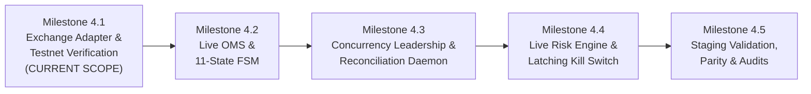

# PHASE 4 — IMPLEMENTATION PLAN & MILESTONE ROADMAP
## Gold AI Quantitative Trading System — AGentTrXPAUS
### Live Exchange Execution, Three-Way Reconciliation, Production Hardening & Safety Architecture

**Status:** ACTIVE IMPLEMENTATION ROADMAP (AUTHORIZED FOR MILESTONE 4.1 ONLY)  
**Author:** Quantitative Systems Engineering Team & Security Architecture  
**Date:** October 9, 2026  
**Governing Documents:**  
1. `PROJECT_CONSTITUTION.md` (Canonical Supreme Authority)  
2. `ARCHITECTURE.md` (System Architecture)  
3. `docs/PHASE_4_DESIGN_REPORT.md` (Frozen Design Specification)  
4. `docs/PHASE_4_FINAL_DESIGN_FREEZE_AUDIT.md` (Final Design Freeze Audit)  
**Frozen Baselines:**  
- Phase 1 Baseline: `v1.1.0-phase1-verified` (`2b3db1b5d505634c77b5fea38a31f21ea340fc90`)  
- Phase 2 Baseline: `v1.2.0-phase2-verified` (`a7b646c42e06d8379f94ab2281b3261848eb3add`)  
- Phase 3 Baseline: `v1.3.0-phase3-verified` (`054cd00d4219e804c2b1ec5859c65a81e1892108`)  

---

## 1. IMPLEMENTATION GOVERNANCE & CORE INVARIANTS

Phase 4 implementation is strictly governed by the following immutable rules:

1. **Safety Hard-Lock:** `LIVE_TRADING_ENABLED: bool = False` must remain hard-locked in `src/core/config.py`.
2. **Zero Real-Money Execution:** No production orders may be submitted. Production API keys must not be used.
3. **AI Zero Authority:** AI models (Ollama, Gemini, research agents) possess zero execution authority, zero secret access, zero trade signing ability, and zero risk override authority.
4. **Target Execution Instrument:** The target instrument is physical gold-backed perpetual futures (`PAXGUSDT`) on Delta Exchange. Silent substitution of instruments is strictly forbidden.
5. **Milestone Authorization Boundaries:** Work is authorized **strictly milestone-by-milestone**. Authorization for Milestone 4.1 does **NOT** authorize Milestone 4.2 or beyond.
6. **Design Discrepancy Rule:** If an implementation issue reveals an exchange contradiction or requires architectural changes, engineers must **STOP** immediately and report it for formal design review.

---

## 2. PHASE 4 MILESTONE BREAKDOWN

---

### Milestone 4.1: Authenticated Exchange Adapter & Wire Verification (CURRENT SCOPE)
* **Objective:** Implement the minimum infrastructure needed for safe, environment-separated Delta Exchange interaction, cryptographic signing, clock-drift verification, and contract validation.
* **Deliverables:**
  - `src/execution/delta/signer.py`: Isolated HMAC-SHA256 request and WebSocket authentication signer.
  - `src/execution/delta/client.py`: Asynchronous Delta REST v2 client with rate-limiting, clock-drift checks, and production order guards.
  - `src/execution/delta/websocket.py`: Authenticated Delta WebSocket client with connection watchdog, heartbeat ping/pong, and channel subscriptions.
  - `src/execution/delta/types.py`: Wire models and message schemas.
  - `src/execution/delta/mock_server.py`: Local simulated Delta Exchange server for offline test suites.
  - Comprehensive unit and integration test suite (`tests/unit/execution/` and `tests/integration/execution/`).
* **Decision A Handling:** Retained as **OPEN**. Document whether Delta API v2 attached bracket parameters are supported for `PAXGUSDT` on Testnet, or if synthetic stop orders must be used.
* **Exit Gate:** All adapter unit/mock tests pass; testnet wire tests executed where supported; zero secret leakage; 100% existing regression test pass.

---

### Milestone 4.2: Deterministic Live Order Management System (OMS) & 11-State FSM
* **Objective:** Implement the canonical 11-state order finite state machine, deterministic idempotency locking, dynamic bracket scaling, and resting remainder cancellation.
* **Prerequisite:** Formal acceptance of Milestone 4.1 report and explicit Milestone 4.2 authorization.
* **Deliverables:**
  - `src/execution/delta/order_router.py`: Order dispatch, next-bar open timing, and remainder timeouts.
  - `src/execution/delta/fsm.py`: Formal 11-state order lifecycle state machine.
  - Mandatory `reduce_only: true` on all exit orders and graceful handling of `ReduceOnlyExceedsPosition`.
  - Partial fill handling: dynamic bracket scaling ($Q_{\text{SL}} = Q_{\text{filled}}$).

---

### Milestone 4.3: Distributed Concurrency Leadership & Three-Way Reconciliation Daemon
* **Objective:** Implement singleton leader election using PostgreSQL `leader_leases`, monotonic fencing tokens (`lease_epoch`), and the three-way continuous reconciliation daemon.
* **Prerequisite:** Completion of Milestone 4.2.
* **Deliverables:**
  - `src/execution/leadership.py`: PostgreSQL advisory lease singleton manager.
  - `src/execution/reconciliation.py`: Background 10-second reconciliation daemon auditing In-Memory $\iff$ PostgreSQL $\iff$ Delta Exchange.
  - `src/execution/funding_worker.py`: 8-hour perpetual contract funding rate ingestion into `live_funding_events`.
  - Startup crash-recovery fill reconciliation matching `client_order_id`.
  - Alembic migration scripts extending `live_trades` and provisioning new Phase 4 tables.

---

### Milestone 4.4: Live-Hardened Risk Engine & Latching Emergency Kill Switch
* **Objective:** Implement the 10-gate deterministic live risk engine with unconditional veto power, and the latching multi-stage emergency Kill Switch (`FLATTEN_ALL`).
* **Prerequisite:** Completion of Milestone 4.3.
* **Deliverables:**
  - `src/risk/live_risk_engine.py`: 10 pre-trade and intra-trade deterministic risk gates.
  - `src/risk/kill_switch.py`: Live-hardened emergency flatten state machine with IOC retry clamps and manual human HMAC reset.

---

### Milestone 4.5: Parity Monitoring, End-to-End Testnet Staging & Final Release Audit
* **Objective:** Validate live-to-paper statistical tracking error ($\text{TE} \le 5.0\%$) and slippage realization delta ($\Delta_{\text{slip}} \le 15.0\%$) over 50 testnet trades, deliver dashboard telemetry, and conduct release audits.
* **Prerequisite:** Completion of Milestone 4.4.
* **Deliverables:**
  - `src/execution/parity_monitor.py`: Mathematical parity tracking engine.
  - Dual-stage operator cryptographic promotion workflow (`POST /api/v1/live/activate`).
  - Independent forensic implementation audit and release freeze audit.

---

## 3. MILESTONE 4.1 DETAILED ACCEPTANCE CHECKLIST

- [ ] **Signer Implementation (`src/execution/delta/signer.py`):**
  - RFC 2104 HMAC-SHA256 REST signature generation.
  - Millisecond timestamp nonce generation.
  - WebSocket authentication frame signature generation (`"GET" + ts + "/live"`).
  - Zero logging or leakage of `DELTA_API_SECRET`.
- [ ] **REST Client Implementation (`src/execution/delta/client.py`):**
  - Environment separation (`DELTA_ENVIRONMENT = "testnet"` vs `"production"`).
  - Clock-drift verification (< 1000ms SLA, fail-closed).
  - Client-side token-bucket rate limiter.
  - Safe error handling and key redaction in exception messages.
  - Hard-coded block preventing live orders when `LIVE_TRADING_ENABLED = False`.
- [ ] **WebSocket Client Implementation (`src/execution/delta/websocket.py`):**
  - Connection to `wss://testnet-socket.delta.exchange`.
  - Auth handshake transmission within 5.0s.
  - Subscription to `orders`, `positions`, `user_trades`, `margins` for `PAXGUSDT`.
  - 30-second ping/pong heartbeat, 10s pong timeout, 45s stale watchdog.
  - Jittered exponential backoff reconnect logic.
- [ ] **Mock Exchange Server (`src/execution/delta/mock_server.py`):**
  - Offline simulation of Delta REST v2 endpoints and WebSocket streams.
  - Orderbook matching, spread simulation, latency injection, and error simulation.
- [ ] **Test Suite Coverage:**
  - Unit tests for HMAC signing against official vectors.
  - Unit tests for clock-drift rejection and rate-limit backoff.
  - Unit tests for WebSocket auth frames and reconnect circuits.
  - Unit tests for instrument discovery and specification validation.
  - Full regression test pass (184 / 184 Phase 1/2/3 tests passing).
- [ ] **Milestone 4.1 Reporting:**
  - Comprehensive documentation of verified exchange contracts, mock test results, testnet trial findings, Decision A status, and security hygiene.

