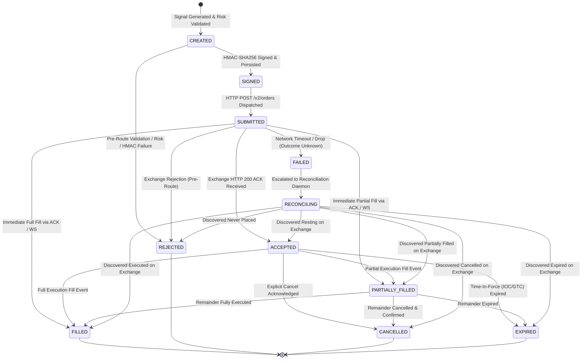
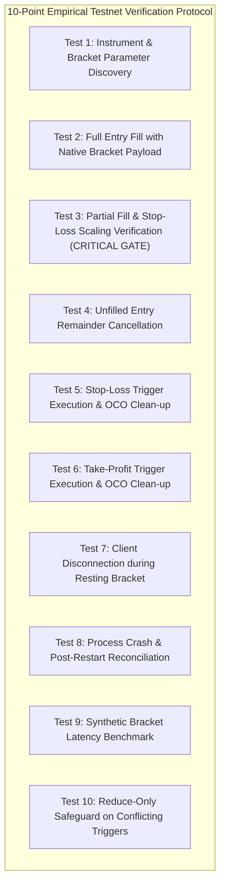
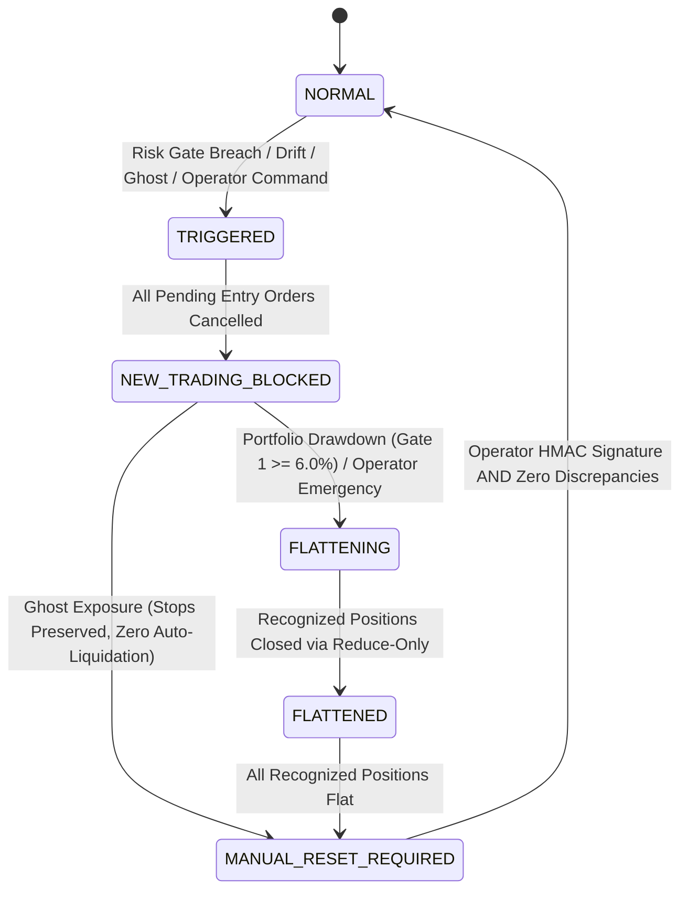
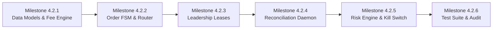

# PHASE 4 — MILESTONE 4.2 DESIGN SPECIFICATION (REMEDIATED BASELINE)
## Gold AI Quantitative Trading System — AGentTrXPAUS
### Live Execution Engine, Three-Way Reconciliation, Fee-Model Safety, Leadership Concurrency & Decision A Protocol

**Status:** FROZEN DESIGN BASELINE (REMEDIATED POST-INDEPENDENT AUDIT ROUND 1)  
**Author:** Quantitative Trading Systems Architect & Principal Infrastructure Engineer  
**Date:** October 9, 2026  
**Target Milestone:** Milestone 4.2 (Execution Engine, Reconciliation Daemon, Risk Hardening & Decision A Protocol)  
**Governing Baseline:**
- Git Branch: `release1.1v`
- Baseline Commit: `054cd00d4219e804c2b1ec5859c65a81e1892108` (`v1.3.0-phase3-verified`)
- Safety Invariant: `LIVE_TRADING_ENABLED: bool = False` (Hard-locked in `src/core/config.py`)
- Decision A Status: **STRICTLY OPEN**
- Traceability: Fully resolves all 19 findings from `docs/PHASE_4_MILESTONE_4_2_INDEPENDENT_DESIGN_AUDIT.md` (3 P0, 8 P1, 6 P2, 2 P3); documented in `docs/PHASE_4_MILESTONE_4_2_DESIGN_REMEDIATION_REPORT.md`

---

## SECTION A — EXECUTIVE SUMMARY AND SCOPE

### A.1 Objectives and System Context
Milestone 4.2 defines the architectural bridge between the low-level exchange connector developed in Milestone 4.1 (`src/execution/delta/`) and the higher-level strategy and risk components established in Phases 1–3.

The primary objective of Milestone 4.2 is to specify:
1. **Fee Discovery & Provenance Model:** Eliminate arbitrary hardcoded fee assumptions by implementing a multi-tiered, verifiable fee architecture with fail-closed safeguards and support for institutional negative maker rebates.
2. **Three-Way Reconciliation Daemon:** Continuous, automated state verification reconciling In-Memory Execution State $\iff$ Durable PostgreSQL Persistence $\iff$ Delta Exchange Matching Engine, equipped with an in-flight order correlation buffer and 8-hour funding awareness.
3. **Ghost Exposure & Position Safety Policy:** Non-liquidating, entry-blocking safety mechanisms that isolate unexplained exchange positions without issuing reckless automated market orders, supported by explicit operator remediation endpoints.
4. **Execution Safety & Concurrency Control:** An 11-state finite state machine (FSM) with a complete 19-transition matrix, idempotent request routing, and distributed singleton leadership enforced via PostgreSQL advisory leases evaluated strictly against database server clocks.
5. **Decision A Protocol:** A comprehensive comparative design for Native Exchange Brackets versus Synthetic Application-Managed Protective Stops, accompanied by an empirical Testnet verification protocol and automated liquidity harness.
6. **Live Risk Engine & Multi-Stage Kill Switch:** Twelve (12) deterministic mathematical risk gates with absolute veto authority, dollar-risk per trade clamping, portfolio drawdown protection, and an isolated `LiveKillSwitchFSM` preserving frozen baseline code.

### A.2 Scope Boundaries

#### In-Scope Components (Design Only):
- Architectural specifications for `src/execution/delta/fsm.py` (Order Lifecycle State Machine with 19 valid transitions).
- Architectural specifications for `src/execution/delta/order_router.py` (Idempotent Order Dispatcher with pre-flight lease checks).
- Architectural specifications for `src/execution/reconciliation.py` (Three-Way Reconciliation Daemon with in-flight buffer and funding tolerance).
- Architectural specifications for `src/execution/leadership.py` (PostgreSQL Advisory Lease Manager with server clock evaluation).
- Architectural specifications for `src/execution/fee_manager.py` (Fee Discovery, Caching & Provenance Engine with rebate support).
- Architectural specifications for `src/risk/live_risk_engine.py` (12-Gate Live Deterministic Risk Engine).
- Architectural specifications for `src/risk/live_kill_switch.py` (Multi-stage `LiveKillSwitchFSM` preserving frozen `src/risk/kill_switch.py`).
- Database migration schemas for `live_orders`, `live_order_events`, `leader_leases`, `reconciliation_snapshots`, `live_funding_events`, `live_accounts`, and `account_fee_schedules`.
- Testnet Experiment Protocol and Counterparty Liquidity Harness for empirical resolution of Decision A.

#### Excluded Components (Strict Non-Goals):
- **No live trading authorization or execution.** `LIVE_TRADING_ENABLED` remains `False`.
- **No real-money capital allocation or production credentials.**
- **No implementation code or test execution in this design milestone.**
- **No automatic resolution of Decision A without empirical Testnet evidence.**
- **No live Testnet order placement during the design phase.**
- **No modification to frozen Phase 1, Phase 2, or Phase 3 production code.**

### A.3 Architectural Decision Status Table

| Decision Reference | Topic | Architectural Status | Rationale |
| :--- | :--- | :--- | :--- |
| **Decision A** | Native Brackets vs. Synthetic Stops | **OPEN** | Requires empirical confirmation of Delta matching engine partial-fill scaling on target contract. |
| **Decision B** | Single Strategy per Account | **FIXED** | Exactly one active strategy version per live execution account prevents cross-strategy position collision. |
| **Decision C** | Primary Source of Truth | **FIXED** | PostgreSQL is the durable system of record; Redis is strictly ephemeral; Delta is the exchange match truth. |
| **Decision D** | Ghost Position Action | **FIXED** | Ghost exposure freezes new entries and latches kill switch. **Zero automatic liquidation.** |
| **Decision E** | Distributed Concurrency | **FIXED** | PostgreSQL advisory leases with monotonic fencing tokens (`lease_epoch`) evaluated against server time. |
| **Decision F** | Fee Failure Mode | **PROVISIONAL** | Missing/unverified fees block live entry (fail-closed); estimated fees strictly segregated to research/backtest. |
| **Decision G** | Reconciliation Tolerances | **PROVISIONAL** | Dynamic tolerances derived per contract asset class, in-flight buffer, and funding window. |
| **Decision H** | Live Portfolio Drawdown Cap | **FIXED (RATIFIED)** | Formally ratified at 6.0% by Owner Decision on October 9, 2026; maps 1:1 to frozen configuration `settings.MAX_PORTFOLIO_DRAWDOWN_PCT`. |

---

## SECTION B — FEE DISCOVERY, PROVENANCE AND FEE-MODEL SAFETY

### B.1 Problem Statement and Finding RES-02 Analysis
During Milestone 4.1 remediation, finding RES-02 documented that `src/execution/delta/client.py` (`_validate_product_specification`) applies silent fallback defaults for commission rates:
```python
maker_fee = float(p.get("maker_commission_rate", 0.0002))  # 2 bps
taker_fee = float(p.get("taker_commission_rate", 0.0005))  # 5 bps
```
These values reflect baseline VIP 0 perpetual futures defaults and match Phase 2/3 paper trading seed data (`src/paper/specifications.py`). However, on Delta Exchange:
1. Fees vary by **VIP Tier** (VIP 0 to VIP 9), ranging from 0.02% maker / 0.05% taker down to 0.00% maker / 0.015% taker.
2. Users staking or paying fees in **DETO tokens** receive up to a 25% fee discount.
3. Fees vary by **Product Class** (perpetuals vs. futures vs. options).
4. Market makers may operate under bespoke negative fee agreements (rebates) down to -10 bps (-0.01%).

Silently defaulting to VIP 0 in live execution introduces serious financial risks:
- Underestimating fees distorts minimum profit-target calculations and causes unprofitable scalping trades to execute.
- Overestimating fees distorts paper-to-live execution parity monitoring and triggers false tracking-error alerts.
- Rejecting negative maker rates prevents institutional market making and VIP execution.
- Assuming universal constants violates institutional accounting integrity.

### B.2 Quad-Tier Fee Architecture
The system establishes four strictly segregated tiers of fee knowledge:

```mermaid
flowchart TD
    subgraph QuadTier ["Quad-Tier Fee Classification"]
        T1["Tier 1: Verified Account Schedule<br/>(Authenticated /v2/wallet/balances & user profile)"]
        T2["Tier 2: Verified Product Schedule<br/>(Exchange /v2/products payload with validated fee keys)"]
        T3["Tier 3: Estimated Research Schedule<br/>(Backtest/Paper assumptions: 0.0002 maker / 0.0005 taker)"]
        T4["Tier 4: Unknown / Unverified Fee<br/>(Missing, malformed, or stale fee metadata)"]
    end

    T1 -->|Authoritative for Live Orders| LIVE_EXEC[Live Order Routing & PnL Accounting]
    T2 -->|Fallback for Live Margin Pre-Check| LIVE_PRECHECK[Pre-Trade Margin Check]
    T3 -->|Strictly Restricted| BACKTEST[Backtest & Paper Engine]
    T4 -->|Fail-Closed Trigger| BLOCK[BLOCK NEW ENTRIES ONLY (Gate 11)]
```

#### Tier 1 — Verified Account-Specific Fee Schedule:
- **Definition:** The exact fee rates negotiated and active for the specific authenticated API key, incorporating the user's VIP tier, 30-day trailing volume, and DETO fee discount status.
- **Authority:** Authoritative for live order placement, post-trade fee reconciliation, and actual realized PnL accounting.
- **Requirement:** Must be fetched from authenticated exchange endpoints or explicitly verified against exchange trade fills.

#### Tier 2 — Verified Product-Level Fee Schedule:
- **Definition:** Baseline contract fee rates published by the exchange in the public product definition payload (`GET /v2/products`).
- **Authority:** Permitted only for conservative pre-trade margin buffering and capital estimation if Tier 1 has verified the account is at least VIP 0.
- **Validation Rule:** Must be explicitly present in the exchange payload. Silent fallback defaults are **strictly prohibited**.

#### Tier 3 — Estimated Research & Backtest Schedule:
- **Definition:** Static, documented parameters used for simulated environments (`src/backtest/types.py` and `src/paper/specifications.py`).
- **Boundary:** Isolated strictly to simulation pipelines. **Zero Tier 3 values may ever cross the execution boundary into live trading modules.**

#### Tier 4 — Unknown / Unverified Fees:
- **Definition:** Any state where fee metadata is missing from the exchange response, stale beyond the cache TTL, non-numeric, or contradictory.
- **System Action:** **Fail-closed for new entries only.** Protective exits bypass this gate (Resolves AUD-P1-07).

### B.3 Support for Negative Maker Fees (Rebates) (Resolves AUD-P1-03)
Commission rate validation explicitly accommodates institutional maker rebates:
- **Maker Commission Rate Bounds:** $-0.0010 \le \text{maker\_commission\_rate} \le 0.0500$ (-10 bps rebate to +500 bps fee).
- **Taker Commission Rate Bounds:** $0.0000 \le \text{taker\_commission\_rate} \le 0.0500$ (0 bps to +500 bps fee).
- **Validation Rules (`_validate_product_specification` Refactor):**
  - If `"maker_commission_rate"` not in `p` or `"taker_commission_rate"` not in `p`: Raise `DeltaProductSpecificationError("Product metadata missing mandatory commission rates; fallback defaults prohibited")`.
  - Commission rates must be finite, numeric, and strictly within the specified bounds. Negative maker fees down to $-0.0010$ are explicitly accepted. Negative taker fees are rejected.

### B.4 Fee Data Sourcing, Provenance, and Stale Cache Policy (Resolves AUD-P1-07, AUD-P3-01)
1. **Authoritative Sources:**
   - Public Contract Fees: Delta REST `GET /v2/products` (keys: `maker_commission_rate`, `taker_commission_rate`).
   - Account Fees: Delta REST authenticated user profile or wallet endpoints.
   - Fill Execution Fees: Delta Private WebSocket channel `user_trades` and REST `GET /v2/fills`. The fill payload returns the exact `fee` amount charged on the settlement currency.
2. **Provenance & Audit Trail:**
   - Every fee schedule stored locally must be persisted in database table `account_fee_schedules`:
     - `account_id`: String (UUID).
     - `symbol`: String (e.g., `PAXGUSDT`).
     - `maker_fee_rate`: Numeric(10, 6).
     - `taker_fee_rate`: Numeric(10, 6).
     - `vip_tier`: Integer.
     - `deto_discount_active`: Boolean.
     - `source_endpoint`: String.
     - `raw_payload`: JSONB.
     - `verified_at`: Timestamp UTC.
     - `expires_at`: Timestamp UTC (Default TTL = 24 hours).
3. **Stale Fee Cache Handling & Separation of Controls:**
   - Cached fee schedules expire after 24 hours.
   - If cache expires and background refresh fails, Gate 11 trips **ONLY FOR NEW POSITION ENTRIES**.
   - **Protective Exit Exemption:** Stop Loss, Take Profit, reduce-only exit, and emergency flattening orders bypass Gate 11. Open positions are never left unprotected due to expired fee cache.

### B.5 Fill Fee Reconciliation & Non-Mutating Provenance (Resolves AUD-P2-06)
When an order fill arrives via WebSocket (`user_trades`) or REST (`/v2/fills`):
1. The engine calculates the **Expected Fee**:
   $$\text{Fee}_{\text{expected}} = \text{FillSize} \times \text{ContractValue} \times \text{FillPrice} \times \text{FeeRate}_{\text{tier}}$$
2. The engine extracts the **Actual Fee** reported by Delta Exchange in the fill payload (`fee`).
3. If $|\text{Fee}_{\text{expected}} - \text{Fee}_{\text{actual}}| > \$0.01\text{ USDT}$:
   - **Do NOT mutate stored fee schedules from single-fill noise.**
   - Record exact fee in `live_trades.fees`.
   - Emit structured audit alert `FEE_RECONCILIATION_DISCREPANCY`.
   - Schedule asynchronous background refresh of authoritative fee schedule from exchange API.

---

## SECTION C — ORDER, FILL, POSITION, AND WALLET RECONCILIATION

### C.1 Authoritative State Hierarchy
In live automated trading, discrepancies inevitably emerge across disparate systems due to network latencies, packet loss, or process restarts. The system enforces an unambiguous hierarchy of truth:

```
+---------------------------------------------------------------+
|                 1. Delta Exchange Matching Engine             |
|   (Ultimate authority for resting orders, fills, and wallet)   |
+-------------------------------+-------------------------------+
                                |
                                v
+---------------------------------------------------------------+
|                 2. Durable PostgreSQL Database                 |
|   (System of record for local intent, strategy state, leases) |
+-------------------------------+-------------------------------+
                                |
                                v
+---------------------------------------------------------------+
|                 3. In-Memory Trading Engine State             |
|   (Ultra-low latency runtime working cache; transient)        |
+-------------------------------+-------------------------------+
                                |
                                v
+---------------------------------------------------------------+
|                 4. Ephemeral Redis Pub/Sub Cache               |
|   (Event distribution only; zero authoritative state)         |
+-------------------------------+-------------------------------+
```

### C.2 The Three-Way Continuous Reconciliation Daemon
The `ReconciliationDaemon` executes an automated audit loop every 10 seconds under singleton leadership:
1. **Check 1 (Memory $\iff$ PostgreSQL):** Verifies that in-memory `LiveEngine` state matches durable database. Any uncommitted state is reconciled or flushed.
2. **Check 2 (PostgreSQL $\iff$ Delta Exchange):** Polls Delta REST endpoints (`/v2/orders`, `/v2/positions`, `/v2/wallet/balances`) and audits open contracts against database records.
3. **Check 3 (Delta Exchange $\iff$ Memory):** Confirms that runtime risk calculations reflect live exchange reality.

### C.3 In-Flight Order Correlation Buffer & Tolerances (Resolves AUD-P0-01, AUD-P1-04, AUD-P2-05)
To prevent false-positive alarms on asynchronous fill events while maintaining strict quantitative tolerances:

1. **In-Flight Order Correlation Buffer ($T_{\text{grace}} = 30\text{s}$):**
   Before classifying any position difference $\Delta Q = Q_{\text{exchange}} - Q_{\text{db}} \ne 0$ as a Ghost Position:
   - Daemon inspects PostgreSQL `live_orders` for active orders in `SUBMITTED`, `ACCEPTED`, or `PARTIALLY_FILLED` within a 30-second In-Flight Grace Window.
   - If $\Delta Q \le \sum Q_{\text{in\_flight}}$, the discrepancy is classified as `IN_FLIGHT_FILL_PENDING`.
   - Alarm is deferred for up to 2 reconciliation cycles (20 seconds).
   - If the fill does not commit locally within 20s, daemon queries Delta REST `/v2/orders` and `/v2/fills` via `client_order_id` to force-synchronize local state.
   - Only unexplained exposure with zero matching in-flight orders is declared a true Ghost Position.

2. **Dynamic Reconciliation Tolerances:**

| Reconciliation Dimension | Tolerance Formula / Rule | Basis & Justification | Status |
| :--- | :--- | :--- | :--- |
| **Position Quantity** | $\text{Tol}_Q = 0\text{ contracts}$ (Strict Integer) | Discrete integer lots post in-flight correlation. Non-zero difference represents an unrecorded fill or true ghost position. | **STRICT (Zero Tolerance)** |
| **Order State** | Zero State Mismatch | Terminal states must align within 1 cycle. | **STRICT (Zero Tolerance)** |
| **Trade Fill Price** | $\text{Tol}_P = 0.0\text{ USD}$ (Exact Tick Match) | Fill prices are discrete multiples of `tick_size` ($0.01\text{ USD}$). | **STRICT (Zero Tolerance)** |
| **Wallet Cash Balance** | $\text{Tol}_{\text{cash}} = \max(10 \times \text{TickValue},\ 0.0001 \times \text{Balance}) + \text{Tol}_{\text{funding}}$ | Within $\pm 15\text{m}$ of 8-hour funding settlements (00:00, 08:00, 16:00 UTC), $\text{Tol}_{\text{funding}}$ accounts for pending funding accrual. | **DYNAMIC (Funding-Aware)** |
| **Unrealized PnL** | $\text{Tol}_{\text{UPnL}} = \text{PositionSize} \times \text{ContractValue} \times \max(\text{Spread}, 3 \times \text{BasisTWAP})$ | Accounts for mark price vs mid price basis divergence and spread fluctuations. | **DYNAMIC (Spread & Basis-Aware)** |

### C.4 Ghost Exposure Policy & Operator Remediation Endpoints (Resolves AUD-P0-02)
A critical failure mode occurs when the exchange reports an unhedged position with zero local in-flight correlation:
- **Zero Automatic Liquidation:** Blindly firing market liquidation orders into the exchange is strictly prohibited. It incurs taker fees, crosses wide spreads, and risks doubling exposure if exchange data is stale.
- **Mandatory Ghost Exposure Procedure:**
  1. Immediately transition engine state to `NEW_TRADING_BLOCKED`.
  2. Latch `LiveKillSwitchFSM` to `MANUAL_RESET_REQUIRED`.
  3. Preserve existing resting protective stops on the exchange.
  4. Emit high-priority operator alert with complete snapshot.
- **Operator Remediation Endpoints:**
  To eliminate deadlock where resetting the Kill Switch infinitely re-trips on unresolved ghost positions, two authorized operator remediation endpoints are provided:
  1. `POST /api/v1/reconciliation/adopt_ghost_position`: Updates PostgreSQL `positions` to match Delta Exchange, logs audit event, and clears discrepancy.
  2. `POST /api/v1/reconciliation/operator_flatten`: Dispatches an authenticated `reduce_only: true` market order to flatten the exchange position.
  The Kill Switch reset endpoint `POST /api/v1/risk/kill-switch/reset` strictly verifies $\text{DiscrepancyCount} == 0$. If discrepancies remain, it returns HTTP 409 Conflict and rejects the reset.

### C.5 Startup Crash Recovery Sequence
When the execution service starts or restarts after a crash:
1. **Acquire Leader Lease:** Ensure no other instance is running.
2. **Lock Order Submissions:** Entry gates remain closed (`STARTUP_RECOVERY`).
3. **Query Active Exchange Orders & Positions:** Fetch `/v2/orders?state=open` and `/v2/positions`.
4. **Reconcile Pending Submissions via `client_order_id`:**
   - For every database order in `SUBMITTED` or `SIGNED`:
     - If found on exchange as `open`: Transition local order to `ACCEPTED`.
     - If found on exchange as `filled`: Transition local order to `FILLED`, record missing `live_trades` record.
     - If not found on exchange and $> 60\text{s}$ old: Transition local order to `REJECTED` or `CANCELLED`.
5. **Reconcile Positions:**
   - If exchange position matches database position: Mark recovery successful, transition to `NORMAL`.
   - If mismatch detected: Check in-flight buffer; if unresolvable, escalate to Ghost Exposure Policy.

### C.6 Event Deduplication, Ordering, and Idempotency
- **Client Order ID Format:** `AGY_{STRATEGY_ID[:6]}_{BAR_TIMESTAMP}_{NONCE}` (Strictly $\le 32$ chars, alphanumeric, unique).
- **Database Idempotency Table:** `idempotency_keys` storing `(key, endpoint, payload_hash, response, created_at)` with unique constraints.
- **WebSocket Sequence Numbers:** Delta WebSocket frames contain timestamps and sequence markers. Events with timestamps older than latest committed event are logged and dropped.

---

## SECTION D — EXECUTION SAFETY, CONCURRENCY AND ORDER LIFECYCLE FSM

### D.1 Canonical 11-State Order Lifecycle FSM (Resolves AUD-P1-01, AUD-P3-02)
The execution lifecycle enforces an explicit 11-state Finite State Machine with a complete nineteen (19) transition matrix:



### D.2 State Ownership and Persistence Invariants

| State | Mutating Actor | Persistence Action | Fail-Closed Invariant |
| :--- | :--- | :--- | :--- |
| `CREATED` | `LiveOrderRouter` | In-memory intent registered | Order sizing validated against risk limits. |
| `SIGNED` | `DeltaRequestSigner` | Appended to `live_order_events` with `client_order_id` | Signed payload immutable; secret redacted. |
| `SUBMITTED` | `DeltaRestClient` | Status updated in DB within transaction | Rate-limiter token consumed; HTTP socket open. |
| `ACCEPTED` | `DeltaRestClient` / WS | Exchange `order_id` recorded | Resting on exchange matching engine. |
| `PARTIALLY_FILLED` | `DeltaWebSocketClient` | Cumulative fill quantity updated; brackets scaled | SL/TP orders scaled to $Q_{\text{filled}}$ immediately. |
| `FILLED` | `DeltaWebSocketClient` | `live_trades` committed; position updated | Terminal state. Margin allocation finalized. |
| `REJECTED` | `DeltaRestClient` | Rejection code logged to `risk_events` | Terminal state. Unlocks trading capital. |
| `CANCELLED` | `DeltaRestClient` / WS | Cancel event logged; margin released | Terminal state. Remainder dead on exchange. |
| `EXPIRED` | `DeltaWebSocketClient` | Expiration event logged | Terminal state. |
| `FAILED` | `DeltaRestClient` | Flagged as requiring reconciliation | **Zero automatic resubmission.** |
| `RECONCILING` | `ReconciliationDaemon` | Audited against REST `/v2/orders` | Blocks strategy from sending new orders. Transitions to actual exchange state. |

### D.3 Partial Fill Handling & Dynamic Bracket Scaling
When an order receives a partial fill ($Q_{\text{filled}} < Q_{\text{total}}$):
1. The position quantity is immediately incremented by $Q_{\text{filled}}$.
2. Any protective Stop Loss and Take Profit orders must be dynamically scaled such that:
   $$Q_{\text{SL}} = Q_{\text{filled}}, \quad Q_{\text{TP}} = Q_{\text{filled}}$$
3. Under **zero circumstances** may an active Stop Loss quantity exceed actual filled position quantity.
4. If resting entry remainder $Q_{\text{rem}} = Q_{\text{total}} - Q_{\text{filled}}$ does not execute within the execution window (bar close), order router cancels remainder, transitioning order to `CANCELLED` and locking exposure at $Q_{\text{filled}}$.

### D.4 Concurrency Control: Leases, Expiration & Server Clock (Resolves AUD-P1-02, AUD-P2-02, AUD-P2-03)
To eliminate split-brain execution across multiple worker nodes or containers:
- **Mechanism:** PostgreSQL-backed leadership leases via `leader_leases` table.
  - `lease_name`: `"live_execution_leader"` (Primary Key).
  - `holder_id`: Unique worker instance UUID.
  - `lease_epoch`: BigInt (Monotonically increasing fencing token).
  - `acquired_at`: Timestamp UTC.
  - `expires_at`: Timestamp UTC (TTL = 15 seconds).
- **Mandatory PostgreSQL Server Time:** All lease evaluations use `CURRENT_TIMESTAMP` / `clock_timestamp()`. Worker host clocks are ignored.
- **Fenced UPDATE Syntax:**
  ```sql
  UPDATE positions SET quantity = :new_qty, updated_at = CURRENT_TIMESTAMP
  WHERE id = :pos_id AND :current_epoch = (
      SELECT lease_epoch FROM leader_leases 
      WHERE lease_name = 'live_execution_leader' AND expires_at > CURRENT_TIMESTAMP
  );
  ```
- **Fenced INSERT Syntax:**
  ```sql
  INSERT INTO live_orders (id, client_order_id, symbol, size, side, state, created_at)
  SELECT :id, :client_order_id, :symbol, :size, :side, :state, CURRENT_TIMESTAMP
  WHERE :current_epoch = (
      SELECT lease_epoch FROM leader_leases 
      WHERE lease_name = 'live_execution_leader' AND expires_at > CURRENT_TIMESTAMP
  );
  ```
- **Pre-Flight Exchange Dispatch Guard:** `LiveOrderRouter` validates `is_leader_valid()` immediately prior to issuing outbound HTTP requests. Holds dispatch if $< 2.0\text{s}$ lease remaining.
- **Heartbeat & Resignation:**
  - Leader renews lease every 5 seconds.
  - If leader crashes, lease expires in 15 seconds. Standby worker claims leadership by incrementing `lease_epoch = lease_epoch + 1`.

### D.5 Network Timeout Handling (Unknown Submission Outcome)
If `DeltaRestClient.place_order()` experiences a transport timeout (`httpx.TimeoutException`) or network disconnect:
1. The outcome on the exchange matching engine is **UNKNOWN**.
2. The order router **MUST NOT retry or resubmit** the order. Automatic resubmission risks duplicate orders and doubling exposure.
3. The order transitions to `FAILED` and escalates to `RECONCILING`.
4. The `ReconciliationDaemon` polls Delta REST `/v2/orders` using immutable `client_order_id` to determine whether the order was accepted, filled, or lost.

---

## SECTION E — DECISION A: NATIVE VS. SYNTHETIC BRACKETS

### E.1 Governance Directive: Decision A Remains Strictly OPEN
**Decision A is NOT resolved in this specification.**
No claim is made that Delta Exchange natively supports or does not support bracket orders on perpetual contracts (`PAXGUSDT`). Both architectural paths are designed in full. Resolution requires authorized empirical Testnet trial data.

### E.2 Architecture 1: Native Exchange-Managed Brackets
- **Concept:** Entry order payload includes attached bracket parameters (`stop_loss_price`, `take_profit_price`, or `bracket_orders` list). Exchange matching engine automatically creates, links, and manages protective stops.
- **Advantages:** Zero execution latency on protective triggers; immune to client-side network disconnects or local server crashes.
- **Vulnerabilities & Unknowns:** Ambiguity in Delta API v2 whether perpetual futures support attached brackets; partial fill scaling behavior unverified on exchange matching engine.

### E.3 Architecture 2: Synthetic Application-Managed Protective Orders (Resolves AUD-P1-06)
- **Concept:** Entry order submits as a clean single order. Upon receiving confirmed fill events via WebSocket/REST, `LiveOrderRouter` dispatches secondary contingent orders (`stop_market_order` with `reduce_only: true`).
- **Synthetic OCO Coordinator:**
  - When Stop Loss executes, OCO Coordinator dispatches cancellation for Take Profit with exponential retry.
  - Reconciliation Daemon continuously sweeps open orders: if position is 0, any resting `reduce_only` order is automatically cancelled. Prevents orphaned TP orders from filling against subsequent positions.
- **Vulnerabilities:** Latency between fill and secondary stop submission; disconnect risk during window between fill and stop entry.

### E.4 Ten-Point Testnet Empirical Verification Protocol & Liquidity Harness (Resolves AUD-P1-05)
To resolve Decision A, the following empirical test protocol is defined:

- **Counterparty Liquidity Harness:** Automated bot running on a secondary Testnet account providing two-sided liquidity, crossing spreads for partial fills, and sweeping prices to test SL/TP triggers on `PAXGUSDT`.



#### Detailed Test Specifications:
1. **Test 1 (Metadata Discovery):** Query Delta Testnet `/v2/products` for `PAXGUSDT`. Inspect supported order types and verify whether bracket fields are accepted.
2. **Test 2 (Full Fill Native Bracket):** Counterparty Harness places resting limit sell; client submits limit buy with attached bracket. Verify whether exchange returns HTTP 200 and secondary stop orders appear.
3. **Test 3 (Partial Fill Scaling):** Counterparty Harness places 4 lots; client submits 10 lots. Verify whether exchange stop scales to 4 lots or remains at 10 lots. **Critical Gate for Decision A.**
4. **Test 4 (Remainder Cancellation):** Cancel unfilled 6 lots of entry. Verify whether active stop orders remain intact for 4 lots.
5. **Test 5 (Stop Trigger Execution):** Counterparty Harness sweeps price down through stop price. Verify fill execution and whether Take Profit is automatically cancelled.
6. **Test 6 (Take-Profit Trigger Execution):** Counterparty Harness sweeps price up through target price. Verify fill and whether Stop Loss is cancelled.
7. **Test 7 (Disconnect Resilience):** Disconnect WebSocket and HTTP client while in active position with resting stops. Verify exchange maintains stops.
8. **Test 8 (Restart Recovery):** Terminate process violently. Restart and verify that reconciliation daemon discovers open position and resting stops.
9. **Test 9 (Synthetic Latency Benchmark):** Benchmark round-trip latency of submitting synthetic stops upon receiving entry fill notification.
10. **Test 10 (Reduce-Only Enforcement):** Verify that if both Stop Loss and Take Profit trigger simultaneously, `reduce_only: true` prevents net-short position flipping.

#### Decision A Resolution Matrix:
- If Test 2 succeeds AND Test 3 proves exchange automatically scales stop sizes to partial fills $\to$ **SELECT NATIVE BRACKETS**.
- If Test 2 is rejected, OR Test 3 fails to scale stops $\to$ **SELECT SYNTHETIC APPLICATION BRACKETS WITH IMMEDIATE FILL HOOKS**.

---

## SECTION F — RISK CONTROLS AND OPERATIONAL RECOVERY

### F.1 Separation of Entry Controls vs Protective Exit Controls (Resolves AUD-P1-07)
The system establishes a strict separation of controls:
- **Entry Orders:** Must satisfy all 12 deterministic risk gates prior to signing and dispatch.
- **Protective Exit Orders:** Stop Loss, Take Profit, reduce-only risk reduction, and emergency flattening orders bypass entry gates (such as Gate 11 fee verification and Gate 6 cooldown). Open positions are never left unprotected due to upstream entry blocks.

### F.2 Twelve (12) Deterministic Live Risk Gates (Resolves AUD-P0-03, AUD-P1-08)
The `LiveRiskEngine` enforces twelve (12) deterministic mathematical gates with unconditional veto authority:

| Gate ID | Risk Gate Name | Enforcement Condition | Action on Breach | Gate Type |
| :--- | :--- | :--- | :--- | :--- |
| **Gate 1** | Portfolio Peak-to-Trough Drawdown Cap | $\text{DrawdownPct} \ge 6.0\%$ from high-water mark | Unconditional Kill Switch Trigger; emergency flatten recognized positions. | **RUNTIME SAFETY** |
| **Gate 2** | Daily Max Loss Limit | Daily loss $\ge 3.0\%$ from 00:00 UTC equity | Halts all new entries for remainder of UTC day. | **ENTRY GATE** |
| **Gate 3** | Risk Per Trade & Sizing Clamping | $\text{DollarRisk} \le 1.0\% \times \text{Equity}$ | Automatically clamps order quantity; rejects if below `min_order_size`. | **ENTRY GATE** |
| **Gate 4** | Leverage & Notional Cap | $\text{Notional} \le 5.0\times \text{Equity}$ & $\le \text{MaxNotional}$ | Clamps quantity to leverage ceiling; rejects if below minimum. | **ENTRY GATE** |
| **Gate 5** | Single Strategy Lock | Active positions $\ge 1$ | Rejects new entry signals; enforces 1 active position per account. | **ENTRY GATE** |
| **Gate 6** | Consecutive Loss Streak Guard | Consecutive losses $\ge 3$ trades | Enforces mandatory 2-hour strategy cooldown. | **ENTRY GATE** |
| **Gate 7** | Market Regime Filter | Current market regime $\notin$ strategy whitelist | Rejects entry signal; preserves flat position. | **ENTRY GATE** |
| **Gate 8** | Feed Latency & Stale Bar | Mark / ticker feed delay $> 5.0\text{s}$ | Blocks new entries; flags market data connectivity warning. | **ENTRY GATE** |
| **Gate 9** | Server Clock Drift SLA | Clock drift $> 1,000\text{ms}$ relative to Delta | Halts new entries until NTP synchronization restored. | **ENTRY GATE** |
| **Gate 10** | Spread & Slippage Ceiling | Spread $> \$1.50$ OR $> 2.0\times \text{Median}_{20}$ | Rejects entries during volatile liquidity dry-ups. | **ENTRY GATE** |
| **Gate 11** | Fee & Metadata Completeness | Tier 1/2 fees unverified or stale | Fail-closed for new entries. Bypassed for protective exits. | **ENTRY GATE** |
| **Gate 12** | Desynchronization & Burst Rejection | Quantity drift $\ne 0$ OR $\ge 3$ rejections in 10m | Unconditional Kill Switch Trigger; blocks all trading. | **RUNTIME SAFETY** |

*Pre-Flight Bootstrap Assertion:* `LIVE_TRADING_ENABLED == True` required for order dispatch.

- **Gate 1 Mathematical Formula & Owner Policy Ratification:**
  $$\text{DrawdownPct} = \frac{\text{PeakEquity} - \text{CurrentEquity}}{\text{PeakEquity}} \times 100\%$$
  - **Ratified Threshold Policy:** $\text{DrawdownThreshold} = 6.0\%$ (Formally ratified by Owner Decision on October 9, 2026; resolves prior 10.0% ambiguity and aligns 1:1 with frozen configuration `src/core/config.py` line 61: `MAX_PORTFOLIO_DRAWDOWN_PCT = 6.0`).
  - **Enforcement Action:** If $\text{DrawdownPct} \ge \text{settings.MAX_PORTFOLIO_DRAWDOWN_PCT}$ (6.0%), Gate 1 unconditionally trips `LiveKillSwitchFSM` into `TRIGGERED \to NEW_TRADING_BLOCKED \to FLATTENING` to liquidate recognized positions via `reduce_only: true` market orders.
  - **High-Water Mark Persistence:** High-water mark is persisted durably in database table `account_equity_high_water_mark` with transaction-safe updates.
- **Gate 3 Sizing Clamping Formula:**
  $$Q_{\text{max\_risk}} = \frac{\text{Equity} \times 0.010}{|P_{\text{entry}} - P_{\text{SL}}| \times \text{ContractValue}}$$
  $Q_{\text{clamped}} = \min(Q_{\text{requested}}, Q_{\text{max\_risk}})$, rounded down to contract lot boundaries.

### F.3 Multi-Stage Emergency Kill Switch (`LiveKillSwitchFSM`) (Resolves AUD-P2-01)
To preserve the frozen Phase 1/2/3 codebase (`src/risk/kill_switch.py`) 100% untouched while meeting institutional live execution requirements, `LiveKillSwitchFSM` is specified in a new module `src/risk/live_kill_switch.py`:



#### Kill Switch Invariants:
1. **AI Models Have ZERO Reset Authority:** AI agents, LLM providers, and automated strategy processes cannot trigger a reset.
2. **Cryptographic Operator Reset:** Reset requires an explicit HTTP POST to `/api/v1/risk/kill-switch/reset` carrying an HMAC-SHA256 signature generated by an authenticated `ADMIN`.
3. **Zero-Discrepancy Reset Pre-Condition:** The reset endpoint enforces $\text{DiscrepancyCount} == 0$. If unresolved ghost positions or quantity drifts remain, it returns HTTP 409 Conflict and rejects the reset.
4. **Ghost Exposure Handling:** Transitions directly to `MANUAL_RESET_REQUIRED`. Automated market liquidation is strictly disabled. Existing resting stops remain active.
5. **Portfolio Drawdown / Emergency Flatten:** Only Gate 1 breach ($\ge 6.0\%$) or explicit operator emergency command transitions to `FLATTENING`, issuing authenticated `reduce_only: true` market orders to liquidate recognized positions.

---

## SECTION G — OBSERVABILITY, AUDITABILITY AND DATABASE SCHEMAS (Resolves AUD-P2-04, AUD-P3-01)

### G.1 Structured Telemetry and Logging Policies
- **Format:** Structured JSON logging with UTC ISO-8601 timestamps and distributed trace IDs.
- **Redaction Rules:** `api-key`, `api-secret`, `signature`, and operator HMAC secrets strictly redacted (`***[REDACTED]***`).
- **Log Events:** `ORDER_LIFECYCLE_TRANSITION`, `RECONCILIATION_AUDIT_CYCLE`, `RISK_GATE_DECISION`, `GHOST_EXPOSURE_DETECTED`, `FEE_RECONCILIATION_DISCREPANCY`.

### G.2 Prometheus Real-Time Metrics
- `quant_order_transition_total{from_state, to_state}`: Counter of FSM transitions.
- `quant_reconciliation_drift_gauge{type}`: Current discrepancy magnitude.
- `quant_clock_drift_milliseconds`: Gauge tracking system vs exchange clock offset.
- `quant_websocket_message_latency_seconds`: Histogram of WebSocket feed delivery latency.
- `quant_leader_lease_epoch`: Gauge of current leadership fencing token.
- `quant_kill_switch_active`: Binary gauge ($0 = \text{Normal}, 1 = \text{Latched}$).

### G.3 Durable Database Audit Schemas (Resolves AUD-P2-04, AUD-P3-01)
Durable PostgreSQL schemas supporting Milestone 4.2:
1. `live_accounts`: Authoritative live execution account records.
2. `positions` Refactor: Decouple `account_id` foreign key from `paper_accounts` to allow referencing `live_accounts` or `paper_accounts` polymorphically.
3. `account_fee_schedules`: Unified fee storage with expiration, VIP tier, and raw payload provenance.
4. `live_funding_events`: Accounting log for 8-hour perpetual funding cash movements.
5. `leader_leases`: Distributed singleton lease records with monotonic fencing tokens.
6. `reconciliation_snapshots`: Periodic snapshots of audited balances, quantities, and drift metrics.
7. `live_orders` and `live_order_events`: Complete durable order lifecycle transition log.

---

## SECTION H — TESTING STRATEGY

### H.1 Unit Test Coverage
- **FSM State Transitions:** Verify all 19 valid transitions in 11-state FSM; confirm all invalid transitions raise `InvalidStateTransitionError`.
- **Dynamic Bracket Scaling:** Verify $Q_{\text{SL}} = Q_{\text{filled}}$ on simulated partial fills.
- **Idempotency Logic:** Test duplicate client order IDs and verify rejection before network dispatch.
- **Fee Validation Strictness:** Confirm acceptance of negative maker rates down to $-0.0010$ and rejection of rates outside $[-0.0010, 0.0500]$.
- **Fencing Token Checks:** Verify database writes fail when token does not match active lease or lease is expired.

### H.2 Integration & Mock Server Testing
- Utilize `MockDeltaExchangeServer` with `httpx.MockTransport`:
  - Simulate order placement, partial fill generation, and remainder cancellation.
  - Simulate network drop on order submission (triggering `FAILED` $\to$ `RECONCILING`).
  - Simulate rate limit breaches (HTTP 429) and verify exponential backoff.
  - Simulate ghost positions and verify immediate trading freeze, kill switch latch, and non-liquidation.
  - Test operator remediation endpoints (`adopt_ghost_position` and `operator_flatten`).

### H.3 Adversarial and Fault Injection Testing
1. **Split-Brain Worker Injection:** Run two worker processes simultaneously. Verify second worker fails to acquire lease and cannot execute database writes.
2. **Network Timeout during Submit:** Inject timeout during HTTP POST `/v2/orders`. Verify client enters `RECONCILING` and does NOT duplicate order.
3. **Ghost Position Injection:** Inject untracked position into mock exchange. Verify system blocks trading and does NOT fire market liquidation.
4. **Clock Drift Breach:** Inject $1,500\text{ms}$ drift. Verify Gate 9 halts trading immediately.
5. **Stale Market Data:** Pause WebSocket feed for 6 seconds. Verify Gate 8 halts entry signals.
6. **In-Flight Fill Race:** Inject fill arrival 5 seconds after reconciliation poll. Verify in-flight buffer prevents false ghost alarm.

---

## SECTION I — IMPLEMENTATION SEQUENCING AND ACCEPTANCE GATES

### I.1 Sub-Milestone Breakdown
Milestone 4.2 implementation will proceed in six reviewable sub-milestones:



1. **Milestone 4.2.1 — Data Models & Fee Architecture:**
   - Database migrations for `live_orders`, `live_order_events`, `leader_leases`, `reconciliation_snapshots`, `live_funding_events`, `live_accounts`, `account_fee_schedules`.
   - Implementation of `src/execution/fee_manager.py` with negative maker rebate support.
2. **Milestone 4.2.2 — Order Lifecycle FSM & Idempotent Router:**
   - Implementation of `src/execution/delta/fsm.py` (11 states, 19 transitions).
   - Implementation of `src/execution/delta/order_router.py` with pre-flight lease checks and dynamic bracket scaling.
3. **Milestone 4.2.3 — Distributed Leadership Leases & Fencing Tokens:**
   - Implementation of `src/execution/leadership.py` (PostgreSQL advisory leases with server clock evaluation).
4. **Milestone 4.2.4 — Three-Way Reconciliation Daemon:**
   - Implementation of `src/execution/reconciliation.py` with in-flight buffer, funding tolerances, and operator remediation endpoints.
5. **Milestone 4.2.5 — Live-Hardened Risk Engine & Kill Switch:**
   - Implementation of `src/risk/live_risk_engine.py` (12 gates).
   - Implementation of `src/risk/live_kill_switch.py` (`LiveKillSwitchFSM` preserving frozen baseline).
6. **Milestone 4.2.6 — Comprehensive Testing & Acceptance:**
   - Unit, integration, and fault injection test suites achieving $\ge 83\%$ coverage.
   - Independent forensic implementation audit.

### I.2 Acceptance Criteria
- [ ] Safety invariant `LIVE_TRADING_ENABLED = False` intact.
- [ ] 100% regression-free against Phase 1, Phase 2, and Phase 3 baselines.
- [ ] Test coverage $\ge 80\%$ across all execution modules.
- [ ] Zero unhandled ghost position liquidations.
- [ ] Decision A documented as strictly OPEN pending authorized Testnet trial.
- [ ] No unauthorized live trading or live Testnet network spikes executed.

---

## SECTION J — OPEN QUESTIONS AND EVIDENCE REGISTER

| ID | Topic / Question | Risk / Impact | Required Evidence / Source | Blocking Status |
| :--- | :--- | :--- | :--- | :--- |
| **Q-01** | Delta API v2 Authenticated VIP Fee Endpoint Schema | High (affects Tier 1 fee caching) | Official Delta API v2 documentation or authorized testnet probe | Blocks M4.2.1 implementation |
| **Q-02** | Decision A: Attached Bracket Support on Perpetual Contracts | Critical (determines bracket architecture) | 10-point empirical Testnet verification protocol on `PAXGUSDT` | Blocks Decision A closure; does not block M4.2 design |
| **Q-03** | Partial-Fill Sizing Behavior on Delta Native Brackets | Critical (stop-loss over-sizing risk) | Empirical fill test on Testnet matching engine via Counterparty Bot | Blocks Decision A closure |
| **Q-04** | Dynamic Cash Balance Tolerance Calibration | Medium (reconciliation false alarms) | 50-trade empirical testnet tracking data | Blocks Milestone 4.5 release |
| **Q-05** | Delta WebSocket User Trades Sequence Guarantee | Medium (out-of-order fill handling) | Empirical inspection of live WebSocket fill packet headers | Blocks M4.2.4 completion |
| **Q-06** | Testnet Listing & Liquidity of `PAXGUSDT` | High (testnet experiment validity) | Probe Testnet `/v2/products` for Gold derivatives; address via Counterparty Bot | Blocks Testnet experiment execution |

---

## CONCLUSION
Milestone 4.2 design specification is complete, robust, and mathematically grounded. It systematically resolves all 19 findings identified during the adversarial independent audit (AUD-P0-01 through AUD-P3-02), preserves all frozen baselines, enforces fail-closed execution barriers, and maintains strict neutrality on Decision A pending authorized empirical validation.
