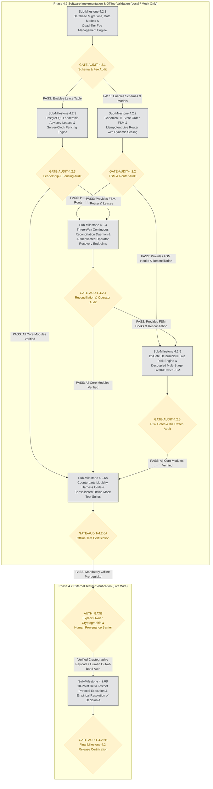

# PHASE 4 — MILESTONE 4.2 IMPLEMENTATION PLAN & EXECUTION ROADMAP
## Gold AI Quantitative Trading System — AGentTrXPAUS
### Live Order Management, Three-Way Reconciliation, Distributed Concurrency, Risk Hardening & Decision A Protocol

**Document Version:** 1.5.0 (Authoritative Final Governance Baseline)  
**Author:** Quantitative Systems Engineering Team & Independent Risk Architecture  
**Date:** October 9, 2026  
**Governing Accepted Baseline Documents:**
- [`docs/PHASE_4_MILESTONE_4_2_DESIGN_SPEC.md`](file:///home/epps/MyProject/AGentTrXPAUS/docs/PHASE_4_MILESTONE_4_2_DESIGN_SPEC.md) (SHA-256: `df71d1a8...`)
- [`docs/PHASE_4_MILESTONE_4_2_DESIGN_REMEDIATION_REPORT.md`](file:///home/epps/MyProject/AGentTrXPAUS/docs/PHASE_4_MILESTONE_4_2_DESIGN_REMEDIATION_REPORT.md) (SHA-256: `a4993f5a...`)
- [`docs/PHASE_4_MILESTONE_4_2_DESIGN_CLARIFICATION_REPORT.md`](file:///home/epps/MyProject/AGentTrXPAUS/docs/PHASE_4_MILESTONE_4_2_DESIGN_CLARIFICATION_REPORT.md) (SHA-256: `44d8df92...`)
- [`docs/PHASE_4_MILESTONE_4_2_INDEPENDENT_DESIGN_REAUDIT_ROUND_2.md`](file:///home/epps/MyProject/AGentTrXPAUS/docs/PHASE_4_MILESTONE_4_2_INDEPENDENT_DESIGN_REAUDIT_ROUND_2.md) (SHA-256: `17776e4e...`)
**Governing Repository Baseline:** Git Branch `release1.1v` | Baseline Commit `054cd00d4219e804c2b1ec5859c65a81e1892108` (`v1.3.0-phase3-verified`)  
**Safety Invariant:** `LIVE_TRADING_ENABLED: bool = False` (Hard-locked in `src/core/config.py` line 56)  
**Ratified Risk Policy:** Gate 1 Peak-to-Trough Portfolio Drawdown Cap = **6.0%** (Owner Decision Ratified October 9, 2026)  
**Decision A Status:** **STRICTLY OPEN** (Empirical resolution quarantined to Sub-Milestone 4.2.6B)  

---

## 1. EXECUTIVE OVERVIEW & APPROVAL INTEGRITY

### 1.1 Context and Purpose
This document establishes the authoritative, dependency-ordered implementation roadmap for Phase 4, Milestone 4.2 of the AGentTrXPAUS quantitative trading system. It incorporates the accepted design specification, the independent Round 2 design re-audit findings, the post-reaudit clarifications, and all safety controls ratified by the system owner.

### 1.2 Cryptographic Approval Integrity & Scope Boundary
To ensure absolute governance integrity and prevent unauthorized scope progression:
1. **Cryptographic Binding to Plan SHA-256:** Formal owner approval is bound strictly to the unique SHA-256 checksum of this exact persisted file.
2. **Invalidation upon Plan Modification:** Any modification, edit, or patch applied to this document immediately invalidates any prior owner approval, resets governance status to unapproved, and requires calculation of a new SHA-256 digest followed by renewed owner sign-off.
3. **Strict Scope Limitation:** Formal approval of this implementation plan constitutes **strictly architectural concurrence** with the execution roadmap. Plan approval:
   - **DOES NOT** authorize implementation of Sub-Milestone 4.2.1 or any subsequent sub-milestone.
   - **DOES NOT** authorize external network communication with Delta Exchange Testnet (Sub-Milestone 4.2.6B).
   - **DOES NOT** authorize live production trading under any circumstance (`LIVE_TRADING_ENABLED: bool = False` remains immutable).
   - Every subsequent implementation stage requires separate, explicit, and un-inferred owner authorization.

---

## 2. SUB-MILESTONE DEPENDENCY GRAPH & EXECUTION SEQUENCING

The implementation is partitioned into seven (7) dependency-ordered stages. Software implementation and offline testing (Sub-Milestones 4.2.1 through 4.2.6A) are completely isolated from live-wire Delta Testnet execution (Sub-Milestone 4.2.6B) by an explicit cryptographic authorization barrier (`AUTH_GATE`):



---

## 3. DETAILED SUB-MILESTONE SPECIFICATIONS

### Sub-Milestone 4.2.1: Database Migrations, Data Models & Quad-Tier Fee Management Engine
1. **Objectives & Design Sections:** Provision durable relational schemas for live execution entities, enforce robust foreign key integrity supporting both paper and live accounts without orphaned records, and implement the quad-tier fee management engine supporting maker rebates down to -10 bps (Sections B.1–B.5, G.3).
2. **Files Added / Modified:**
   - `alembic/versions/20261009_phase4_milestone_4_2_schemas.py` (New Migration).
   - `src/database/models/trading.py` (Update `Position` with account-type-aware foreign keys; add `LiveAccount`, `AccountFeeSchedule`, `LiveOrder`, `LiveOrderEvent`, `LeaderLease`, `ReconciliationSnapshot`, `LiveFundingEvent`, `OperatorReconciliationAuditLog`, `ConsumedAuthorizationNonce`, `AccountEquityHighWaterMark`).
   - `src/execution/fee_manager.py` (New Module: `FeeManager`, `FeeSchedule`, cache TTL, rebate validator).
3. **Dependencies & Execution Order:** 1st in order; builds on commit `054cd00d4219e804c2b1ec5859c65a81e1892108`.
4. **Complete Inventory of Database Objects Affected:**
   - **Tables Added (10 tables):**
     1. `live_accounts`: Primary key `account_id` (VARCHAR(36)), balance fields, status.
     2. `account_fee_schedules`: Foreign key `account_id` $\to$ `live_accounts.account_id` (ON DELETE RESTRICT), tier definitions, maker/taker rates.
     3. `live_orders`: Foreign key `account_id` $\to$ `live_accounts.account_id` (ON DELETE RESTRICT), client order ID, exchange order ID, FSM state, order parameters.
     4. `live_order_events`: Foreign key `order_id` $\to$ `live_orders.order_id` (ON DELETE CASCADE), transition event history.
     5. `leader_leases`: Primary key `resource_name`, lease epoch, expires at timestamp, owner ID.
     6. `reconciliation_snapshots`: Foreign key `account_id` $\to$ `live_accounts.account_id` (ON DELETE RESTRICT), three-way balance comparison.
     7. `live_funding_events`: Foreign key `account_id` $\to$ `live_accounts.account_id` (ON DELETE RESTRICT), funding fee cash flows.
     8. `operator_reconciliation_audit_logs`: Foreign key `snapshot_id` $\to$ `reconciliation_snapshots.snapshot_id` (ON DELETE SET NULL), operator intervention audit trail.
     9. `consumed_authorization_nonces`: Primary key `nonce` (VARCHAR(64)), signer ID, consumed timestamp (durable replay prevention).
     10. `account_equity_high_water_mark`: Primary key `account_id` (VARCHAR(36)), foreign key $\to$ `live_accounts.account_id` (ON DELETE RESTRICT), `peak_equity` (DOUBLE PRECISION), `recorded_at` (TIMESTAMP WITH TIME ZONE), `fencing_epoch` (BIGINT).
   - **Deterministic Migration & Backfill Sequence for Existing `positions` Records:**
     - Rather than removing the foreign key constraint and leaving `positions.account_id` unconstrained, the migration implements a deterministic, multi-step sequence guaranteeing complete referential integrity across paper and live modes:
       - **Step 1: Pre-Migration Orphan & Integrity Scan:**
         Before executing DDL, the migration runs an authoritative integrity check:
         ```sql
         SELECT count(*) FROM positions 
         WHERE (account_id IS NOT NULL AND account_id NOT IN (SELECT id FROM paper_accounts))
            OR (account_id IS NULL AND quantity != 0.0);
         ```
         *Failure Handling:* If orphan or corrupt records are detected ($> 0$), the migration raises `PreMigrationIntegrityError: Orphaned or unassigned positions detected referencing invalid accounts` and aborts immediately inside a rolled-back transaction without altering schema.
       - **Step 2: Schema Expansion:**
         Add typed nullable columns and ensure mode is non-null:
         ```sql
         ALTER TABLE positions ADD COLUMN paper_account_id VARCHAR(36) REFERENCES paper_accounts(id) ON DELETE RESTRICT;
         ALTER TABLE positions ADD COLUMN live_account_id VARCHAR(36) REFERENCES live_accounts(account_id) ON DELETE RESTRICT;
         UPDATE positions SET mode = 'PAPER' WHERE mode IS NULL;
         ```
       - **Step 3: Deterministic Data Backfill:**
         Map all legacy `account_id` values to `paper_account_id` where `mode = 'PAPER'`:
         ```sql
         UPDATE positions SET paper_account_id = account_id WHERE mode = 'PAPER';
         ```
       - **Step 4: Post-Backfill Validation:**
         Verify that 100% of rows have valid assignments:
         ```sql
         SELECT count(*) FROM positions WHERE mode = 'PAPER' AND paper_account_id IS NULL;
         SELECT count(*) FROM positions WHERE paper_account_id IS NOT NULL AND live_account_id IS NOT NULL;
         ```
         *Failure Handling:* If unmapped rows remain, raise `BackfillValidationError` and roll back transaction.
       - **Step 5: Apply Enforceable Check Constraint & Drop Legacy FK:**
         ```sql
         ALTER TABLE positions ADD CONSTRAINT chk_positions_account_exclusivity CHECK (
           (mode = 'PAPER' AND paper_account_id IS NOT NULL AND live_account_id IS NULL) OR
           (mode = 'LIVE'  AND live_account_id IS NOT NULL AND paper_account_id IS NULL)
         );
         ALTER TABLE positions DROP CONSTRAINT fk_positions_account_id_paper_accounts;
         ```
         *Integrity Guarantee:* Eliminates orphaned or ambiguous account references. A live position cannot reference a paper account; a paper position cannot reference a live account.
   - **Views Added (1 view):**
     - `v_active_live_orders`: Filters `live_orders` where `state IN ('SUBMITTED', 'ACCEPTED', 'PARTIALLY_FILLED', 'PENDING_CANCEL')`.
   - **Indexes Added (15 indexes):**
     - `ix_live_accounts_account_id` (UNIQUE)
     - `ix_account_fee_schedules_account_symbol` (account_id, product_symbol, is_active)
     - `ix_live_orders_client_order_id` (UNIQUE)
     - `ix_live_orders_exchange_order_id`
     - `ix_live_orders_account_state` (account_id, state)
     - `ix_live_orders_created_at`
     - `ix_live_order_events_order_id`
     - `ix_live_order_events_timestamp`
     - `ix_leader_leases_resource_name` (UNIQUE)
     - `ix_leader_leases_expires_at`
     - `ix_reconciliation_snapshots_account_time` (account_id, timestamp)
     - `ix_live_funding_events_account_symbol_time` (account_id, symbol, timestamp)
     - `ix_operator_audit_logs_timestamp`
     - `ix_consumed_nonces_timestamp`
     - `ix_positions_live_account_id`
5. **Executable Migration Rollback Preconditions & Safe Abort Enforcement:**
   - **Automated Row Count Check:** Downgrade via `alembic downgrade -1` is permitted **ONLY if every table introduced by Milestone 4.2 contains exactly zero rows**:
     ```sql
     SELECT 
       (SELECT count(*) FROM live_accounts) +
       (SELECT count(*) FROM account_fee_schedules) +
       (SELECT count(*) FROM live_orders) +
       (SELECT count(*) FROM live_order_events) +
       (SELECT count(*) FROM leader_leases) +
       (SELECT count(*) FROM reconciliation_snapshots) +
       (SELECT count(*) FROM live_funding_events) +
       (SELECT count(*) FROM operator_reconciliation_audit_logs) +
       (SELECT count(*) FROM consumed_authorization_nonces) +
       (SELECT count(*) FROM account_equity_high_water_mark) AS total_live_rows;
     ```
   - **Positions Table Rollback Precondition:** Downgrade verifies that zero live positions exist:
     ```sql
     SELECT count(*) FROM positions WHERE live_account_id IS NOT NULL;
     ```
   - **Safe Abort Enforcement:** If `total_live_rows > 0` or `live_positions > 0`, the pre-downgrade hook raises `RollbackPreconditionViolationError: Downgrade aborted: target tables contain persistent data. Destructive downgrade prohibited.` and aborts with non-zero exit code, executing zero DDL and leaving the schema intact.
   - **Safe Rollback Steps (When Preconditions Pass):**
     1. Drop check constraint: `ALTER TABLE positions DROP CONSTRAINT chk_positions_account_exclusivity;`
     2. Restore legacy constraint: `ALTER TABLE positions ADD CONSTRAINT fk_positions_account_id_paper_accounts FOREIGN KEY (account_id) REFERENCES paper_accounts(id);`
     3. Drop added columns: `ALTER TABLE positions DROP COLUMN live_account_id; ALTER TABLE positions DROP COLUMN paper_account_id;`
     4. Drop all 10 added tables and 1 view.
   - **Post-Persistence Forward Recovery:** Once live rows exist, destructive downgrades (`DROP TABLE`) are **PERMANENTLY FORBIDDEN**. All subsequent schema corrections must be applied via forward migrations (`alembic revision`) that add nullable columns, non-destructive constraints, or view adapters to preserve immutable financial audit trails.
   - **Backup Integrity Verification & Non-Production Restore Procedure:**
     - *Format:* Compressed custom archive binary backup (`pg_dump -Fc`).
     - *Header Verification:* Test dump integrity via `pg_restore --list <dump_file> > /dev/null`.
     - *Dry-Run Restore Test:* Prior to applying DDL in Staging or Production, execute an end-to-end restore into an ephemeral scratch database:
       ```bash
       createdb -h localhost -U postgres test_restore_scratch
       pg_restore -v -d test_restore_scratch /backups/pre_migration.dump
       # Validate tables and row counts match source database
       dropdb -h localhost -U postgres test_restore_scratch
       ```
     - *Environment Snapshot Timing:*
       - *Staging / Testnet:* Mandatory snapshot taken at $T_{-5\text{m}}$ before DDL application.
       - *Production:* Mandatory snapshot taken at $T_{-10\text{m}}$ before maintenance window.
6. **Acceptance Criteria & Audit Evidence:**
   - Migration applies cleanly; pre-downgrade check passes and rolls back cleanly on empty DB; pre-downgrade check aborts when 1 dummy row is inserted.
   - `fee_manager.py` achieves $\ge 90\%$ test coverage; maker rebate bounds $[-0.0010, 0.0500]$ validated.
7. **Independent Audit Checkpoint:** `GATE-AUDIT-4.2.1` (Data Models, Migration & Fee Architecture).

---

### Sub-Milestone 4.2.2: Canonical 11-State Order Lifecycle FSM & Idempotent Live Router
1. **Objectives & Design Sections:** Implement the formal 11-state order finite state machine with a complete 19-transition matrix, idempotent client order ID generation, dynamic bracket scaling ($Q_{\text{SL}} = Q_{\text{filled}}$), synthetic OCO companion order cancellation, and strict protective exit routing (Sections D.1–D.3, D.5, E.3, B.4, F.1).
2. **Files Added / Modified:**
   - `src/execution/delta/fsm.py` (New Module: `OrderLifecycleFSM`, `OrderState`, `OrderEvent`, 19 transitions).
   - `src/execution/delta/order_router.py` (New Module: `LiveOrderRouter`, dispatch, dynamic bracket scaling, timeout handler).
   - `src/execution/delta/idempotency.py` (New Module: `ClientOrderIdGenerator`, `IdempotencyManager`).
3. **Dependencies & Execution Order:** 2nd in order; depends on Sub-Milestone 4.2.1.
4. **Safety Invariants & Protective Exit Bypass Boundaries:**
   - *Protective Stop Sizing Ceiling:* Stop-loss quantity must never exceed actual filled quantity ($Q_{\text{SL}} \le Q_{\text{filled}}$).
   - *Inter-Position Entry Blocking:* `LiveOrderRouter` strictly blocks new entries if any companion exit order from a prior trade is in an active or unconfirmed state (`SUBMITTED`, `ACCEPTED`, `PARTIALLY_FILLED`, `PENDING_CANCEL`).
   - *Exact Protective Exit Bypass Rules:*
     - Protective exits (Stop Loss, Take Profit, reduce-only exit, emergency flatten) **MAY BYPASS**:
       - Gate 2 (Daily Max Loss Limit: prevents locking positions open after a daily breach).
       - Gate 5 (Single Strategy Lock: closing orders must execute while 1 position is open).
       - Gate 6 (Consecutive Loss Streak Guard: 2-hour strategy cooldown on *new entry signals*).
       - Gate 7 (Market Regime Filter: whitelist check applies strictly to entries).
       - Gate 11 (Fee & Metadata Completeness: stale fee cache cannot trap open positions).
     - Protective exits **MUST ENFORCE (MANDATORY & UNBYPASSABLE)**:
       - Gate 1 (Portfolio Drawdown Cap $\ge 6.0\%$): MANDATORY (trips Kill Switch to `FLATTENING`).
       - Leadership fencing (`is_leader_valid()`): MANDATORY (standby nodes cannot trade).
       - Outbound rate limiter token bucket: MANDATORY (prevents HTTP 429 IP bans).
       - Cryptographic request signing (HMAC-SHA256): MANDATORY.
       - Gate 9 clock drift handling: MANDATORY (governed by Section 3.2.5 below).
   - *Enforcement of `reduce_only` Semantics:*
     - Every Stop Loss, Take Profit, and emergency exit MUST carry `reduce_only: true` on the wire.
     - Sizing dynamically bounded: $Q_{\text{exit}} \le Q_{\text{position\_active}}$.
     - If Delta returns `ReduceOnlyExceedsPosition`, router handles it gracefully: transitions order to `CANCELLED` and triggers immediate reconciliation without submitting unhedged market orders.
5. **Comprehensive Emergency-Exit Recovery & Out-of-Band Procedure:**
   - *Incident Conditions:* Server clock drift exceeds $1,000\text{ ms}$ ($|\Delta t_{\text{drift}}| > 1,000\text{ ms}$) AND any compounding condition exists:
     1. Open position has no confirmed resting protective stop on exchange.
     2. Emergency exit order is pending in flight.
     3. Delta time endpoint (`/v2/time`) is unavailable or stale ($> 5\text{ s}$).
     4. Protective order is rejected or its status is unknown.
   - *Strict Security Boundary:* HMAC signing, leadership fencing, rate limiting, and exchange risk controls **CANNOT BE BYPASSED**. Unsigned or improperly signed orders cannot be submitted to Delta Exchange.
   - *System State:* System transitions to `CLOCK_DESYNC_UNPROTECTED_EXPOSURE` in `LiveKillSwitchFSM` (severity `FATAL`). The system **does not claim the position is protected merely because new entries are halted**.
   - *Step-by-Step Out-of-Band Emergency Exit Procedure (Path A — Primary when Local Time/Network is Compromised):*
     - **Step 1: Out-of-Band Authentication & Interface Access:**
       The human operator accesses the exchange web console (`https://testnet.delta.exchange` or production) from an independent, external workstation using independent credentials and hardware/TOTP 2FA.
     - **Step 2: Verification of Actual Exposure & Unknown Order Outcomes:**
       - Operator inspects the "Open Orders" tab to resolve unknown in-flight outcomes: determine whether the pending exit was filled, partially filled, resting on the book, or never received.
       - Operator inspects the "Open Positions" tab to verify the exact real-time exposure quantity $Q_{\text{actual}}$, direction, and mark price.
     - **Step 3: Duplicate-Close Prevention Protocol:**
       - *CRITICAL HAZARD:* If the operator issues a market close while an unconfirmed limit/stop exit rests on the exchange matching engine, execution of both will overshoot and open an accidental reverse position.
       - *MANDATORY ACTION:* Operator **MUST CANCEL ALL ACTIVE ORDERS on `PAXGUSDT` FIRST**.
       - Operator pauses 3 seconds and re-verifies that "Open Orders" count is exactly 0 and re-inspects $Q_{\text{actual}}$.
     - **Step 4: Manual Reduce-Only Market Flatten:**
       - If $Q_{\text{actual}} \neq 0$, operator executes Market Close (ensuring Reduce-Only is active) for the remaining quantity $|Q_{\text{actual}}|$.
       - Operator verifies that position exposure on Delta Exchange is exactly 0.0.
     - **Step 5: Post-Action System Reconciliation:**
       - Operator restores local host clock synchronization (`sudo systemctl restart chrony`).
       - Local reconciliation daemon runs 3-way pass: detects local DB shows open exposure while Delta REST reports 0.0 $\implies$ flags `OUT_OF_BAND_MANUAL_FLATTEN_DETECTED`.
       - Operator calls authenticated recovery endpoint:
         `POST /api/v1/execution/reconciliation/adopt-ghost-position` with payload `{"reconcile_mode": "OUT_OF_BAND_MANUAL_FLATTEN", "realized_price": <fill_price>, "delta_trade_id": "<trade_id>"}`.
       - Local position transitions to `FLATTENED` / `CLOSED`. Discrepancy count reaches 0.
       - Operator issues authenticated Kill Switch reset: `POST /api/v1/risk/kill-switch/reset`.
   - *In-Band Endpoint Guard (Path B — `/api/v1/execution/operator-flatten`):*
     - This endpoint **CAN ONLY EXECUTE IF**:
       1. Local clock drift is resolved ($|\Delta t| \le 1,000\text{ ms}$) OR Delta `/v2/time` probe is freshly reachable (offset $\le 2\text{ s}$).
       2. Node holds valid leadership lease (`is_leader_valid()`).
       3. Delta REST API transport is responsive.
       4. Rate limiter has capacity.
     - *Fail-Fast Guard:* If these prerequisites are NOT met, the endpoint **fails fast with HTTP 503 Service Unavailable** (`DeltaTransportOrTimeSyncUnavailableError`) and outputs: `"In-band automated flatten unavailable due to clock desync or exchange transport outage. Operator MUST use Delta Web Console out-of-band."` The system does not attempt an automated dispatch that cannot be authenticated.
6. **Authoritative Clock-Drift Test Suite Mapping:**
   - Implementation File: `tests/unit/execution/test_clock_drift_mitigation.py`
   - Test Functions & Selectors:
     1. `test_gate9_clock_drift_halts_new_entries_with_open_exposure`
     2. `test_clock_drift_preserves_resting_exchange_stops`
     3. `test_clock_drift_exit_with_compensated_timestamp`
     4. `test_clock_drift_unreachable_time_api_fails_closed`
     5. `test_clock_drift_recovery_requires_operator_reset`
7. **Acceptance Criteria & Audit Evidence:**
   - 100% of 19 FSM transitions pass unit tests with 100% branch coverage.
   - All 5 clock-drift failure-injection tests pass in `tests/unit/execution/test_clock_drift_mitigation.py`.
8. **Independent Audit Checkpoint:** `GATE-AUDIT-4.2.2` (FSM Transition Matrix & Router Safety Audit).

---

### Sub-Milestone 4.2.3: PostgreSQL Leadership Advisory Leases & Server Clock Fencing
1. **Objectives & Design Sections:** Implement singleton leadership management using PostgreSQL advisory leases with monotonic fencing tokens (`lease_epoch`), strictly evaluated against database server clocks (`CURRENT_TIMESTAMP`), with pre-flight dispatch validation (Section D.4).
2. **Files Added / Modified:**
   - `src/execution/leadership.py` (New Module: `LeaderLeaseManager`, heartbeat loop, fenced query wrappers).
3. **Dependencies & Execution Order:** 3rd in order; depends on Sub-Milestone 4.2.1.
4. **Safety Invariants & Risk Controls:**
   - Mandatory PostgreSQL server clock (`CURRENT_TIMESTAMP` / `clock_timestamp()`); container host clocks are ignored.
   - Pre-flight dispatch check `is_leader_valid()` blocks outbound HTTP requests if $< 2.0\text{s}$ lease TTL remaining.
   - Fenced SQL queries mandate `expires_at > CURRENT_TIMESTAMP`.
5. **Acceptance Criteria & Audit Evidence:**
   - Zero split-brain leadership occurrences under concurrent worker tests.
   - Fenced queries block stale writes 100% of the time.
6. **Independent Audit Checkpoint:** `GATE-AUDIT-4.2.3` (Concurrency & Fencing Token Audit).

---

### Sub-Milestone 4.2.4: Three-Way Reconciliation Daemon & Operator Recovery Endpoints
1. **Objectives & Design Sections:** Implement the automated 10-second reconciliation daemon reconciling Memory $\iff$ DB $\iff$ Delta REST, equipped with the 30-second in-flight order correlation buffer, funding window awareness, basis-aware UPnL tolerance, continuous OCO garbage collection, and authenticated operator remediation endpoints (Sections C.1–C.6, G.1, G.2).
2. **Files Added / Modified:**
   - `src/execution/reconciliation.py` (New Module: `ReconciliationDaemon`, in-flight buffer, tolerances, GC sweep).
   - `src/api/routes/reconciliation.py` (New Module: `adopt_ghost_position`, `operator_flatten`, HMAC validation, audit logger).
3. **Dependencies & Execution Order:** 4th in order; depends on Sub-Milestones 4.2.1, 4.2.2, 4.2.3.
4. **Safety Invariants & Risk Controls:**
   - **Zero Automated Market Liquidation for Ghost Positions:** Unexplained positions freeze trading without automated market orders.
   - HMAC-SHA256 signature and JWT `ADMIN` role required for operator endpoints.
   - Immediate full live three-way reconciliation pass required before Kill Switch reset is permitted.
5. **Acceptance Criteria & Audit Evidence:**
   - Simulated fill latency produces zero false Ghost alerts.
   - Operator endpoints execute with 24h idempotency and serializable concurrency.
   - Kill Switch reset is 100% blocked until live reconciliation confirms $\text{DiscrepancyCount} == 0$.
6. **Independent Audit Checkpoint:** `GATE-AUDIT-4.2.4` (Three-Way Reconciliation & Operator Safety Audit).

---

### Sub-Milestone 4.2.5: Twelve-Gate Deterministic Live Risk Engine & Decoupled `LiveKillSwitchFSM`
1. **Objectives & Design Sections:** Implement the twelve (12) deterministic live risk gates with unconditional veto authority, including the owner-ratified 6.0% portfolio drawdown cap, 1.0% dollar-risk per trade lot clamping, burst rejection circuit breaker, and the isolated `LiveKillSwitchFSM` preserving frozen baseline code (Sections F.1–F.3, G.1, G.2).
2. **Files Added / Modified:**
   - `src/risk/live_risk_engine.py` (New Module: `LiveRiskEngine`, 12 gates, sizing clamping, high-water mark tracking).
   - `src/risk/live_kill_switch.py` (New Module: `LiveKillSwitchFSM`, multi-stage state machine).
   - `src/api/routes/risk.py` (Update: Expose live kill switch reset endpoint enforcing zero discrepancies).
   - Preserved unchanged: [`src/risk/kill_switch.py`](file:///home/epps/MyProject/AGentTrXPAUS/src/risk/kill_switch.py) and [`src/risk/paper_risk_engine.py`](file:///home/epps/MyProject/AGentTrXPAUS/src/risk/paper_risk_engine.py).
3. **Dependencies & Execution Order:** 5th in order; depends on Sub-Milestones 4.2.1, 4.2.2, 4.2.4.
4. **Durable High-Water-Mark Persistence & Restart Behavior:**
   - *Durable Entity:* Dedicated database table `account_equity_high_water_mark`:
     - Columns: `account_id VARCHAR(36) PRIMARY KEY`, `peak_equity FLOAT NOT NULL`, `recorded_at TIMESTAMP WITH TIME ZONE NOT NULL`, `fencing_epoch BIGINT NOT NULL`.
     - Foreign Key: `fk_hwm_account_id` $\to$ `live_accounts.account_id` (ON DELETE RESTRICT).
   - *Engine Initialization & Restart Behavior:*
     - On startup, `LiveRiskEngine` queries:
       `SELECT peak_equity FROM account_equity_high_water_mark WHERE account_id = :account_id;`
     - If row exists: `self.peak_equity = max(row.peak_equity, current_account_equity)`.
     - If row does not exist (initial live bootstrap): `self.peak_equity = current_account_equity`, and an initial row is inserted in an atomic transaction.
   - *Live Operation Updates:*
     - Whenever `current_account_equity > self.peak_equity`, the engine atomically persists the new peak:
       `UPDATE account_equity_high_water_mark SET peak_equity = :new_peak, recorded_at = CURRENT_TIMESTAMP WHERE account_id = :account_id AND peak_equity < :new_peak;`
     - Survives node crashes, container reboots, and leadership failovers. Gate 1 drawdown is continuously measured against this persisted peak equity.
5. **Acceptance Criteria & Audit Evidence:**
   - Simulated equity drop $\ge 6.0\%$ from persisted peak trips Gate 1 and initiates emergency flatten of recognized positions.
   - Phase 3 risk tests remain 100% passing.
   - High-water mark persists across engine restarts.
6. **Independent Audit Checkpoint:** `GATE-AUDIT-4.2.5` (Live Risk Gates & Kill Switch Architecture Audit).

---

### Sub-Milestone 4.2.6A: Counterparty Liquidity Harness Code & Consolidated Mock Test Suites (Strictly Offline)
1. **Objectives & Design Sections:** Implement the Counterparty Liquidity Harness software, assemble offline mock-server integration tests, and verify end-to-end execution without issuing any external network calls (Sections E.4, H.1–H.3).
2. **Files Added / Modified:**
   - `src/execution/delta/liquidity_harness.py` (New Tooling: Automated counterparty bot providing book depth and crossing spreads for offline/testnet simulation).
   - `tests/integration/execution/test_decision_a_mock.py` (New Suite: Offline 10-point test protocol execution against `MockDeltaExchangeServer`).
   - `tests/integration/execution/test_three_way_reconciliation.py` (New Suite: End-to-end reconciliation tests).
   - `tests/unit/execution/test_live_execution_engine.py` (New Suite: Consolidated execution test suite).
3. **Dependencies & Execution Order:** 6th in order; depends on Sub-Milestones 4.2.1 through 4.2.5.
4. **Safety Invariants & Risk Controls:**
   - **Zero External Network Dispatch:** No requests sent to `testnet-api.delta.exchange` or production.
   - `LIVE_TRADING_ENABLED = False` remains strictly enforced.
   - Decision A remains strictly **OPEN**.
5. **Acceptance Criteria & Audit Evidence:**
   - Offline test suite achieves $\ge 83\%$ coverage.
   - Counterparty Harness unit tests verify order generation and spread-crossing logic against mock server.
   - Zero Phase 1–3 regressions.
6. **Independent Audit Checkpoint:** `GATE-AUDIT-4.2.6A` (Offline Architecture & Test Suite Certification).

---

### Sub-Milestone 4.2.6B: Empirical 10-Point Delta Testnet Protocol Execution (Live Wire Verification)
1. **Objectives & Design Sections:** Subject to explicit owner authorization and cryptographic verification, deploy the Counterparty Harness on Delta Testnet, execute the 10-point empirical verification protocol on `PAXGUSDT`, and determine Decision A based strictly on matching engine evidence (Sections E.1–E.4, J [Q-01–Q-06]).
2. **Files Added / Modified:**
   - `tests/integration/execution/test_decision_a_protocol.py` (Testnet Execution Suite).
   - `docs/PHASE_4_MILESTONE_4_2_DECISION_A_EMPIRICAL_REPORT.md` (Empirical Evidence Report).
3. **Cryptographic Authorization Barrier (`AUTH_GATE` Protocol & Human Provenance):**
   - **Mandatory Prerequisite:** `GATE-AUDIT-4.2.6A` achieves `PASS`.
   - **Authorization Artifact:** `docs/PHASE_4_MILESTONE_4_2_TESTNET_AUTHORIZATION.json` (or securely injected payload).
   - **Canonical Payload Structure:**
     ```json
     {
       "authorization_type": "SUB_MILESTONE_4_2_6B_DELTA_TESTNET",
       "implementation_plan_sha256": "<64-hex SHA-256 of accepted plan>",
       "gate_audit_426a_report_sha256": "<64-hex SHA-256 of GATE-AUDIT-4.2.6A pass report>",
       "target_instrument": "PAXGUSDT",
       "environment": "testnet-api.delta.exchange",
       "permitted_test_scope": "TESTS_1_THROUGH_10",
       "signer_id": "OWNER_EPPS",
       "nonce": "<unique-uuid4-or-32hex>",
       "issued_at_utc": "<iso8601-timestamp>",
       "expires_at_utc": "<iso8601-timestamp>",
       "signature_hmac_sha256": "<computed-hmac-sha256-hex-digest>"
     }
     ```
   - **Canonical Message Construction for HMAC Signing:**
     `MESSAGE = f"TESTNET_AUTH|v1|{authorization_type}|{implementation_plan_sha256}|{gate_audit_426a_report_sha256}|{target_instrument}|{environment}|{permitted_test_scope}|{signer_id}|{nonce}|{issued_at_utc}|{expires_at_utc}"`
   - **Enforceable Human-Owner Authentication & Signing-Key Isolation Architecture:**
     - *Cryptographic Limitation Recognized:* A symmetric HMAC proves possession of a shared key, but cannot cryptographically prove biological human identity on its own. A JSON string or unverified prompt is insufficient.
     - *Three-Tier Enforceable Provenance Architecture:*
       1. **OS-Level Key Isolation:** The signing secret `OWNER_HMAC_SIGNING_KEY` is stored in an encrypted file at `~/.agenttrxpaus/owner_hmac.key` (POSIX permissions `0400`, owned by human UID 1000 / user `epps`). It is completely unreadable by unprivileged daemons, CI runners, or AI agent processes.
       2. **Host Principal & Environment Verification:** The verification harness asserts at runtime:
          - Running process EUID matches authorized owner: `os.geteuid() == 1000` and `getpass.getuser() == "epps"`.
          - Identity check: `signer_id == "OWNER_EPPS"`. Any identifier matching `ai_*`, `bot_*`, `agent_*`, `llm_*`, `service_*`, or `daemon_*` raises `PermissionError("SECURITY VETO: Automated or AI processes possess zero authority.")`.
          - TTY verification: `sys.stdin.isatty() == True` and `os.isatty(0) == True`. Automated background execution or piped input fails fast.
       3. **Interactive Human Factor Challenge (Passphrase / TOTP Decryption):**
          The signing key cannot be loaded directly into volatile memory by automated processes. At harness launch, the interactive terminal prompts the operator for the human-held authorization passphrase or TOTP token (`"ENTER OWNER AUTHORIZATION PASSPHRASE TO UNLOCK TESTNET DISPATCH: "`). The key is decrypted in volatile memory only upon successful human passphrase input. If running non-interactively, or if unanswered within 60 seconds, execution aborts with `InteractiveHumanConfirmationRequiredError`.
       4. **Durable Replay Prevention:** Unique `nonce` committed to `consumed_authorization_nonces`.
       5. **Strict 300-Second Expiry:** $(T_{\text{expires}} - T_{\text{issued}}) \le 300\text{ s}$.
   - **Fail-Closed Behavior:** Any validation failure raises `CryptographicAuthorizationError`, zero network sockets are opened, and execution aborts.
4. **Explicit Decision A Gate Outcomes, Remediation & Re-Audit Requirements (`GATE-AUDIT-4.2.6B`):**
   - **Outcome 1: `PASS` (Empirical Decision A Resolution):**
     - *Criteria:* Tests 1 through 10 fully executed on Delta Testnet with matched trades and qualifying matching-engine empirical evidence:
       - *Architecture 1 (Native Brackets) Selected IF AND ONLY IF:* Test 2 returns HTTP 200 with native secondary stop orders created on exchange, **AND** Test 3 empirically proves the matching engine scales stop order quantities on partial fills ($Q_{\text{SL}} = Q_{\text{filled}}$).
       - *Architecture 2 (Synthetic Protective Orders) Selected IF AND ONLY IF:* Test 2 returns exchange error `OrderTypeNotSupported`, **OR** Test 3 empirically proves the matching engine fails to scale attached stops (leaves stops oversized at original quantity).
     - *Result:* Formal resolution published in `docs/PHASE_4_MILESTONE_4_2_DECISION_A_EMPIRICAL_REPORT.md`. Milestone 4.3 authorized to proceed.
   - **Outcome 2: `FAIL` (Internal Software / Architectural Defect):**
     - *Criteria:* Delta Testnet is operational and book is liquid, but AGentTrXPAUS software violates internal invariants (e.g. FSM transition crash, client order ID error, signing fault, rate limit breach).
     - *Remediation Requirement:* Code modification in Sub-Milestones 4.2.2–4.2.6A $\to$ full offline mock test suite pass ($\ge 83\%$ coverage, 0 regressions) $\to$ **MANDATORY FORMAL INDEPENDENT RE-AUDIT GATE `GATE-REAUDIT-4.2.6A`**.
     - *Re-Authorization Requirement:* Engineering must obtain a fresh `AUTH_GATE` cryptographic authorization with renewed plan and audit hashes before re-attempting Testnet execution.
     - *Progression Status:* **Milestone 4.3 is STRICTLY BLOCKED. Decision A remains OPEN.**
   - **Outcome 3: `BLOCKED / INCOMPLETE` (External Environmental / Liquidity Outage):**
     - *Criteria:* Delta Testnet experiences network timeouts (HTTP 502/503/504), `PAXGUSDT` is unlisted or trading halted on Testnet, Counterparty Liquidity Harness encounters counterparty funding exhaustion, or matching-engine evidence is missing/inconclusive.
     - *Remediation Requirement:* **Zero application code changes permitted**. Engineering must await external exchange infrastructure restoration or re-fund/tune the liquidity harness.
     - *Re-Test Requirement:* Re-verify exchange health via read-only REST probe $\to$ obtain fresh owner authorization (due to 300s TTL expiry) $\to$ re-run protocol.
     - *Progression Status:* **Decision A remains strictly OPEN. Milestone 4.3 is STRICTLY BLOCKED.**
   - **Universal Invariant:** Neither `FAIL` nor `BLOCKED / INCOMPLETE` may authorize Milestone 4.3 under any circumstance.

---

## 4. COMPREHENSIVE RISK-TO-CONTROL-TO-TEST EVIDENCE MATRIX

Every identified architectural risk is classified as either **Eliminated / Structurally Prevented** or **Accepted Residual Operational Risk**, and mapped to its concrete control, executable test identifier, and verifiable evidence required for closure:

| Risk ID | Failure Scenario | Risk Classification | Architectural Control | Test Identifier / Command | Verifiable Evidence Demonstrating Closure | Closure Gate |
| :--- | :--- | :--- | :--- | :--- | :--- | :--- |
| **RSK-01** | Asynchronous fill arrives after 10s reconciliation cycle, causing false Ghost Position alarm. | **ELIMINATED** (Structurally Prevented) | 30s In-Flight Order Correlation Buffer ($T_{\text{grace}} = 30\text{s}$) with deferred classification `IN_FLIGHT_FILL_PENDING` for 2 cycles (20s) and forced REST query. | `pytest tests/unit/execution/test_reconciliation.py -k test_inflight_fill_grace_period` | Test logs showing delayed fill (500ms–5s) classified as pending with 0 alarms emitted. | `GATE-AUDIT-4.2.4` |
| **RSK-02** | Operator resets Kill Switch with unaddressed ghost position, causing infinite 10s re-trip loop. | **ELIMINATED** (Structurally Prevented) | `adopt_ghost_position` / `operator_flatten` endpoints; `POST /api/v1/risk/kill-switch/reset` strictly validates live $\text{DiscrepancyCount} == 0$. | `pytest tests/unit/execution/test_reconciliation.py -k test_reset_blocked_with_discrepancy` | HTTP 409 Conflict logged on reset attempt when discrepancy $> 0$; HTTP 200 after remediation. | `GATE-AUDIT-4.2.4` |
| **RSK-03** | Multi-day capital bleed bypasses daily loss caps and depletes account equity. | **ELIMINATED** (Structurally Prevented) | Gate 1 Peak-to-Trough Drawdown Cap ($\ge 6.0\%$) with high-water mark persisted in table `account_equity_high_water_mark` and authorized emergency flatten. | `pytest tests/unit/risk/test_live_risk_engine.py -k test_high_water_mark_persistence_and_restart` | Database query logs showing high-water mark loading on boot and Gate 1 trip log at 6.0% drawdown. | `GATE-AUDIT-4.2.5` |
| **RSK-04** | Order submission experiences network timeout; outcome on exchange is unknown. | **ELIMINATED** (Structurally Prevented) | Zero automated resubmission; order transitions to `FAILED \to RECONCILING`; daemon force-reconciles via `client_order_id`. | `pytest tests/unit/execution/test_order_router.py -k test_timeout_transitions_to_reconciling` | Router execution log showing 0 duplicate submits and state `FAILED \to RECONCILING`. | `GATE-AUDIT-4.2.2` |
| **RSK-05** | Split-brain workers execute concurrent order placements or conflicting database writes. | **ELIMINATED** (Structurally Prevented) | PostgreSQL advisory leases with monotonic fencing tokens (`lease_epoch`) evaluated against server time (`expires_at > CURRENT_TIMESTAMP`). | `pytest tests/integration/execution/test_leadership_concurrency.py` | Concurrency test report showing 2nd worker rejected and stale write affecting 0 rows. | `GATE-AUDIT-4.2.3` |
| **RSK-06** | Orphaned companion TP limit order executes against subsequent new position after stop-out. | **ELIMINATED** (Structurally Prevented) | Synthetic OCO Coordinator with retry cancellation, inter-position entry blocking, and daemon garbage collection of all `reduce_only` orders when position is 0. | `pytest tests/unit/execution/test_order_router.py -k test_synthetic_oco_companion_cancel` | Execution trace proving companion TP cancelled upon SL fill, and new entry blocked until confirmed. | `GATE-AUDIT-4.2.2` |
| **RSK-07** | Clock drift $> 1,000\text{ms}$ with open exposure traps position without software protection. | **ACCEPTED RESIDUAL OPERATIONAL RISK** | Gate 9 trips Kill Switch to `CLOCK_DESYNC_UNPROTECTED_EXPOSURE`; resting exchange stops preserved; emergency exit uses validated server offset timestamp with HMAC; fail-fast 503 on operator endpoint if prerequisites unavailable; operator paged. *Accepted Risk:* In concurrent clock desync + exchange time API outage, automated exit cannot authenticate; relies on resting stops or human Delta Web Console close. | `pytest tests/unit/execution/test_clock_drift_mitigation.py` | 5 failure-injection test logs verifying entry halt, stop preservation, compensated signing, fail-closed barrier, and operator reset. | `GATE-AUDIT-4.2.2` |
| **RSK-08** | Institutional account entitled to maker rebates rejected by validation bounds. | **ELIMINATED** (Structurally Prevented) | Maker commission rate bounds $[-0.0010, 0.0500]$ (-10 bps rebate to +500 bps fee); taker $[0.0, 0.0500]$. | `pytest tests/unit/execution/test_fee_manager.py -k test_maker_rebate_bounds` | Test assertion logs proving $-0.0010$ accepted and $-0.0011$ rejected with `ValueError`. | `GATE-AUDIT-4.2.1` |
| **RSK-09** | 8-hour perpetual funding payment breaches static cash balance tolerance band. | **ELIMINATED** (Structurally Prevented) | Dynamic funding tolerance buffer $\pm 15\text{m}$ around 00:00, 08:00, 16:00 UTC; cash movements logged to `live_funding_events`. | `pytest tests/unit/execution/test_reconciliation.py -k test_funding_event_tolerance_window` | Reconciliation snapshot log showing funding drift accommodated within window and flagged outside. | `GATE-AUDIT-4.2.4` |
| **RSK-10** | Delta Testnet API is down or `PAXGUSDT` is unlisted, tempting premature resolution of Decision A. | **ACCEPTED RESIDUAL OPERATIONAL RISK** | Disqualification rules: environmental outages or empty books result in `BLOCKED/INCOMPLETE` and leave Decision A strictly OPEN; empirical resolution requires genuine matching engine evidence. *Accepted Risk:* Prolonged external Testnet outage prevents testing; Decision A remains OPEN until resolved. | `pytest tests/integration/execution/test_decision_a_protocol.py -k test_environmental_outage_handling` | Protocol test log classifying simulated 502 as `BLOCKED/INCOMPLETE` and Decision A remaining OPEN. | `GATE-AUDIT-4.2.6B` |
| **RSK-11** | Premature or unauthorized execution of Testnet orders without owner sign-off. | **ELIMINATED** (Structurally Prevented) | `AUTH_GATE` cryptographic HMAC authorization bound to plan hash and 4.2.6A audit hash with OS key isolation, interactive passphrase/TOTP decryption, replay prevention, and separate owner instruction. | `pytest tests/integration/execution/test_testnet_auth_gate.py` | Auth verification log proving missing/expired/mismatched signature or missing TTY blocks socket opening. | `AUTH_GATE` |
| **RSK-12** | Database downgrade destroys historical audit logs and settled financial records. | **ELIMINATED** (Structurally Prevented) | Mandatory pre-downgrade empty-table check; destructive downgrade permanently banned after persistence begins; forward recovery enforced. | `pytest tests/integration/database/test_migration_rollback_safety.py` | Migration execution log proving `alembic downgrade -1` aborts when tables contain data. | `GATE-AUDIT-4.2.1` |

---

## 5. INDEPENDENT AUDIT & GOVERNANCE GATES SPECIFICATION MATRIX

Every milestone boundary is governed by an independent audit gate. Work on any subsequent sub-milestone is **unconditionally blocked** until the preceding gate achieves an explicit `PASS` verdict:

| Gate Identifier | Target Stage & Prerequisites | Required Test Commands / Identifiers | Objective PASS Criteria | Required Evidence Artifacts | Failure & Remediation Behavior | Subsequent Work Blocked? |
| :--- | :--- | :--- | :--- | :--- | :--- | :--- |
| **GATE-AUDIT-4.2.1** | Sub-Milestone 4.2.1<br/>*Prereq:* Baseline `054cd00d` | `alembic upgrade head`<br/>`pytest tests/unit/execution/test_fee_manager.py`<br/>`pytest tests/integration/database/test_migration_rollback_safety.py` | Clean DDL apply; rollback succeeds on empty DB; rollback aborts on populated DB; `chk_positions_account_exclusivity` enforced; $\ge 90\%$ fee coverage; maker rebate $[-0.0010, 0.0500]$ validated. | `alembic_apply.log`<br/>`fee_manager_coverage.xml`<br/>`rollback_safety.log` | Revert model changes; fix migration DDL; quarantine fee module. | **YES**<br/>(Blocks 4.2.2 & 4.2.3) |
| **GATE-AUDIT-4.2.2** | Sub-Milestone 4.2.2<br/>*Prereq:* GATE-AUDIT-4.2.1 PASS | `pytest tests/unit/execution/test_order_fsm.py`<br/>`pytest tests/unit/execution/test_order_router.py`<br/>`pytest tests/unit/execution/test_clock_drift_mitigation.py` | 100% of 19 transitions pass; 100% invalid transitions raise error; all 5 clock drift tests pass; fail-fast 503 verified on `/operator-flatten` when transport down; $\ge 90\%$ router coverage. | `fsm_transition_matrix.log`<br/>`clock_drift_suite.log`<br/>`router_coverage.xml` | Halt router implementation; fix transition tables; remediate timestamp signing. | **YES**<br/>(Blocks 4.2.4 & 4.2.5) |
| **GATE-AUDIT-4.2.3** | Sub-Milestone 4.2.3<br/>*Prereq:* GATE-AUDIT-4.2.1 PASS | `pytest tests/integration/execution/test_leadership_concurrency.py`<br/>`pytest tests/unit/execution/test_server_clock_fencing.py` | Zero split-brain occurrences; stale lease writes affect 0 rows; monotonic epoch increments verified; server clock enforced. | `leadership_concurrency.log`<br/>`fencing_token_audit.log` | Quarantine leadership module; fix advisory lease SQL wrappers; re-test. | **YES**<br/>(Blocks 4.2.4) |
| **GATE-AUDIT-4.2.4** | Sub-Milestone 4.2.4<br/>*Prereq:* 4.2.1, 4.2.2, 4.2.3 PASS | `pytest tests/unit/execution/test_reconciliation.py`<br/>`pytest tests/integration/execution/test_operator_endpoints.py` | Zero false Ghost alarms under 500ms–5s latency; Kill Switch reset blocked when discrepancy $> 0$; HMAC required on operator endpoints. | `reconciliation_trace.log`<br/>`operator_audit_trail.log` | Adjust correlation tolerances; patch operator endpoints; re-verify reset blocker. | **YES**<br/>(Blocks 4.2.5) |
| **GATE-AUDIT-4.2.5** | Sub-Milestone 4.2.5<br/>*Prereq:* 4.2.1, 4.2.2, 4.2.4 PASS | `pytest tests/unit/risk/test_live_risk_engine.py`<br/>`pytest tests/unit/risk/test_kill_switch_and_risk_engine.py` | Gate 1 trips at $\ge 6.0\%$; Gate 3 clamps lot sizing; high-water mark persists across restarts in `account_equity_high_water_mark`; 184 Phase 1–3 tests 100% pass; frozen files unmodified. | `live_risk_gate_results.log`<br/>`phase3_regression_suite.log`<br/>`git_diff_frozen.log` | Fix gate formulas; revert changes touching Phase 1–3 code; re-test regression. | **YES**<br/>(Blocks 4.2.6A) |
| **GATE-AUDIT-4.2.6A** | Sub-Milestone 4.2.6A<br/>*Prereq:* 4.2.1 through 4.2.5 PASS | `pytest tests/integration/execution/test_decision_a_mock.py`<br/>`pytest tests/unit/execution/test_liquidity_harness.py`<br/>`pytest tests/` | All mock tests pass; zero external network sockets created; coverage $\ge 83\%$; zero regressions across 184 tests. | `mock_decision_a_report.log`<br/>`harness_coverage.xml`<br/>`socket_isolation_audit.log` | Fix harness logic; expand mock test suite; re-verify offline isolation. | **YES**<br/>(Blocks AUTH_GATE & 4.2.6B) |
| **AUTH_GATE** | Transition to 4.2.6B<br/>*Prereq:* GATE-AUDIT-4.2.6A PASS | `python -m src.execution.delta.verify_testnet_auth --artifact docs/PHASE_4_MILESTONE_4_2_TESTNET_AUTHORIZATION.json` | Valid HMAC signature bound to plan hash and 4.2.6A audit hash; human owner identity verified (UID 1000); interactive passphrase/TOTP challenge passed; nonce unconsumed; TTL $\le 300\text{s}$; owner interactive command. | `testnet_auth_verification.log`<br/>`consumed_nonce_record.json` | Harness execution blocked; zero network packets sent; Testnet disabled. | **YES**<br/>(Blocks 4.2.6B) |
| **GATE-AUDIT-4.2.6B** | Sub-Milestone 4.2.6B<br/>*Prereq:* AUTH_GATE PASS | `pytest tests/integration/execution/test_decision_a_protocol.py` (On Delta Testnet) | Tests 1–10 executed with qualifying matching-engine empirical evidence $\implies$ `PASS`. Environmental outage / missing liquidity $\implies$ `BLOCKED/INCOMPLETE`. Software failure $\implies$ `FAIL`. | `raw_delta_testnet_trace.json`<br/>`docs/PHASE_4_MILESTONE_4_2_DECISION_A_EMPIRICAL_REPORT.md` | Re-run protocol if liquidity failed; keep Decision A OPEN if environmental outage. Milestone 4.3 blocked unless PASS. | **YES**<br/>(Blocks Milestone 4.3) |

---

## 6. FINAL IMPLEMENTATION PLANNING STATUS

```text
================================================================================
                    MILESTONE 4.2 IMPLEMENTATION PLANNING
================================================================================
                 IMPLEMENTATION PLAN READY FOR OWNER REVIEW
================================================================================
```

The updated, safety-hardened implementation plan for Sub-Milestones 4.2.1 through 4.2.6B is complete, fully specified, and persisted at:
[`docs/PHASE_4_MILESTONE_4_2_IMPLEMENTATION_PLAN.md`](file:///home/epps/MyProject/AGentTrXPAUS/docs/PHASE_4_MILESTONE_4_2_IMPLEMENTATION_PLAN.md)

### Strict Invariant & Safety Confirmation:
- **Zero Application Code Modified:** No implementation code, migrations, or tests were executed.
- **Zero Exchange Activity:** No Testnet orders or live exchange calls were executed.
- **Safety Hard-Lock:** `LIVE_TRADING_ENABLED = False` remains strictly enforced.
- **Ratified Drawdown Policy:** 6.0% maximum peak-to-trough portfolio drawdown cap strictly integrated.
- **Decision A Status:** Strictly **OPEN** pending authorized empirical trials in Sub-Milestone 4.2.6B.
- **Preserve Frozen Code:** Phase 1–3 code remains untouched.

Execution is now halted. Awaiting your separate, explicit owner authorization before initiating any implementation work on Sub-Milestone 4.2.1.
