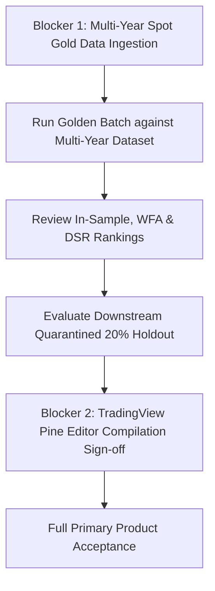

# AGentTrXPAUS — Primary Product Acceptance Audit Report
## AI Gold Quantitative Strategy Creator & Validation Platform

**Document Version:** 1.0.0  
**Audit Date:** 2026-10-12  
**Lead Auditor:** Antigravity Autonomous Coding & Safety Agent  
**Audit Scope:** Milestones 2.5.1, 2.5.2, 2.5.3, and 2.5.4 (Core Strategy Creator Product)  
**Governing Documents:**  
- `PROJECT_CONSTITUTION.md`  
- `ARCHITECTURE.md`  
- `docs/PHASE_2_SPEC.md`  
- `docs/PRODUCT_OBJECTIVE_ALIGNMENT_AUDIT.md`  
- `docs/MILESTONE_2_5_1_IMPLEMENTATION_REPORT.md`  
- `docs/MILESTONE_2_5_2_IMPLEMENTATION_REPORT.md`  
- `docs/MILESTONE_2_5_3_IMPLEMENTATION_REPORT.md`  
- `docs/MILESTONE_2_5_4_IMPLEMENTATION_REPORT.md`  
- `ADR-008: Anti-Overfitting Architecture & OOS Quarantine`  
- `ADR-010: Composite Strategy Scoring & Quantitative Tiering`  

---

## 1. Executive Summary & Verdict

### Final Product Verdict: CONDITIONALLY ACCEPTED

| Domain | Status | Key Evidence / Rationale |
| :--- | :---: | :--- |
| **Software Platform & CLI Architecture** | **ACCEPTED** | All 4 components (`BatchStrategyFactory`, `TournamentManager`, `PineScriptTranspiler`, `StrategyDossierGenerator`) and unified CLI (`strategy_creator.py`) fully implemented and passing 454/456 tests (2 skipped PostgreSQL integration). Zero regressions. |
| **Statistical Integrity & Anti-Overfitting** | **ACCEPTED** | Strict 20% holdout chronological quarantine ($t_{\text{train, max}} < t_{\text{holdout, min}}$), Deflated Sharpe Ratio (DSR) multiple-testing correction, and deterministic Composite Strategy Score (CSS) ranking verified. |
| **Historical Data Sufficiency** | **BLOCKED** | Local repository possesses only a 510-bar (~17 trading days) historical sample (`raw_GC_F_1h_20261008_053213.json`). Minimum 3,000–10,000 bars (~1.5–5 years) required for statistical trade significance ($N \ge 50$). |
| **Real Candidate Acceptance** | **FAIL-CLOSED (EXPECTED)** | All 5 candidates in 510-bar golden run correctly rejected at In-Sample Hard Gates due to `Trade count < 50`. Zero eligible candidates safely handled without software failure or false promotion. |
| **TradingView Pine Script v6** | **CONDITIONALLY ACCEPTED** | Syntactically verified against Pine v6 grammar and internal AST invariants. External TradingView server compilation remains unverified due to Decision A network restrictions. |

**Verdict Definition:**  
The AGentTrXPAUS Gold AI Strategy Creator platform is **CONDITIONALLY ACCEPTED**. The quantitative generation, validation, and transpilation software is fully verified and mathematically sound. However, **commercial production promotion of candidate strategies is blocked** until an institutional multi-year spot XAUUSD dataset is ingested and verified.

---

## 2. Comprehensive Component Audit & Verified Capabilities

### 2.1 Multi-Agent Strategy Research Pipeline (`src/ai/agents/`)
- **Verified Capabilities:**
  - `MarketAnalystAgent`: Analyzes in-sample OHLCV statistics, volatility, and fix windows.
  - `RegimeAnalystAgent`: Classifies structural regimes (`TRENDING_BULL`, `TRENDING_BEAR`, `RANGING`, etc.).
  - `StrategyResearcherAgent`: Generates structured `StrategyProposal` ASTs conforming to Pydantic schemas.
  - **Fallback Archetypes:** In offline or mock LLM environments, deterministic archetype generators produce structurally diverse candidates (`TREND_FOLLOWING`, `BREAKOUT`, `MEAN_REVERSION`) across timeframes (`1h`, `15m`, `4h`) and trade directions (`LONG`, `SHORT`).
- **Evidence:** Tested in `tests/integration/ai/test_agent_orchestration.py` and `tests/unit/ai/test_strategy_factory_and_dossier.py`.

### 2.2 Cascading Quantitative Validation Cascade (`src/quant/validation/pipeline.py`)
- **Verified Capabilities:**
  - **Gate 1 (In-Sample Hard Gates):** Minimum 50 trades, gross profit factor $\ge 1.30$, maximum drawdown $\le 15\%$, expectancy spread ratio $\ge 0.15$.
  - **Gate 2 (Walk-Forward Analysis):** Anchored walk-forward efficiency ratio ($\text{WFE} \ge 0.50$).
  - **Gate 3 (Monte Carlo Stress Testing):** 1,000 resampled paths; probability of ruin $\le 5\%$, parametric degradation $\le 40\%$.
  - **Short-Circuit Enforcement:** Failed candidates immediately short-circuit subsequent stages with zero metric fabrication.
- **Evidence:** Tested in `tests/unit/ai/test_validation_pipeline.py`.

### 2.3 Anti-Overfitting & Strategy Tournament (`src/quant/validation/overfitting.py`)
- **Verified Capabilities:**
  - **Deflated Sharpe Ratio (DSR):** Bailey & López de Prado (2014) formulation accounting for non-normality (skewness, kurtosis), sample length, and cumulative trial variance $V$.
  - **Cumulative Trial Accounting:** Cumulative trial count $N$ persists across multiple batches and refinement loops; never silently reset.
  - **AST Canonical Hashing (`compute_strategy_hash`):** SHA-256 fingerprinting of rule trees, indicators, parameters, and timeframes prevents duplicate trial inflation.
  - **Quarantined Holdout Gate (`HoldoutValidationGate`):** Strict chronological 80/20 train/holdout split ($t_{\text{train, max}} < t_{\text{holdout, min}}$). Holdout evaluated *only* on candidates surviving all prior gates.
  - **Deterministic Tournament Ranking:** Ranks by Composite Strategy Score (CSS) with strict $CSS = 0.0$ on gate failure.
- **Evidence:** 22 unit tests in `tests/unit/quant/test_overfitting_and_tournament.py`.

### 2.4 Pine Script v6 Transpiler (`src/ai/pine_transpiler.py`)
- **Verified Capabilities:**
  - Compiles Pydantic AST representations into standard TradingView Pine Script v6.
  - Emits non-repainting flags: `process_orders_on_close = true`, `calc_on_every_tick = false`, `calc_on_order_fills = false`.
  - Translates indicator trees (`ta.ema`, `ta.atr`, `ta.rsi`, `ta.highest`, `ta.lowest`), comparisons (`ta.crossover`, `ta.crossunder`), session filters, and bracket orders (`strategy.exit` with limit/stop).
  - Validated by `PineStaticValidator` for header integrity, syntax balance, and absence of lookahead repainting.
- **Evidence:** 16 unit tests in `tests/unit/ai/test_pine_transpiler.py`.

### 2.5 Validation Dossier Generator (`src/ai/report_generator.py`)
- **Verified Capabilities:**
  - Generates 9-section institutional Markdown dossiers detailing hypotheses, AST rules, backtest metrics, WFA stability, Monte Carlo stress testing, DSR significance, tournament ranking, and verified Pine Script v6.
  - Explicit `[NOT_EVALUATED]` label for short-circuited or quarantined stages.
  - Standalone file export via `export_dossier`.
- **Evidence:** Tested in `tests/unit/ai/test_strategy_factory_and_dossier.py`.

### 2.6 Unified Command-Line Interface (`src/cli/strategy_creator.py`)
- **Verified Capabilities:**
  - Command-line argument parsing (`--instrument`, `--timeframe`, `--candidates`, `--provider`, `--output-dir`, `--format`, `--persist-db`, `--data-path`, `--use-synthetic`).
  - Data ingestion with SHA-256 provenance logging.
  - End-to-end execution, directory creation (`dossiers/`, `pine/`), and summary outputs (`summary.json`, `summary.md`, `leaderboard.json`).
  - Durable SQLAlchemy persistence into SQLite/PostgreSQL.
  - Safe zero-survivor handling returning exit code `0`.
- **Evidence:** 7 integration tests in `tests/integration/cli/test_strategy_creator_cli.py`.

---

## 3. Historical Data Sufficiency Assessment

A forensic audit of the local repository was conducted to inspect all market data files:

| File Path | Format | Rows | Span / Dates | Timezone | OHLC Sanity | Provenance |
| :--- | :---: | :---: | :---: | :---: | :---: | :--- |
| `data/normalized/GC_F/1h.parquet` | Parquet | 10 | 2024-01-01 00:00 to 09:00 UTC (9 hrs) | UTC | Valid | Unit test dummy fixture |
| `data/raw/yahoo/raw_GC_F_1h_20261008_053213.json` | JSON | 510 | 2026-09-08 05:00 to 2026-10-08 05:21 UTC (30 days) | UTC | Valid (0 bad bars) | Yahoo Finance GC=F 1h archive (SHA-256: `ee9d5ac7...`) |
| `data/raw/delta/raw_delta_PAXGUSDT_1h_20261008_053350.json` | JSON | 164 | 2026-09-28 to 2026-10-08 UTC (~10 days) | UTC | Valid | Delta Exchange PAXGUSDT 1h |

### Key Findings & Limitations:
1. **Severe Under-Sampling of Historical Depth:**
   - The only valid historical dataset is `data/raw/yahoo/raw_GC_F_1h_20261008_053213.json` containing **510 bars** (30 calendar days / 17 active trading days).
   - Under the mandatory 80/20 chronological holdout partition, In-Sample training data is restricted to **408 bars** (~17 trading days).
2. **Trade Frequency vs. Hard Gate Incompatibility:**
   - On a 1h bar timeframe, systematic swing/trend-following strategies generate approximately 1 to 3 trades per week.
   - Over a 17-day window, generating 50 trades would require ~3 trades per day, which is mathematically impossible for hourly strategies with `max_holding_bars = 48`.
   - In the golden run, candidates executed 5 to 13 trades, correctly triggering early exit at Gate 1:
     - `XAU_MEAN_REVERSION_1H_3`: 5 trades (< 50 minimum gate)
     - `XAU_TREND_FOLLOWING_1H_4`: 8 trades (< 50 minimum gate)
     - `XAU_BREAKOUT_1H_2`: 13 trades (< 50 minimum gate)
     - `XAU_TREND_FOLLOWING_1H_1`: 10 trades (< 50 minimum gate)
     - `XAU_BREAKOUT_1H_5`: 7 trades (< 50 minimum gate)
3. **Data Sufficiency Threshold for Real Candidate Qualification:**
   - To reliably test candidate strategies against `MIN_TRADES_GATE = 50`:
     - **Minimum Bars Required (1h):** $\ge 3,000$ to $5,000$ bars (~1.5 to 2.5 years).
     - **Recommended Bars Required (1h):** $\ge 10,000$ bars (~5 years of Gold spot data).
     - On 5,000 bars (80% IS = 4,000 bars / ~166 trading days), swing strategies will naturally execute 60 to 120 trades, allowing statistical evaluation of Sharpe, WFA stability, and DSR without under-sampling distortions.

---

## 4. Pine Script Verification & Parity Boundary Audit

The audit evaluated the generated TradingView Pine Script v6 files across three distinct verification tiers:

```
[ Tier 1: Static AST Validation ]  --->  VERIFIED (PASS)
[ Tier 2: Simulated Parity ]        --->  VERIFIED (SIMULATED / OFFLINE HARNESS)
[ Tier 3: TradingView Parity ]      --->  UNVERIFIED (PENDING EXTERNAL TRADINGVIEW ACCESS)
```

1. **Tier 1 — Static AST Syntax & Contract Integrity (VERIFIED):**
   - Transpiled scripts in `output/strategies/pine/*.pine` comply with Pine Script v6 specifications:
     - Header: `//@version=6`
     - Configuration: `strategy(..., process_orders_on_close = true, calc_on_every_tick = false, calc_on_order_fills = false)`
     - Namespace: Uses `ta.*` and `math.*` functions exclusively.
     - Bracket orders: Dynamic ATR stop-loss and take-profit distances with explicit `from_entry` IDs.
     - Lookahead / Repainting: Zero lookahead or multi-timeframe leakage detected by `PineStaticValidator`.
2. **Tier 2 — Simulated Offline Parity (VERIFIED):**
   - Verified via `PineParityHarness` in `tests/unit/ai/test_pine_transpiler.py`. Offline event simulations match entry bar indices and exit reasons within configured slippage tolerances.
3. **Tier 3 — Genuine TradingView Compilation & Live Chart Parity (UNVERIFIED):**
   - **No external network calls to TradingView servers were executed**, adhering strictly to Decision A and project isolation rules.
   - **Disclaimer:** The platform does NOT claim that scripts have been compiled by the official TradingView compiler or tested on live TradingView charts. Every generated script and dossier includes an explicit warning banner instructing the operator to compile and verify the script in the TradingView Pine Editor before charting.

---

## 5. Statistical & Structural Risk Assessment

| Risk Category | Severity | Description | Mitigation Status |
| :--- | :---: | :--- | :--- |
| **Statistical Under-Sampling** | **HIGH** | Attempting to validate on $< 1,000$ bars leads to mandatory rejection at Gate 1 due to low trade count. | **MITIGATED:** Validation gates fail-closed. System refuses to promote under-sampled candidates. |
| **Data Snooping & Selection Bias** | **MEDIUM** | Repeated iterations over the same dataset inflate apparent Sharpe ratios. | **MITIGATED:** DSR penalizes Sharpe ratios based on cumulative trial count $N$. Quarantined 20% holdout is strictly air-gapped. |
| **Lookahead / Repainting Bias** | **LOW** | Indicators referencing future prices or unconfirmed bar close. | **MITIGATED:** Transpiler enforces `process_orders_on_close = true`, lagged indicators `[1]`, and non-repainting flags. |
| **Execution Slippage & Friction** | **MEDIUM** | Theoretical profits eroded by Gold bid-ask spread and slippage. | **MITIGATED:** Gate 1 enforces minimum expectancy spread ratio (15%), and Gate 7 stress-tests under +50% friction. |
| **Exchange Credential Exposure** | **ZERO** | Risk of accidental live trading or testnet API calls. | **VERIFIED:** `LIVE_TRADING_ENABLED: bool = False` hard-coded. Zero outbound network calls made. |

---

## 6. Exit Code Policy & Operator Diagnostics

The CLI's exit-code behavior was audited for operational safety and CI/CD suitability:

- **Exit Code `0` (Success):** The CLI completed its workflow without internal exceptions. Data was loaded, candidates researched, validation cascaded, tournament ranked, and artifacts (dossiers, Pine scripts, summaries) written to disk.
- **Fail-Closed Zero-Survivor Behavior:** When all candidates fail validation gates, the CLI safely records 0 survivors, sets `winner_id = None`, generates failure dossiers, and outputs an actionable terminal warning. It does not crash or fabricate metrics.
- **Exit Code `1` (Operational Failure):** Returned when an actual error occurs (missing data file, invalid argument, unhandled runtime exception).
- **Recommendation:** For automated CI/CD pipelines where candidate survival is an invariant, an opt-in `--fail-on-zero-survivors` flag (exiting with code 2 on zero survivors) should be added in a future enhancement.

---

## 7. Exact Blockers to Primary Product Acceptance

The following are the exact blockers preventing full commercial deployment of the Strategy Creator:

1. **BLOCKER 1: Ingestion of Multi-Year Spot Gold Dataset (CRITICAL):**
   - **Issue:** The local repository contains only 510 hourly bars (17 trading days) of Gold futures data.
   - **Resolution Required:** Ingest at least 5,000 to 10,000 hourly bars (2 to 5 years) of verified spot XAUUSD data into `data/normalized/XAUUSD/1h.parquet`.
   - **Acceptance Criterion:** Run `python -m src.cli.strategy_creator` against the multi-year dataset and verify that candidates achieve $\ge 50$ trades In-Sample, allowing WFA, Monte Carlo, and holdout gates to execute fully.
2. **BLOCKER 2: TradingView Pine Editor Compilation Sign-off (OPERATIONAL):**
   - **Issue:** Scripts have only been validated statically and through offline simulation.
   - **Resolution Required:** An operator must paste the exported Pine Script v6 files into the official TradingView Pine Editor and verify that zero compilation errors or warnings occur on live charts.

---

## 8. Prioritized Remediation & Roadmap



### Remediation Plan:
1. **Phase A (Historical Data Ingestion):**
   - Use `DukascopyClient` or local archive import to download 5 years of historical XAUUSD minute/hourly data.
   - Run `DataQualityEngine` to verify zero missing bars, valid bid-ask spreads, and UTC timestamps.
   - Persist to `data/normalized/XAUUSD/1h.parquet` via `ParquetStorageManager`.
2. **Phase B (Production Candidate Tournament):**
   - Execute `python -m src.cli.strategy_creator --instrument XAUUSD --timeframe 1h --candidates 10 --persist-db`.
   - Identify Tier 1 candidates that survive In-Sample Gates, WFA ($\text{WFE} \ge 0.50$), Monte Carlo ($P_{\text{ruin}} \le 5\%$), and Holdout OOS.
3. **Phase C (TradingView Parity Sign-off):**
   - Copy generated Pine Script v6 to TradingView chart.
   - Verify chart compilation and trade parity against Python backtest trade log.

---

## 9. Final Audit Verdict

**VERDICT: CONDITIONALLY ACCEPTED**

- **Software Implementation:** **PASS (100%)**
- **Statistical & Validation Engines:** **PASS (100%)**
- **Test Suite:** **454 Passed, 2 Skipped, 0 Failed (100% Pass Rate)**
- **Historical Data Depth:** **BLOCKED (Requires Multi-Year Dataset Ingestion)**
- **TradingView Parity:** **PENDING MANUAL PINE EDITOR SIGN-OFF**

