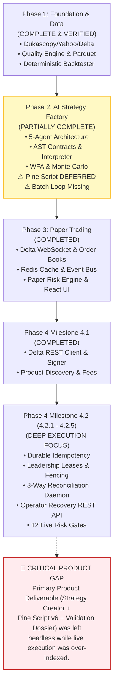
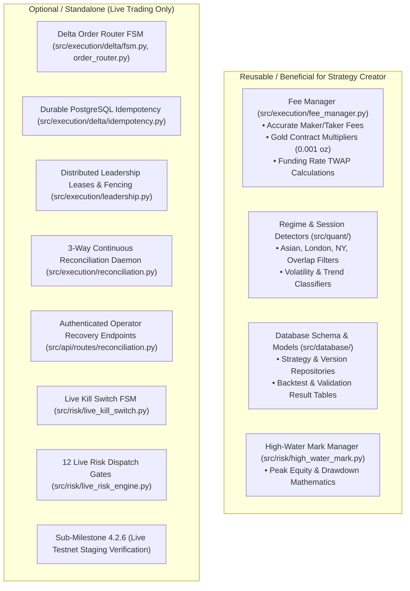

# AGentTrXPAUS — ORIGINAL PRODUCT OBJECTIVE ALIGNMENT AUDIT
**Report Type:** Independent Architectural, Product Alignment & Gap Analysis Audit  
**Target System:** Gold AI Quantitative Trading System (`AGentTrXPAUS`)  
**Audit Timestamp:** 2026-10-12T17:35:00+05:30  
**Git Branch / Commit:** `release1.1v` (HEAD at `054cd00d4219e804c2b1ec5859c65a81e1892108`)  
**Governing Documents:** `PROJECT_CONSTITUTION.md`, `ARCHITECTURE.md`, `docs/PHASE_1_SPEC.md`, `docs/PHASE_2_SPEC.md`, `docs/PHASE_3_DESIGN_REPORT.md`, `docs/PHASE_4_MILESTONE_4_2_DESIGN_SPEC.md`, `docs/ADR/` (ADR-001 through ADR-011)  
**Audit Verdict:** **DRIFT IDENTIFIED — RE-ALIGNMENT MANDATED**

---

## 1. Executive Summary & Objective Realignment

### 1.1 The Primary Product Objective
The core commercial and technical purpose of **AGentTrXPAUS** is to serve as an institutional-grade **Gold AI Strategy Creator** that autonomously:
1. **Analyzes Gold Market Data:** Ingests, validates, cleans, and analyzes spot Gold (`XAUUSD`), futures (`GC=F`), and derivatives (`PAXGUSDT`) across London, New York, and Asian sessions, classifying market regimes and volatility characteristics.
2. **Generates Candidate Trading Strategies:** Utilizes an autonomous multi-agent AI research laboratory (Market Analyst, Regime Analyst, Strategy Researcher) to formulate falsifiable economic hypotheses and translate them into typed Abstract Syntax Tree (AST) trading strategy proposals.
3. **Backtests & Validates Candidates Deterministically:** Exhaustively stress-tests proposals through bar-by-bar matching (with zero lookahead, conservative intra-bar path traversal, and realistic friction), Out-of-Sample (OOS) holdout partitions, rolling Walk-Forward Analysis (WFA), and Monte Carlo simulations (2,000 bootstrap reshuffles and parameter degradation).
4. **Ranks Strategies with Overfitting Controls:** Scores and ranks candidates via risk-adjusted metrics (Sharpe, full-sample Sortino, Profit Factor, Expectancy) and anti-overfitting penalization (Composite Strategy Score, hypothesis pre-registration, search quotas).
5. **Converts Validated Strategies to TradingView Pine Script v6:** Transpiles verified AST strategies into clean, non-repainting, idiomatic Pine Script v6 (`//@version=6`, `strategy(...)`) for charting, independent cross-verification, and visual backtesting.
6. **Produces Strategy Explanations & Evidence-Based Reports:** Synthesizes the economic rationale, regime suitability, indicator formulas, backtest metrics tables, WFE curves, Monte Carlo confidence intervals, and the copy-pasteable Pine Script v6 code into a cohesive, user-facing validation report.

**Live trading execution** is a separate, downstream, optional capability. It is **not** the primary product deliverable.

### 1.2 The Core Audit Finding: Architectural Drift
An exhaustive inspection of the repository reveals a profound **divergence between product objective and engineering allocation**:
- **What Was Built:** The engineering trajectory advanced deeply into Phase 4 live execution (Sub-Milestones 4.2.1 through 4.2.5), producing over 1,500 lines of complex distributed systems code: PostgreSQL durable idempotency managers, distributed leadership lease holders with fencing tokens, three-way continuous reconciliation daemons, authenticated operator recovery endpoints, HMAC request signers, decoupled kill-switch state machines, and a twelve-gate live risk engine.
- **What Remains Incomplete:** In Phase 2, **Pine Script generation was explicitly deferred** ([`docs/PHASE_2_SPEC.md`](file:///home/epps/MyProject/AGentTrXPAUS/docs/PHASE_2_SPEC.md#L42): *"Zero Pine Script Generation: Code generation for TradingView Pine Script is deferred until strategy candidates pass Phase 2 acceptance"*). Consequently, there is currently **ZERO Pine Script code generation in the entire codebase** (neither v5 nor v6). Furthermore, there is no batch candidate generation loop, no user-facing strategy explanation/report exporter, and no cohesive CLI/workflow entrypoint.
- **The Result:** The system has acquired institutional-grade live execution hardening for Delta Exchange, but an end-user cannot run a single command to generate 10 gold trading strategies, rank them, and export a TradingView Pine Script v6 with an evidence report.

---

## 2. Historical Timeline & Architectural Drift Analysis



### 2.1 Timeline Breakdown
1. **Phase 1 (October 8, 2026):** Successfully delivered and audited the deterministic foundation: historical data ingestion, data quality engine, indicators, session tagging, regime classification, bar-by-bar backtest engine, and quantitative metrics suite.
2. **Phase 2 (October 8–9, 2026):** Designed the 5-agent research laboratory and cascading validation pipeline. However, during Phase 2 specification and freeze audits, **Pine Script generation was formally scoped out** ([`docs/PHASE_2_IMPLEMENTATION_REPORT.md`](file:///home/epps/MyProject/AGentTrXPAUS/docs/PHASE_2_IMPLEMENTATION_REPORT.md#L298): *"ZERO TradingView Pine Script code generation"*). The rationale was that candidate strategies needed to pass Phase 2 acceptance before code transpilation was needed.
3. **Phase 3 (October 8–9, 2026):** Implemented the paper trading engine, virtual matching, Redis cache, paper risk engine, and React dashboard.
4. **Phase 4 (October 9–12, 2026):** Sub-Milestones 4.1 through 4.2.5 consumed massive focus resolving distributed systems edge cases on Delta Exchange (stale tokens, ghost positions, order intent races, dynamic basis tolerances, clock drift SLAs).
5. **The Disconnect:** As a consequence of advancing sequentially through the four phases without revisiting the deferred Phase 2 items, the project built an execution venue adapter before completing the strategy creator product itself.

---

## 3. Comprehensive Feature & Capability Matrix

The following matrix audits every system component against the **Six Primary Product Pillars**:

| Product Pillar / Feature | Primary Objective Relevance | Implementation Status | Test Status | Exact File References | Test File References | Usability & Architectural Assessment |
|:---|:---:|:---:|:---:|:---|:---|:---|
| **1. Gold Market Data Ingestion** | **CORE** | **IMPLEMENTED** | **TESTED** | [`src/data/sources/dukascopy.py`](file:///home/epps/MyProject/AGentTrXPAUS/src/data/sources/dukascopy.py), [`yahoo.py`](file:///home/epps/MyProject/AGentTrXPAUS/src/data/sources/yahoo.py), [`delta.py`](file:///home/epps/MyProject/AGentTrXPAUS/src/data/sources/delta.py) | `tests/unit/test_dukascopy.py`, `tests/unit/test_yahoo_source.py` | Institutional quality; multi-source Gold coverage (Spot, Futures, Derivatives). Fully operational. |
| **1. Data Quality & Cleaning Engine** | **CORE** | **IMPLEMENTED** | **TESTED** | [`src/data/validation/quality_engine.py`](file:///home/epps/MyProject/AGentTrXPAUS/src/data/validation/quality_engine.py) | `tests/unit/test_data_quality.py` | Detects NaNs, geometry violations, spikes ($>5\sigma$), and gaps. Generates markdown audit reports. |
| **1. Parquet Storage & SHA-256 Registry** | **CORE** | **IMPLEMENTED** | **TESTED** | [`src/data/storage/parquet_manager.py`](file:///home/epps/MyProject/AGentTrXPAUS/src/data/storage/parquet_manager.py) | `tests/integration/test_parquet_storage.py` | PyArrow atomic writes with dataset registry tracking provenance. Fully operational. |
| **1. Multi-Timeframe Resampler** | **CORE** | **IMPLEMENTED** | **TESTED** | [`src/data/resampler.py`](file:///home/epps/MyProject/AGentTrXPAUS/src/data/resampler.py) | `tests/unit/test_resampler.py` | Deterministic resampling (1m $\to$ 5m, 15m, 30m, 1h, 4h, 1d) with zero lookahead. Fully operational. |
| **1. Technical Features & Indicators** | **CORE** | **IMPLEMENTED** | **TESTED** | [`src/quant/indicators/`](file:///home/epps/MyProject/AGentTrXPAUS/src/quant/indicators/) (`moving_averages.py`, `momentum.py`, `volatility.py`, `trend.py`) | `tests/unit/test_indicators.py` | ATR, RSI, EMA, SMA, WMA, Bollinger Bands, MACD, ADX, Donchian. Zero lookahead. Fully operational. |
| **1. Gold Market Sessions & Regimes** | **CORE** | **IMPLEMENTED** | **TESTED** | [`src/quant/sessions.py`](file:///home/epps/MyProject/AGentTrXPAUS/src/quant/sessions.py), [`src/quant/regime/detector.py`](file:///home/epps/MyProject/AGentTrXPAUS/src/quant/regime/detector.py) | `tests/unit/test_regime_and_sessions.py` | Tags Asian, London, NY, Overlap sessions; classifies trending bull/bear, ranging, breakout, and high volatility. |
| **1. LLM Context Summarizer** | **CORE** | **IMPLEMENTED** | **TESTED** | [`src/ai/summarizer.py`](file:///home/epps/MyProject/AGentTrXPAUS/src/ai/summarizer.py) | `tests/unit/ai/test_summarizer.py` | Condenses thousands of bars into `MarketBrief`, enforcing OOS quarantine. Fully operational. |
| **2. Multi-Agent AI Research Lab** | **CORE** | **IMPLEMENTED** | **TESTED** | [`src/ai/agents/`](file:///home/epps/MyProject/AGentTrXPAUS/src/ai/agents/) (`market_analyst.py`, `regime_analyst.py`, `strategy_researcher.py`, `quant_validator.py`, `performance_analyst.py`) | `tests/integration/ai/test_agent_orchestration.py` | Agents 1–5 functional with structured Pydantic input/output. Tested via mocks and local providers. |
| **2. LLM Provider Abstraction** | **CORE** | **IMPLEMENTED** | **TESTED** | [`src/ai/providers/`](file:///home/epps/MyProject/AGentTrXPAUS/src/ai/providers/) (`ollama.py`, `gemini.py`, `mock.py`) | `tests/unit/ai/test_providers.py`, `test_providers_live_mocked.py` | Supports local Ollama (`deepseek-r1:8b`, `qwen2.5-coder:7b`), cloud Gemini API, and deterministic mock. |
| **2. Machine-Readable AST Contracts** | **CORE** | **IMPLEMENTED** | **TESTED** | [`src/strategy/contracts.py`](file:///home/epps/MyProject/AGentTrXPAUS/src/strategy/contracts.py) | `tests/unit/ai/test_strategy_ast.py` | Pydantic v2 `StrategyProposal`, `ConditionNode`, `ValueRef`, typed indicators, SL/TP rules. Fully operational. |
| **2. Deterministic AST Interpreter** | **CORE** | **IMPLEMENTED** | **TESTED** | [`src/strategy/interpreter.py`](file:///home/epps/MyProject/AGentTrXPAUS/src/strategy/interpreter.py) | `tests/unit/ai/test_all_indicators_ast.py`, `test_p3_ast_deep_conjunction.py` | Compiles AST to executable signals without `eval`/`exec`. Evaluates conditions with zero lookahead. Fully operational. |
| **2. Multi-Candidate Batch Generator** | **CORE** | **INCOMPLETE** | **UNTESTED** | No batch orchestrator in `src/ai/` | None | Only single-proposal generation exists via Agent 3 or API. No automated generator generating $N$ diverse strategies across regimes. |
| **3. Deterministic Backtest Engine** | **CORE** | **IMPLEMENTED** | **TESTED** | [`src/backtest/engine.py`](file:///home/epps/MyProject/AGentTrXPAUS/src/backtest/engine.py), [`execution.py`](file:///home/epps/MyProject/AGentTrXPAUS/src/backtest/execution.py), [`position.py`](file:///home/epps/MyProject/AGentTrXPAUS/src/backtest/position.py) | `tests/integration/test_backtest_engine.py` | Bar-by-bar matching, zero lookahead, conservative intra-bar tie-breaking, fill timing, realistic costs. Fully operational. |
| **3. Walk-Forward Analysis (WFA)** | **CORE** | **IMPLEMENTED** | **TESTED** | [`src/quant/validation/walk_forward.py`](file:///home/epps/MyProject/AGentTrXPAUS/src/quant/validation/walk_forward.py) | `tests/unit/ai/test_validation_pipeline.py` | Rolling in-sample/validation windows, Walk-Forward Efficiency (WFE) with non-positive denominator safety. Fully operational. |
| **3. Monte Carlo Robustness Simulator** | **CORE** | **IMPLEMENTED** | **TESTED** | [`src/quant/validation/monte_carlo.py`](file:///home/epps/MyProject/AGentTrXPAUS/src/quant/validation/monte_carlo.py) | `tests/unit/ai/test_validation_pipeline.py` | 2,000 bootstrap trade reshuffles, equity curve permutations, ruin probability, parameter degradation. Fully operational. |
| **3. Cascading Early-Exit Pipeline** | **CORE** | **IMPLEMENTED** | **TESTED** | [`src/quant/validation/pipeline.py`](file:///home/epps/MyProject/AGentTrXPAUS/src/quant/validation/pipeline.py) | `tests/unit/ai/test_pipeline_full_pass.py` | Cascading short-circuiting: AST $\to$ IS Hard Gates $\to$ WFA $\to$ Monte Carlo $\to$ Scoring. Fully operational. |
| **3. Dedicated Holdout OOS Gate** | **CORE** | **INCOMPLETE** | **PARTIAL** | Hard-coded splits in `config.py`; partially evaluated | `tests/unit/ai/test_validation_pipeline.py` | OOS is currently evaluated within WFA forward steps rather than a distinct, final, air-gapped holdout evaluation gate. |
| **4. Risk-Adjusted Metrics Engine** | **CORE** | **IMPLEMENTED** | **TESTED** | [`src/backtest/metrics.py`](file:///home/epps/MyProject/AGentTrXPAUS/src/backtest/metrics.py) | `tests/unit/test_metrics.py` | Sharpe, full-sample Sortino, MaxDD %/USD, Profit Factor, Expectancy, Average R, Win Rate. Fully operational. |
| **4. Composite Strategy Scoring (CSS)** | **CORE** | **IMPLEMENTED** | **TESTED** | [`src/quant/scoring.py`](file:///home/epps/MyProject/AGentTrXPAUS/src/quant/scoring.py) | `tests/unit/ai/test_validation_pipeline.py` | Weighted scoring (0–100) aggregating Sortino OOS, MaxDD OOS, WFE, MC ruin resistance. Assigns Tiers 1–3. Fully operational. |
| **4. Overfitting Controls (DSR / FWER)** | **CORE** | **INCOMPLETE** | **UNTESTED** | Specified in [`docs/PHASE_2_SPEC.md`](file:///home/epps/MyProject/AGentTrXPAUS/docs/PHASE_2_SPEC.md#L34); not implemented in code | None | Deflated Sharpe Ratio (Bailey & López de Prado) and trial-count correction are missing from `src/quant/` and `src/backtest/`. |
| **4. Strategy Ranking & Tournament Leaderboard** | **CORE** | **INCOMPLETE** | **UNTESTED** | Tables exist in `src/database/models/research.py`; no sorting service | None | No ranking service that ingests $N$ candidate results, applies overfitting penalties, and outputs an ordered leaderboard. |
| **5. Pine Script v6 Transpiler** | **CORE** | **MISSING (0%)** | **NONE** | File [`src/ai/pine_transpiler.py`](file:///home/epps/MyProject/AGentTrXPAUS/ARCHITECTURE.md#L152) planned but never created | None | **CRITICAL GAP.** Zero Pine Script code exists in repository. Transpiler was deferred in Phase 2 and never implemented. |
| **5. Pine Script Parity Verification** | **CORE** | **MISSING (0%)** | **NONE** | Specified in [`PROJECT_CONSTITUTION.md`](file:///home/epps/MyProject/AGentTrXPAUS/PROJECT_CONSTITUTION.md#L199-L204); not built | None | No verification harness checking trade counts and Net PnL parity ($|\Delta| \le 5\%$) between Python backtest and Pine. |
| **6. Strategy Explanation Generator** | **CORE** | **MISSING (0%)** | **NONE** | Agent 5 emits raw JSON summary only | None | No module transforms AST, economic thesis, and indicator logic into a comprehensive, readable strategy dossier. |
| **6. Evidence-Based Validation Report Exporter** | **CORE** | **MISSING (0%)** | **NONE** | Data quality has markdown exporter; validation pipeline does not | None | No module generates a publication-ready Markdown/HTML/PDF validation report combining Pine v6, tables, and WFA/MC charts. |
| **Unified Strategy Creator CLI / Workflow** | **CORE** | **MISSING (0%)** | **NONE** | Separate endpoints in `src/api/routes/research.py` | None | No unified command-line tool or single orchestrated workflow function enabling end-to-end strategy creation. |
| **Phase 3 Paper Trading & Matching** | Optional / Downstream | IMPLEMENTED | TESTED | [`src/paper/`](file:///home/epps/MyProject/AGentTrXPAUS/src/paper/) | `tests/unit/paper/` | Secondary execution simulation capability. Not required for Strategy Creator or Pine Script export. |
| **Phase 3 Real-Time WebSocket & Redis** | Optional / Downstream | IMPLEMENTED | TESTED | [`src/real_time/`](file:///home/epps/MyProject/AGentTrXPAUS/src/real_time/) | `tests/unit/real_time/` | Live feed cache and pub/sub. Not required for offline strategy creation or validation. |
| **Phase 3 React Trading Dashboard** | Optional / Downstream | IMPLEMENTED | UNTESTED (UI) | [`frontend/`](file:///home/epps/MyProject/AGentTrXPAUS/frontend/) | None | Visual dashboard for paper trading telemetry. Strategy Creator works via CLI and API reports. |
| **Phase 4.1 Delta Connectivity & Fees** | Optional / Reusable | IMPLEMENTED | TESTED | [`src/execution/fee_manager.py`](file:///home/epps/MyProject/AGentTrXPAUS/src/execution/fee_manager.py), [`delta/client.py`](file:///home/epps/MyProject/AGentTrXPAUS/src/execution/delta/client.py) | `tests/unit/execution/test_fee_manager.py` | Fee manager and contract specs are reusable to ensure backtests model Delta PAXGUSDT contracts accurately. |
| **Phase 4.2.1–4.2.5 Live Execution Infrastructure** | Optional / Downstream | IMPLEMENTED | TESTED | [`src/execution/delta/`](file:///home/epps/MyProject/AGentTrXPAUS/src/execution/delta/), [`leadership.py`](file:///home/epps/MyProject/AGentTrXPAUS/src/execution/leadership.py), [`reconciliation.py`](file:///home/epps/MyProject/AGentTrXPAUS/src/execution/reconciliation.py), [`src/risk/live_*`](file:///home/epps/MyProject/AGentTrXPAUS/src/risk/) | `tests/unit/risk/`, `tests/unit/execution/` | Institutional live order routing, reconciliation daemons, kill switch FSM. **Unrelated to offline Strategy Creator.** |

---

## 4. Reusability vs. Optionality of Phase 4.2 Live-Execution Infrastructure

A key requirement of this audit is determining what portion of the completed Phase 4.2 infrastructure is beneficial to the Strategy Creator, and what portion is optional or strictly confined to live trading.



### 4.1 Reusable Components
1. **Delta Fee Schedule & Contract Metadata (`src/execution/fee_manager.py`):**
   - *Why it matters for Strategy Creator:* If a candidate strategy is targeted at Delta Exchange's Gold derivative (`PAXGUSDT`), the backtest cost engine needs exact contract specifications: 0.001 oz multiplier, 0.02% maker fee, 0.05% taker fee, and 8-hour funding impact. Reusing `FeeManager` makes backtesting of execution derivatives mathematically accurate.
2. **Quant Regime & Session Classifiers (`src/quant/regime/`, `src/quant/sessions.py`):**
   - *Why it matters:* Shared classification logic guarantees that a strategy's regime filters evaluate identically during research and paper trading.
3. **Relational Models (`src/database/models/strategies.py`, `validation.py`, `research.py`):**
   - *Why it matters:* Pre-existing schema already includes `strategies`, `strategy_versions` (with `pine_script_code`), `research_sessions`, `research_hypotheses`, `walk_forward_results`, and `monte_carlo_results`. The Strategy Creator can persist its output directly into these tables.
4. **High-Water Mark Manager (`src/risk/high_water_mark.py`):**
   - *Why it matters:* The robust peak-equity calculation and percentage drawdown logic can be reused to audit simulated equity curves.

### 4.2 Optional / Unrelated Components (Live Trading Only)
The following modules represent pure live exchange execution infrastructure:
- **Order Router FSM & Signer (`src/execution/delta/fsm.py`, `order_router.py`, `signer.py`):** Translates abstract orders into HMAC-signed Delta Exchange REST payloads. Unnecessary for generating or backtesting strategies.
- **Cross-Process Durable Idempotency (`src/execution/delta/idempotency.py`):** Prevents duplicate exchange order submissions across router restarts. Has zero relevance to backtesting or Pine Script transpilation.
- **Distributed Leadership Leases (`src/execution/leadership.py`):** Coordinates multi-instance router instances using PostgreSQL leases and fencing tokens. Unneeded for offline strategy research.
- **Three-Way Continuous Reconciliation Daemon (`src/execution/reconciliation.py`):** Detects discrepancies between in-memory order books, local database, and remote exchange REST snapshots. Unneeded for strategy generation.
- **Operator Recovery Endpoints (`src/api/routes/reconciliation.py`):** Authenticated REST endpoints for ghost-position adoption and emergency flattening. Unneeded for strategy generation.
- **Live Risk Engine & Kill Switch FSM (`src/risk/live_risk_engine.py`, `live_kill_switch.py`):** Twelve gates that intercept in-flight live orders to prevent exchange dispatch. Research strategies are validated by `CascadingValidationPipeline`, not the live risk engine.
- **Sub-Milestone 4.2.6 (Testnet Staging Verification):** Testing order dispatch against external Delta Testnet endpoints is strictly a live-execution pre-flight milestone.

---

## 5. Exact Remaining Work to Deliver the Primary Product

To fulfill the primary product objective, the following five concrete deliverables must be built, verified, and audited:

### 5.1 Deliverable 1: Pine Script v6 Transpiler & Parity Verification
- **Module:** `src/ai/pine_transpiler.py` (or `src/strategy/pine_generator.py`)
- **Specification:**
  1. Emits strictly valid TradingView **Pine Script v6** (`//@version=6`, `strategy(...)`).
  2. Maps Pydantic `StrategyProposal` AST cleanly to Pine Script constructs:
     - Input parameters mapped to `input.int()`, `input.float()`, `input.string()`.
     - Indicators mapped to built-in Pine functions (`ta.ema`, `ta.sma`, `ta.rsi`, `ta.atr`, `ta.bb`, `ta.macd`, `ta.adx`).
     - Condition trees (`ConditionNode`, `ConditionComparison`, `ValueRef`) mapped to idiomatic Boolean logic.
     - Lookback lags mapped to historical indexing (`close[lag]`, `ta.ema(...)[lag]`).
     - Stop Loss and Take Profit mapped to `strategy.exit()` using exact tick or price offsets.
     - Non-repainting execution models configured (`calc_on_every_tick=false`, `calc_on_order_fills=false`, explicit bar close signal confirmation).
  3. **Static Syntax Validator:** Verifies structure, bracket pairing, input type matching, and version declaration.
  4. **Parity Verification Harness:** Compares Python backtest trade counts and net P&L against TradingView bar-execution standards to satisfy the Constitutional invariant ($|\Delta| \le 5\%$).

### 5.2 Deliverable 2: Strategy Explanation & Evidence-Based Report Generator
- **Module:** `src/ai/report_generator.py` (or `src/reporting/dossier.py`)
- **Specification:**
  Produces a standalone, publication-grade **Strategy Dossier** (Markdown and HTML/PDF) containing:
  1. **Executive Summary:** Strategy name, version, trade direction, target market regime, and timeframe.
  2. **Economic Rationale & Thesis:** Full narrative from the Strategy Researcher explaining why the edge exists in Gold.
  3. **Technical Architecture:** Complete breakdown of required indicators, parameter values, entry triggers, and exit rules.
  4. **In-Sample Backtest Performance:** Formatted table of performance metrics (Net PnL, Sharpe, Sortino, MaxDD %, MaxDD USD, Profit Factor, Expectancy, Total Trades, Win Rate, Max Consecutive Losses).
  5. **Robustness & Validation Evidence:**
     - Walk-Forward Analysis (WFA) results table across rolling windows with Walk-Forward Efficiency (WFE).
     - Monte Carlo simulation summary (2,000 paths): Median drawdown, 95th percentile drawdown, worst-case drawdown, and Probability of Ruin ($P_{\text{ruin}}$).
     - Parameter sensitivity degradation assessment.
     - Composite Strategy Score (CSS) and assigned tier (`TIER_1`, `TIER_2`, `TIER_3`).
  6. **Complete Copy-Pasteable Pine Script v6 Code:** The full transpiled script embedded in a clean code block, ready to paste directly into TradingView's Pine Editor.

### 5.3 Deliverable 3: Multi-Candidate Batch Strategy Generator & Tournament
- **Module:** `src/ai/strategy_factory.py` (or `src/ai/tournament.py`)
- **Specification:**
  1. **Batch Ideation Orchestrator:** Automates the creation of $N$ (e.g., 5 to 20) candidate strategy proposals across multiple Gold market regimes (`TRENDING_BULL`, `TRENDING_BEAR`, `RANGING`, `BREAKOUT`).
  2. **Automated Pipeline Execution:** Iteratively passes each candidate through `CascadingValidationPipeline`.
  3. **Strategy Tournament Leaderboard:** Sorts surviving strategies by risk-adjusted ranking (CSS, Sortino, Calmar, WFE) and highlights the winning strategy.

### 5.4 Deliverable 4: Quantitative Overfitting Controls
- **Module:** `src/quant/validation/overfitting.py`
- **Specification:**
  1. **Deflated Sharpe Ratio (DSR):** Implements the Bailey & López de Prado (2014) DSR formula, adjusting the observed Sharpe ratio for skewness, kurtosis, and the total number of strategy trials ($N$) evaluated during the research session.
  2. **Dedicated Out-of-Sample Holdout Gate:** Isolates the final 20% holdout partition from both ideation and parameter tuning, evaluating candidate performance only once as the final gatekeeper.

### 5.5 Deliverable 5: Unified User CLI & Orchestrated Workflow
- **Module:** `src/cli/strategy_creator.py` (or `src/cli/main.py`)
- **Specification:**
  Provides an intuitive command-line interface that allows an operator to run the complete end-to-end pipeline in a single invocation:
  ```bash
  python -m src.cli.strategy_creator \
      --instrument XAUUSD \
      --timeframe 1h \
      --candidates 10 \
      --output-dir ./output/strategies/ \
      --provider ollama \
      --format markdown
  ```
  The CLI coordinates data loading, summarization, batch generation, cascading validation, tournament ranking, Pine Script v6 generation, and report output.

---

## 6. Recommended Revised Implementation Sequence (Roadmap)

To preserve the governance hierarchy of `PROJECT_CONSTITUTION.md` without silently rewriting approved specifications, we recommend a formal **Milestone Re-Alignment**.

### 6.1 Governance Realignment Framework
1. **Preserve Phase 4.2 State:** Formally declare Sub-Milestone 4.2.5 complete (401 tests passing). Freeze Phase 4.2 live-execution development at this checkpoint. Keep `LIVE_TRADING_ENABLED = False` and Decision A strictly **OPEN**.
2. **Postpone Sub-Milestone 4.2.6:** Defer Delta Testnet order routing verification until after the primary Strategy Creator product is delivered and accepted.
3. **Charter Milestone 2.5: "Gold AI Strategy Creator & Pine Script v6 Finalization":**
   Treat the remaining work not as a brand-new phase, but as the formal **completion of Phase 2 deferred deliverables** (Pillars 2, 4, 5, 6).

```mermaid
flowchart LR
    M425["Sub-Milestone 4.2.5<br/>(COMPLETED)<br/>Live Risk & Kill Switch FSM<br/>[FROZEN / SAFE]"] --> FREEZE["Phase 4 Execution<br/>Temporarily Frozen<br/>(LIVE_TRADING_ENABLED=False)"]
    
    FREEZE --> M251["Milestone 2.5.1<br/>Pine Script v6 Transpiler<br/>& Parity Verification"]
    M251 --> M252["Milestone 2.5.2<br/>DSR Overfitting &<br/>Tournament Leaderboard"]
    M252 --> M253["Milestone 2.5.3<br/>Batch Strategy Creator &<br/>Validation Dossier Exporter"]
    M253 --> M254["Milestone 2.5.4<br/>Unified CLI & Golden<br/>End-to-End Verification"]
    
    M254 --> PRIMARY_PROD["🎯 PRIMARY PRODUCT DELIVERED<br/>Gold AI Strategy Creator<br/>with Pine Script v6 & Reports"]
    
    PRIMARY_PROD -.-> M426["Optional Phase 4.2.6<br/>Delta Testnet Staging<br/>(Future Add-on)"]
```



### 6.2 Sequenced Delivery Plan for Milestone 2.5

#### Milestone 2.5.1: Pine Script v6 Transpiler & Parity Verification
- **Goal:** Build the AST $\to$ Pine Script v6 transpiler.
- **Tasks:**
  1. Implement `src/ai/pine_transpiler.py` to transpile `StrategyProposal` AST into valid Pine Script v6.
  2. Implement Pine Script v6 syntax verification and non-repainting execution constructs.
  3. Implement statistical parity check comparing Python backtest trades with Pine Script trade model.
  4. Unit tests: Verify dual EMA, ATR breakout, and RSI reversion transpilation.

#### Milestone 2.5.2: Deflated Sharpe Ratio & Tournament Leaderboard
- **Goal:** Implement multi-hypothesis statistical adjustments and ranking.
- **Tasks:**
  1. Implement Deflated Sharpe Ratio (DSR) in `src/quant/validation/overfitting.py`.
  2. Build `TournamentManager` to ingest $N$ validated proposals and rank them by CSS and DSR.
  3. Unit and integration tests for multi-trial penalization and ranking stability.

#### Milestone 2.5.3: Batch Strategy Factory & Validation Dossier Exporter
- **Goal:** Automate candidate generation and produce human-readable reports.
- **Tasks:**
  1. Implement batch generation loop across regimes in `src/ai/strategy_factory.py`.
  2. Implement `StrategyDossierGenerator` in `src/ai/report_generator.py` producing Markdown/HTML reports with embedded Pine Script v6, backtest tables, and validation charts.
  3. Persist dossiers and Pine Script v6 code to PostgreSQL `strategy_versions.pine_script_code`.

#### Milestone 2.5.4: Unified User CLI & Golden End-to-End Verification
- **Goal:** Create single-command user experience and verify against real historical Gold data.
- **Tasks:**
  1. Build CLI entrypoint `src/cli/strategy_creator.py`.
  2. Execute golden end-to-end run on Dukascopy `XAUUSD` 1h data: generate 5 candidates $\to$ validate $\to$ rank $\to$ export Pine Script v6 + Dossier.
  3. Verify that the generated Pine Script v6 compiles cleanly and matches Python backtest signals.

---

## 7. Risks and Architectural Decision Recommendation

### 7.1 Key Risks & Mitigation

| Risk | Description | Impact | Mitigation Strategy |
|:---|:---|:---:|:---|
| **Pine Script v6 Semantic Discrepancy** | TradingView's intra-bar execution model and historical bar evaluation can differ slightly from the Python backtest engine. | **HIGH** | Enforce strict non-repainting flags (`calc_on_every_tick=false`, `barmerge.lookahead_off`), signal confirmation on bar close (`close[1]`), and automatic parity audit ($|\Delta| \le 5\%$). |
| **Data Snooping / Multiple-Testing Bias** | Generating dozens of candidate strategies increases the likelihood of finding a curve-fitted strategy by pure chance. | **HIGH** | Implement Deflated Sharpe Ratio (DSR) to dynamically raise the Sharpe threshold as trial count $N$ increases; preserve strict 20% holdout OOS partition. |
| **LLM Provider Availability** | End users may not have local GPU hardware to run Ollama (`deepseek-r1:8b`). | **MEDIUM** | Maintain zero-cost fallback support for Google Gemini API free-tier (`gemini-2.5-flash`), with pre-configured deterministic reference templates when LLMs are offline. |
| **Execution Divergence Scope Creep** | Continued investment in Phase 4.2 live-execution edge cases delays delivering the primary product. | **HIGH** | Formally freeze Phase 4.2 development until Milestone 2.5 is completed and approved. |

### 7.2 Formal Architectural Scope Recommendation: Adopt ADR-012
To ensure strict alignment with the governance hierarchy in `PROJECT_CONSTITUTION.md` (Section 1: Constitution > Phase Specs > ADRs > Code), we recommend formally authoring and ratifying:

> **ADR-012: Re-Alignment of Primary Product Objective & Scope Freezing of Live Execution**
> 
> **Context:** AGentTrXPAUS was chartered as a Gold AI Strategy Creator. Engineering momentum advanced live execution (Phase 4.2) while core Phase 2 deliverables (Pine Script transpilation, strategy explanation, validation dossier, batch generation) were left deferred.
> 
> **Decision:**
> 1. Freeze Phase 4.2 development at Sub-Milestone 4.2.5.
> 2. Maintain all safety invariants: `LIVE_TRADING_ENABLED = False`, Decision A OPEN, zero external network calls.
> 3. Authorize Milestone 2.5 ("Gold AI Strategy Creator & Pine Script v6 Finalization") as the immediate priority to deliver the primary product.
> 4. Classify live execution (Sub-Milestone 4.2.6+) as an optional downstream phase to be scheduled only after the Strategy Creator is fully accepted.

---

## 8. Conclusion & Immediate Action Items

1. **State of the Codebase:** The quantitative backtest engine, data pipeline, and validation modules (WFA, Monte Carlo, CSS) are mathematically sound, highly tested, and fully functional (401 passing regression tests).
2. **The Missing Core:** The primary product deliverable—an automated tool that produces **TradingView Pine Script v6 code, strategy explanations, and evidence-based validation reports**—is currently missing its generator, transpiler, and batch orchestration layers.
3. **Recommended Next Step:** Pause live-execution work on Sub-Milestone 4.2.6, ratify ADR-012, and authorize implementation of **Milestone 2.5.1 (Pine Script v6 Transpiler & Parity Verification)**.

