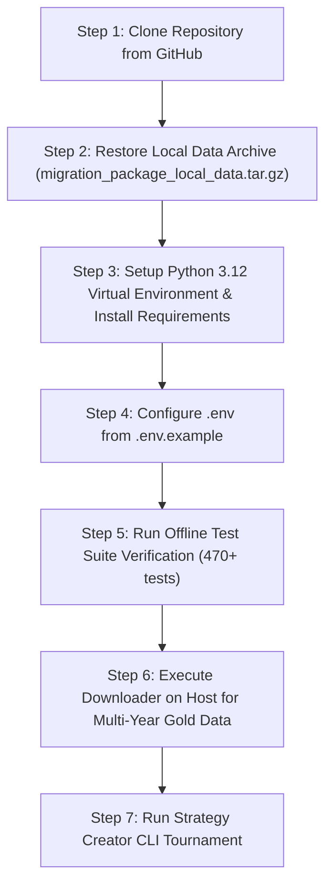

# AGentTrXPAUS — Windows Migration & Setup Guide

**Document:** `docs/WINDOWS_MIGRATION_GUIDE.md`  
**Date:** 2026-10-13  
**Target Platform:** Windows 10/11 (Native PowerShell / CMD or WSL2)  
**Governing Authority:** `PROJECT_CONSTITUTION.md`

---

## 1. Quick Start Overview

AGentTrXPAUS is built on standard Python 3.12, SQLAlchemy, Pandas, PyArrow, and FastAPI. It can be executed either directly in **Native Windows** (PowerShell / Windows Terminal) or inside **WSL2** (Windows Subsystem for Linux).



---

## 2. Prerequisites & Software Requirements

### 2.1 Essential Host Software
1. **Git for Windows:**
   - Download: [git-scm.com/download/win](https://git-scm.com/download/win)
   - Configuration recommended during installation:
     - Default editor: VS Code or Notepad
     - Line ending conversions: *Checkout as-is, commit Unix-style line endings* (`git config --global core.autocrlf input`)
2. **Python 3.12 (64-bit):**
   - Download: Python 3.12.x from [python.org/downloads](https://www.python.org/downloads/) or via Windows Package Manager:
     ```powershell
     winget install Python.Python.3.12
     ```
   - **Crucial:** Check the box **"Add python.exe to PATH"** during installation.
3. **C++ Build Tools (Optional / Fallback):**
   - Pre-built binary wheels exist for all required libraries (`numpy`, `pandas`, `pyarrow`, `scipy`, `greenlet`, `psycopg2-binary`). If wheel compilation is required, install *Microsoft C++ Build Tools*.

### 2.2 Optional Production Services
- **SQLite (Default Dev Database):** Built into Python standard library. Zero external installation needed.
- **Docker Desktop (Optional):** Only if you intend to run PostgreSQL 16 or Redis locally in containers.

---

## 3. Step-by-Step Native Windows Setup (PowerShell)

### Step 1: Clone the Repository
Open PowerShell or Windows Terminal:

```powershell
# Navigate to your preferred project directory
cd C:\Users\$env:USERNAME\Projects

# Clone repository
git clone -b release1.1v git@github.com:Kunal-dhadwal/gold-trade-agent-pax.git AGentTrXPAUS
cd AGentTrXPAUS
```

*(If using HTTPS instead of SSH)*:
```powershell
git clone -b release1.1v https://github.com/Kunal-dhadwal/gold-trade-agent-pax.git AGentTrXPAUS
cd AGentTrXPAUS
```

---

### Step 2: Restore Local Historical Data & Database
Copy `migration_package_local_data.tar.gz` from your USB drive, network share, or transfer location into the root of `AGentTrXPAUS`.

Extract the archive (Windows 10/11 includes `tar.exe` natively):
```powershell
tar -xzf migration_package_local_data.tar.gz
```

Verify restored files:
```powershell
# Check normalized parquet data
Get-ChildItem -Recurse data\normalized\

# Check SQLite database
Get-Item data\gold_trading.db
```

---

### Step 3: Create Virtual Environment and Install Dependencies

```powershell
# Create Python 3.12 virtual environment
py -3.12 -m venv .venv

# Activate virtual environment
.\.venv\Scripts\Activate.ps1

# Upgrade pip and install pinned requirements
python -m pip install --upgrade pip
pip install -r requirements.txt
```

> [!NOTE]
> If PowerShell blocks script execution with `Execution_Policies` error, run:
> ```powershell
> Set-ExecutionPolicy -ExecutionPolicy RemoteSigned -Scope CurrentUser
> ```

---

### Step 4: Environment Configuration

```powershell
# Create .env from template
Copy-Item .env.example .env
```

Open `.env` in your text editor. The default settings point to SQLite at `./data/gold_trading.db` and keep live trading locked out:
```dotenv
DATABASE_URL=sqlite+aiosqlite:///./data/gold_trading.db
LIVE_TRADING_ENABLED=false
PAPER_TRADING_ENABLED=true
```

---

### Step 5: Run Verification Test Suite

Run the full offline test suite:
```powershell
pytest tests/ -m "not live_delta" -v
```

Expected result:
```text
======================= 470 passed, 2 skipped in ~60-90s =======================
```
*(The 2 skipped tests are PostgreSQL-specific tests requiring a live external PostgreSQL instance).*

---

### Step 6: Download Multi-Year Gold Historical Data

Run the memory-safe downloader directly on your Windows host terminal with internet access:

```powershell
python scripts\download_dukascopy_gold.py `
    --symbol XAUUSD `
    --start 2021-01-01 `
    --end 2024-12-31 `
    --timeframe 1h `
    --out data\raw\external\XAUUSD_1h_2021_2024.csv
```

---

### Step 7: Certify Ingested Data & Run Strategy Creator Tournament

```powershell
# 1. Ingest and certify canonical Parquet dataset
python -m src.cli.import_dataset `
    --file data\raw\external\XAUUSD_1h_2021_2024.csv `
    --instrument XAUUSD `
    --timeframe 1h `
    --source DUKASCOPY `
    --expected-frequency 3600 `
    --manifest-out data\metadata\manifest_XAUUSD_1h.json

# 2. Execute Gold AI Strategy Tournament
python -m src.cli.strategy_creator `
    --instrument XAUUSD `
    --timeframe 1h `
    --candidates 20 `
    --output-dir .\output\tournament_xauusd_qualified `
    --provider mock `
    --format markdown
```

---

## 4. Alternative: WSL2 Setup (Ubuntu on Windows)

If you prefer an identical Linux environment on your Windows laptop:

1. In PowerShell as Administrator:
   ```powershell
   wsl --install -d Ubuntu-24.04
   ```
2. Open Ubuntu terminal, install Python 3.12:
   ```bash
   sudo apt update && sudo apt install -y python3.12 python3.12-venv python3-pip git
   ```
3. Follow the standard Linux steps:
   ```bash
   git clone -b release1.1v git@github.com:Kunal-dhadwal/gold-trade-agent-pax.git AGentTrXPAUS
   cd AGentTrXPAUS
   tar -xzf /mnt/c/Users/<your_user>/Downloads/migration_package_local_data.tar.gz
   python3.12 -m venv .venv
   source .venv/bin/activate
   pip install -r requirements.txt
   pytest tests/ -m "not live_delta"
   ```

---

## 5. Windows-Specific Compatibility Notes & Troubleshooting

| Area | Native Windows Behavior | Recommendation / Solution |
| :--- | :--- | :--- |
| **Path Separators** | Python `pathlib.Path` handles `/` and `\` automatically | All codebase paths use `Path("./data")` or `Path(...) / "subdir"`. No code modification required. |
| **Line Endings (CRLF vs LF)** | Git on Windows may convert LF to CRLF | Repository includes `.gitattributes` to force LF line endings on Python, JSON, and Markdown files. |
| **Asyncio Event Loop** | Windows uses `ProactorEventLoop` by default | Compatible with `aiosqlite`, `asyncpg`, `httpx`, and `websockets`. |
| **`uvloop`** | Not supported on Windows | `uvicorn` automatically falls back to standard asyncio on Windows without issues. |
| **Memory Streaming in Downloader** | Uses standard Python `lzma`, `struct`, `urllib` | Fully cross-platform; tested for Windows $O(1)$ memory consumption. |
| **Database Locks** | SQLite on Windows locks open files strictly | Do not open `data/gold_trading.db` in an external GUI viewer while running tests or CLI scripts. |
| **PowerShell Line Continuations** | Backtick (`` ` ``) is used instead of backslash (`\`) | Use backtick for multi-line commands in PowerShell, or run commands on a single line. |
